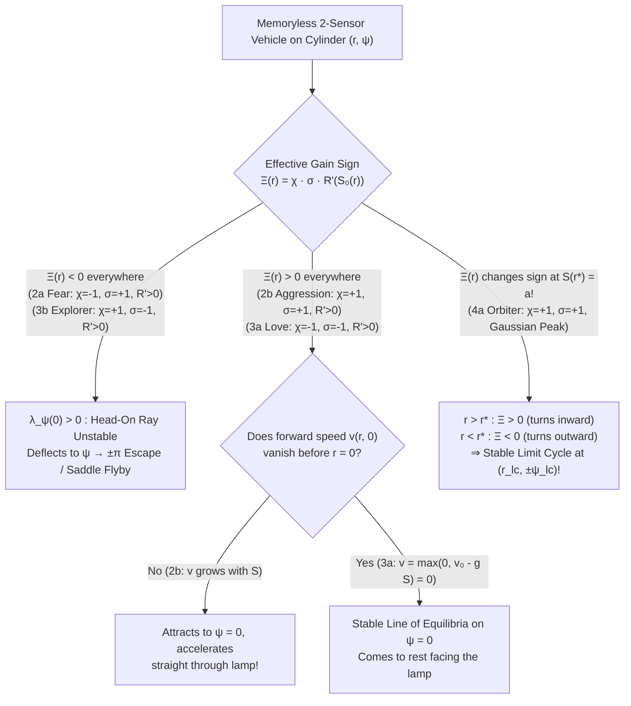
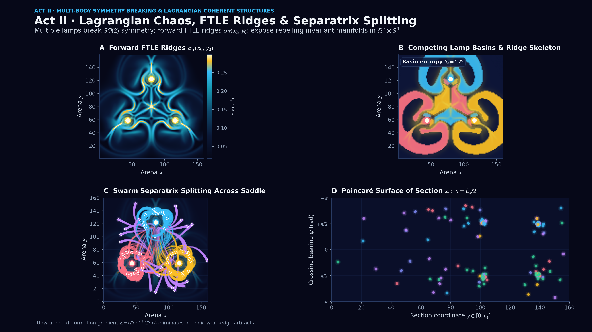
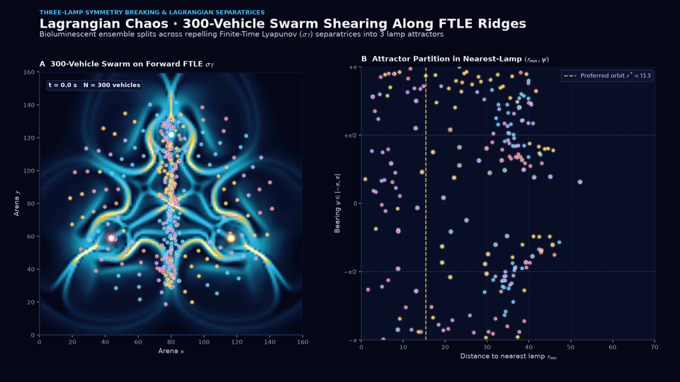
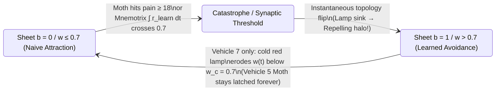
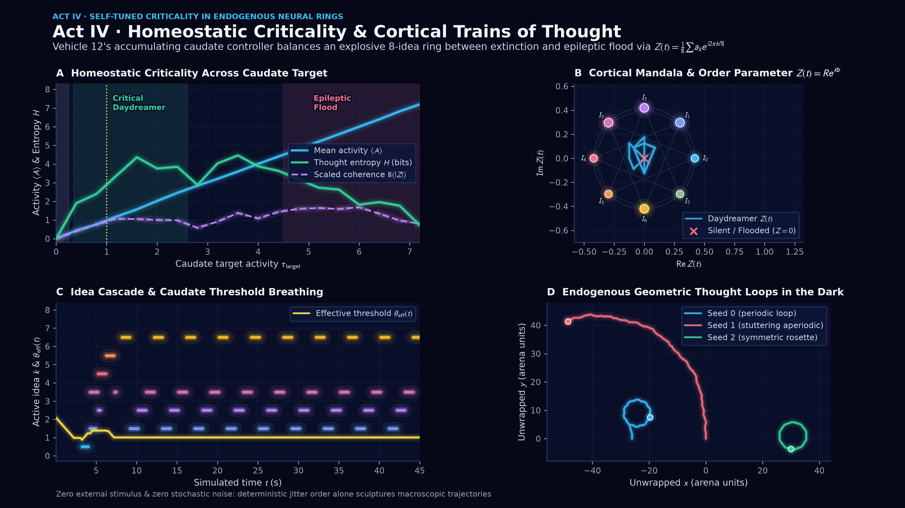
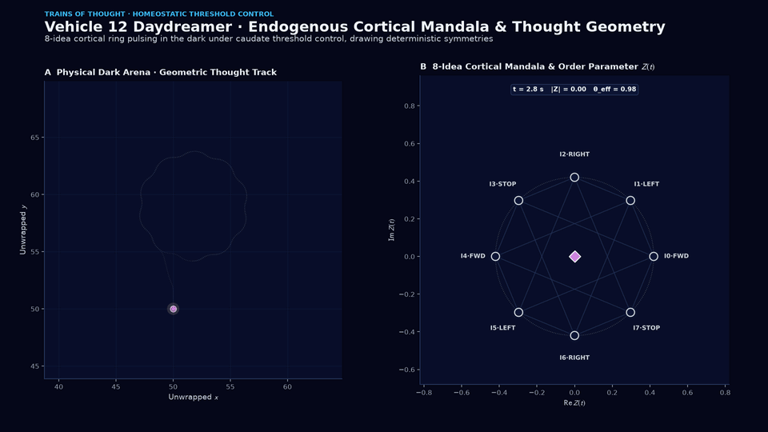
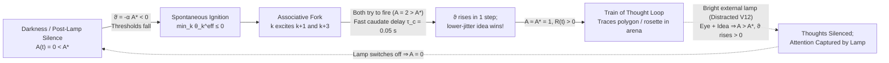

# Synthetic Psychology as Nonlinear Dynamics

*A geometric excursion through Valentino Braitenberg's fourteen Vehicles—after the spirit of Steven Strogatz.*


> *Prefer classic print plates? View the warm-paper Strogatz textbook edition: [`media/strogatz_atlas_textbook.png`](media/strogatz_atlas_textbook.png).*

---

## Prologue: The Law of Uphill Analysis—Seen from Phase Space

In 1984, the neuroanatomist Valentino Braitenberg opened *Vehicles: Experiments in Synthetic Psychology* with a wickedly charming thought experiment. Give a toy cart two light sensors in front and two wheels in back. Wire the left eye to the left wheel and the right eye to the right wheel, and watch what it does near a lamp: it charges furiously when close, swerves away as if startled, and flees into the dark. You can scarcely stop yourself from calling it **Fear** (*Vehicle 2a*). Swap the two wires so they cross—left eye to right wheel, right eye to left wheel—and the same cart pivots toward the bulb and rams it head-on: **Aggression** (*Vehicle 2b*). Flip the sign of the uncrossed wires from excitatory to inhibitory, and the cart turns gently toward the light, decelerates to a hush, and gazes into the lamp forever: **Love** (*Vehicle 3a*).

Braitenberg called this asymmetry the **Law of Uphill Analysis and Downhill Invention**: wiring up a mechanism from scratch is easy, whereas inferring the mechanism from behavior feels hard because we instinctively project intentions, passions, and values onto motion.

To a dynamical systems theorist, something even deeper is going on. **Every psychological word Braitenberg coins is secretly the name of a geometric object in phase space:**

| Psychological Verb | Braitenberg Vehicle | Phase Space $\mathcal{M}$ | Geometric Invariant / Bifurcation |
|---|---|---|---|
| *Rest & Devotion* | **3a Love** | Cylinder $\mathbb{R}_+ \times S^1$ | Stable fixed-point segment on $\psi = 0$ ($v = 0$, $\lambda_\psi < 0$) |
| *Panic & Escape* | **2a Fear** | Cylinder $\mathbb{R}_+ \times S^1$ | Unstable head-on ray $\psi = 0$ ($\lambda_\psi > 0$) feeding $\psi = \pm\pi$ escape |
| *Ambivalence / Instinct* | **4a Orbiter** | Cylinder $\mathbb{R}_+ \times S^1$ | **Isolated stable limit cycle** born from sign reversal of $R'(S)$ |
| *Abrupt Decision* | **4b Decider** | $\mathbb{R}^2 \times S^1$ | **Piecewise-smooth grazing reflection** across step discontinuity $S = a$ |
| *Hesitation & Whim* | **4a / 4b** in 2–3 lamps | $\mathbb{R}^2 \times S^1$ (3D flow) | **Hyperbolic saddle separatrices**, FTLE ridges & chaotic 3-body scattering |
| *Trauma / Remorse* | **5 Moth** | $(\mathbb{R}^2 \times S^1) \times \{0, 1\}$ | **Irreversible fold/latch catastrophe** jumping between two phase sheets |
| *Hunger & Drive* | **5 / 6 Forager** | $(\mathbb{R}^2 \times S^1) \times [0, E_{\max}] \times \{0, 1\}$ | **Slow–fast relaxation oscillation** (van der Pol–style hysteresis loop) |
| *Associative & Causal Learning* | **7 Wary Moth, 11 Driver** | $\mathcal{M}_{\text{body}} \times [0, 1]^M$ | **Filippov synaptic bifurcation** as weight $w(t)$ crosses $w_c = 0.7$ |
| *Trains of Thought* | **12 Daydreamer** | $\mathcal{M}_{\text{body}} \times \{0, 1\}^8 \times \mathbb{R}$ | **Self-organized homeostatic criticality** via integral threshold control |

This monograph—together with its standalone interactive browser laboratory ([`explorer.html`](explorer.html)), real-time Pygame HUD (`D` key), and publication studio (`python -m braitenberg.dynamics`)—charts the complete mathematical arc from two-wire taxis to cortical criticality.

---

## Quick Start: Three Ways to Explore

### 1. Standalone Interactive HTML5 Canvas Lab (Zero Dependencies, Offline-Ready)

Open [`explorer.html`](explorer.html) directly in any browser:

```bash
open experiments/strogatz-dynamics/explorer.html   # macOS (or double-click in any OS)
```

- **Left Canvas (Physical Arena):** Drag lamps live to warp nullclines and FTLE ridges, `Shift + Click` to add or remove lamps, click/drag anywhere to launch vehicles, or click **Release 800-Particle Swarm** to watch 800 glowing comet trajectories shear along invariant manifolds at 60 FPS.
- **Right Canvas (Synchronized Phase Space):** Live $(r, \psi)$ cylindrical phase plane with $\dot{r} = 0$ and $\dot{\psi} = 0$ nullclines (Acts I–II), Moth fold-catastrophe diagram & 9-unit circuit (Act III), or Daydreamer 8-idea cortical ring + Kuramoto order parameter $Z(t)$ + caudate trace (Act IV).
- **Themes & Export:** Toggle **Cosmic Dark** $\leftrightarrow$ **Strogatz Textbook** and export **4K (`3840 × 2160`) PNG** plates in one click.

### 2. Live Pygame Complex-Dynamics HUD (`D` Key)

Run any scenario (including the two new multi-lamp dynamical scenarios) and press **`D`** to cycle through four live Strogatz overlays (`Off` $\to$ `Flow Field & Rings` $\to$ `Phase-Space Inset HUD` $\to$ `Full Dynamics View`), and **drag light sources with the mouse** to watch invariant circles and streamlines deform in real time:

```bash
python -m braitenberg scenarios/dynamics-three-body-orbiter.yaml
python -m braitenberg scenarios/dynamics-twin-lamp-separatrix.yaml
python -m braitenberg scenarios/vehicle4-orbiter-and-decider.yaml
python -m braitenberg scenarios/vehicle12-daydreamer.yaml
```

### 3. Publication Poster & 60 FPS Animation Studio (`python -m braitenberg.dynamics`)

```bash
# Generate the full curated gallery (4K Cosmic & Textbook PNGs, README GIFs, and 16:9 / 1:1 / 9:16 MP4s)
python -m braitenberg.dynamics showcase --out-dir experiments/strogatz-dynamics/media

# Render individual 4K posters in Cosmic Dark or Strogatz Textbook print style
python -m braitenberg.dynamics poster --act all --theme cosmic --aspect 16:9 --out-dir experiments/strogatz-dynamics/media
python -m braitenberg.dynamics poster --act atlas --theme textbook --aspect 16:9 --out-dir experiments/strogatz-dynamics/media

# Render 60 FPS synchronized arena + phase-space animations (16:9, 1:1, or vertical 9:16)
python -m braitenberg.dynamics animate --scene all --theme cosmic --aspect 16:9 --fps 60 --seconds 8 --out-dir experiments/strogatz-dynamics/media
```

---

## Act I — Symmetry Reduction on the Cylinder: Fear, Love, and the Birth of an Orbit


> *Print plate: [`media/act1_polar_phase_portraits_textbook.png`](media/act1_polar_phase_portraits_textbook.png)*

### 1.1 Exact Kinematics on $SE(2)$

Consider a memoryless differential-drive vehicle of half-width $W_h$ and half-length $L_h$ (`size = 4` $\implies W_h = L_h = 2$ in [`vehicles/`](../../vehicles/)) moving in a planar arena with pose $(x, y, \theta) \in \mathbb{R}^2 \times S^1$. In body coordinates where $+y$ points forward and $+x$ points to the right ([`braitenberg/vehicle.py`](../../braitenberg/vehicle.py)):

- Two front sensors sit at $(\mp b_s, +f_s) = (\mp 0.9 W_h, +0.9 L_h) = (\mp 1.8, +1.8)$, i.e., world positions
  $$\mathbf{x}_L = \begin{pmatrix} x + f_s\cos\theta - b_s\sin\theta \\ y + f_s\sin\theta + b_s\cos\theta \end{pmatrix}, \qquad \mathbf{x}_R = \begin{pmatrix} x + f_s\cos\theta + b_s\sin\theta \\ y + f_s\sin\theta - b_s\cos\theta \end{pmatrix}.$$
- Two rear motors at $(\mp b_m, -0.6 L_h)$ ($b_m = 0.5 W_h = 1.0$) run at clamped speeds
  $$v_L = \operatorname{clip}\!\big(v_0 + g\,\sigma\,R(S_{\text{in}, L}),\, 0,\, v_{\max}\big), \qquad v_R = \operatorname{clip}\!\big(v_0 + g\,\sigma\,R(S_{\text{in}, R}),\, 0,\, v_{\max}\big),$$
  driving the deterministic noiseless kinematics
  $$\dot{x} = v\cos\theta, \qquad \dot{y} = v\sin\theta, \qquad \dot{\theta} = \omega, \qquad \text{with}\quad v = \frac{v_L + v_R}{2}, \quad \omega = \frac{v_R - v_L}{2 b_m}.$$

At first glance, $(x, y, \theta)$ is a **three-dimensional** dynamical system—already spacious enough to hide chaos! Yet around a **single isotropic lamp** at $\mathbf{s} = (s_x, s_y)$ with Lorentzian falloff ([`braitenberg/world.py`](../../braitenberg/world.py)),
$$S(\mathbf{x}) = \frac{I_0}{1 + \|\mathbf{x} - \mathbf{s}\|^2 / \ell^2},$$
nothing in the physics cares where the lamp sits in the plane or how the compass is oriented. The Euclidean symmetry group $SO(2) \ltimes \mathbb{R}^2$ acts freely away from the lamp, collapsing the 3D arena flow onto a **two-dimensional autonomous phase cylinder**!

### 1.2 Deriving the Cylindrical $(r, \psi)$ Equations

Let $r = \|\mathbf{x} - \mathbf{s}\| > 0$ be the distance from the vehicle's center to the lamp, and let
$$\phi = \operatorname{atan2}(s_y - y,\, s_x - x), \qquad \psi = \operatorname{wrap}_\pi(\phi - \theta) \in [-\pi, \pi]$$
be the **bearing of the lamp in the vehicle's body frame**:
- $\psi = 0$: the lamp lies dead ahead;
- $\psi > 0$: the lamp lies to the **left** ($\psi = +\pi/2$ directly abeam on the port side);
- $\psi < 0$: the lamp lies to the **right**;
- $\psi = \pm\pi$: the lamp lies dead astern.

Since $\mathbf{s} - \mathbf{x} = r(\cos\phi, \sin\phi)^\top$, differentiating $r^2 = (s_x - x)^2 + (s_y - y)^2$ with $(\dot{s}_x - \dot{x}, \dot{s}_y - \dot{y}) = -v(\cos\theta, \sin\theta)$ immediately gives $r\dot{r} = -r v\cos(\phi - \theta) = -r v\cos\psi$. Differentiating $\phi$ yields $\dot{\phi} = \frac{v}{r}\sin(\phi - \theta) = \frac{v}{r}\sin\psi$. Subtracting $\dot{\theta} = \omega$ produces the **exact $SO(2)$-reduced cylindrical equations**:

$$\dot{r} = -v(r, \psi)\cos\psi, \qquad \dot{\psi} = \frac{v(r, \psi)}{r}\sin\psi - \omega(r, \psi).$$

Look at the sheer physical transparency of those two terms in $\dot{\psi}$:
1. **Kinematic parallax** $+\frac{v}{r}\sin\psi$: even if the wheels are locked straight ($\omega = 0$), driving forward past a lamp on your left ($\psi > 0$) makes the lamp sweep further aft toward $+\pi$.
2. **Differential-drive steering** $-\omega(r, \psi)$: turning left ($\omega > 0$, right wheel faster than left) rotates the nose *toward* a lamp on your left, pulling $\psi$ back toward $0$.

Every orbit, rest point, and escape trajectory of Vehicles 1 through 4 lives in the tug-of-war between those two terms!

### 1.3 Eigenvalue Flip Along $\psi = 0$ and $\psi = \pi$: Why Wiring + Sign = Destiny

By bilateral symmetry of the eyes, at $\psi = 0$ and $\psi = \pi$ both sensors sit equidistant from the lamp ($d_L = d_R$), so $S_L = S_R \equiv S_0(r)$ and $\omega(r, 0) = \omega(r, \pi) = 0$. Thus **$\psi = 0$ (head-on approach) and $\psi = \pi$ (head-on retreat) are always invariant manifolds**.

Are they stable or unstable? Let us compute the exact eye distances using the law of cosines in the body frame:
$$d_{L,R}^2(r, \psi) = r^2 + b_s^2 + f_s^2 - 2 r f_s\cos\psi \mp 2 r b_s\sin\psi.$$
Near $\psi = 0$, a tiny leftward bearing $\psi > 0$ brings the left eye closer by $\Delta(d^2) \approx -2 r b_s \psi$ and pushes the right eye farther by $+2 r b_s \psi$. Since $S(d)$ decreases monotonically with distance ($S'(d) < 0$), the left eye sees *more* light than the right eye:
$$S_L(r, \psi) - S_R(r, \psi) \approx 2 r b_s \,\frac{|S'(d_0)|}{d_0} \cdot d_0\,\psi = \frac{4 I_0 b_s r (r - f_s)}{\ell^2 \big(1 + d_0^2/\ell^2\big)^2}\,\psi + \mathcal{O}(\psi^3) \equiv \Gamma(r)\,\psi, \qquad \Gamma(r) > 0 \;\; (r > f_s).$$

Now let $\chi \in \{+1 \text{ (crossed)}, -1 \text{ (uncrossed)}\}$ denote the wiring topology and $\sigma \in \{+1 \text{ (excitatory)}, -1 \text{ (inhibitory)}\}$ denote the synapse sign. Unsaturated motor speeds satisfy $v_R - v_L = \chi\,\sigma\,g\,\big(R(S_L) - R(S_R)\big) \approx \chi\,\sigma\,g\,R'(S_0(r))\,\Gamma(r)\,\psi$. Linearizing $\dot{\psi}$ around $\psi = 0$ yields the **transverse steering eigenvalue**:

$$\lambda_\psi(r; 0) = \left.\frac{\partial \dot{\psi}}{\partial \psi}\right|_{\psi = 0} = \frac{v(r, 0)}{r} - \underbrace{\frac{\chi\,\sigma\,g}{2 b_m}\,R'\!\big(S_0(r)\big)\,\Gamma(r)}_{\text{neural steering gain } \kappa(r)}.$$

Read the product $\chi \cdot \sigma \cdot R'(S_0(r))$—three signs multiplied together—and watch all six classical Braitenberg vehicles fall out like dominoes:




Look especially at **Vehicle 4a (*Orbiter*)** ([`vehicles/vehicle4a-orbiter.yaml`](../../vehicles/vehicle4a-orbiter.yaml)):
- Its sensors have a **Gaussian peaked response** $R(S) = \exp\!\big(-\frac{(S - a)^2}{2 w^2}\big)$ (`at = 4`, `width = 1.5`), wired **contralaterally** ($\chi = +1, \sigma = +1$).
- Its derivative $R'(S) = -\frac{S - a}{w^2} R(S)$ vanishes and **reverses sign** on the critical circle
  $$S(r^*) = a \quad \Longleftrightarrow \quad r^* = \ell\sqrt{\frac{I_0}{a} - 1} = 15\sqrt{\frac{10}{4} - 1} \approx 18.37.$$
- For $r > r^*$ ($S < a$), $R'(S) > 0$: the vehicle behaves like *Aggression* (2b) and curves *toward* the lamp.
- For $r < r^*$ ($S > a$), $R'(S) < 0$: the vehicle behaves like *Fear* (2a) and curves *away* from the lamp!
- Where can it settle? On the $\dot{r} = 0$ nullclines $\psi = \pm\pi/2$ (flying tangentially around the lamp, neither approaching nor receding!), the lamp sits closer to the inner eye than the outer eye by roughly $2 b_s$. Just slightly outside $r^*$ (at $r_{\text{lc}} \approx 19.9$ in `one-light.yaml`), the inner eye sits near the crest $S \approx a$ while the outer eye sits down the outer flank $S < a$, producing an inward contralateral torque $\omega > 0$ (for $\psi \approx +\pi/2$) that **exactly balances centrifugal parallax** $\frac{v}{r_{\text{lc}}}\sin\psi_{\text{lc}} = \omega(r_{\text{lc}}, \psi_{\text{lc}})$!
- By the **Poincaré–Bendixson theorem** on the cylinder—bounded outside by inward phototaxis and bounded inside by outward repulsion—trajectories collapse onto a pair of **chirally symmetric, asymptotically stable limit cycles** (clockwise at $\psi \approx -\pi/2$, counterclockwise at $\psi \approx +\pi/2$). No clock, no oscillator neuron, no memory: the closed orbit is an emergent collaboration between a bell curve and a lamp!

---

## Act II — Broken Symmetry, Three-Body Scattering & Lagrangian Coherent Structures



> *Print plate: [`media/act2_lagrangian_chaos_ftle_textbook.png`](media/act2_lagrangian_chaos_ftle_textbook.png)*

What happens the moment we light a **second** or **third** lamp?

On the cylinder of Act I, chaos was mathematically impossible: a smooth autonomous flow on a 2D surface cannot cross its own trajectories, so Poincaré–Bendixson limits its long-term repertoire to fixed points, limit cycles, and homoclinic/heteroclinic connections.

A second lamp at $\mathbf{s}_2 \neq \mathbf{s}_1$ **shatters $SO(2)$ rotational symmetry**. Knowing your distance $r_1$ and bearing $\psi_1$ to Lamp 1 no longer tells you where Lamp 2 lies relative to your eyes! The dynamics lifts irreducibly back into the **three-dimensional manifold** $\mathcal{M} = \mathbb{R}^2 \times S^1$ (or the 3-torus $\mathbb{T}^2 \times S^1$ on a wrapping arena). And in three dimensions, invariant manifolds of saddle equilibria and unstable periodic orbits can stretch, fold, and intersect transversely in **homoclinic and heteroclinic tangles**.



### 2.1 Exposing Hidden Separatrices with Unwrapped FTLE Ridges

Suppose we release a dense grid of vehicles at initial positions $\mathbf{x}_0 = (x_0, y_0)$ (oriented, say, toward the lamp centroid) and integrate the noiseless flow forward over horizon $T > 0$ to obtain the spatial projection of the flow map $\Phi_0^T(\mathbf{x}_0) \in \mathbb{R}^2$.

> [!IMPORTANT]
> **Topological Subtlety on Periodic Arenas (`edges: wrap`):** Sensors read wrapped distances on $\mathbb{T}^2$, so the vector field itself is smooth and doubly periodic. However, differentiating the *modulo-wrapped* final coordinates $(x_T \bmod W, y_T \bmod H)$ produces violent fake jump discontinuities wherever trajectories cross $x = 0$ or $y = 0$. Differentiating the **unwrapped lift** $\tilde{\Phi}_0^T(\mathbf{x}_0) = (u_x(T), u_y(T)) \in \mathbb{R}^2$ on the universal cover yields a completely seam-free deformation gradient!

From the $2 \times 2$ spatial Jacobian $D\tilde{\Phi}_0^T(\mathbf{x}_0) = \frac{\partial(u_x(T), u_y(T))}{\partial(x_0, y_0)}$, we form the symmetric positive-definite **right Cauchy–Green strain tensor** and **forward Finite-Time Lyapunov Exponent (FTLE)**:

$$\Delta_T(\mathbf{x}_0) = \big[D\tilde{\Phi}_0^T(\mathbf{x}_0)\big]^\top \big[D\tilde{\Phi}_0^T(\mathbf{x}_0)\big], \qquad \sigma_T(\mathbf{x}_0) = \frac{1}{|T|}\ln\sqrt{\lambda_{\max}\!\big(\Delta_T(\mathbf{x}_0)\big)}.$$

Ridges of $\sigma_T(\mathbf{x}_0)$ are **repelling Lagrangian Coherent Structures (LCS)**—the finite-time skeletons of stable manifolds $W^s(\gamma)$ along which neighboring vehicles shear exponentially apart onto different fates:

- **Twin-Lamp Separatrix Splitting ([`scenarios/dynamics-twin-lamp-separatrix.yaml`](../../scenarios/dynamics-twin-lamp-separatrix.yaml)):** Two lamps at `[30, 50]` and `[70, 50]` create a hyperbolic saddle along the perpendicular bisector $x = 50$. Vehicles initialized just $\Delta x = \pm 0.05$ or $\Delta\theta = \pm 0.1^\circ$ apart across $x = 50$ ride the stable manifold almost to `[50, 50]`, pause in apparent "hesitation," and then peel dramatically apart along the unstable manifold toward opposite lamps!
- **Three-Body Lamp Pinball ([`worlds/three-lights-chaos.yaml`](../../worlds/three-lights-chaos.yaml) & [`scenarios/dynamics-three-body-orbiter.yaml`](../../scenarios/dynamics-three-body-orbiter.yaml)):** Classic nonlinear physics celebrates the **three-disk pinball** (Eckhardt 1987; Gaspard & Rice 1989; Cvitanović *ChaosBook*) as the archetype of open chaotic scattering. Placing three lamps of `intensity: 9`, `falloff: 12.5` at the vertices of an equilateral triangle of circumradius $42$ around `[80, 80]` (`[80, 122]`, `[43.63, 59]`, `[116.37, 59]` in a $160 \times 160$ arena) keeps the saddle-midpoint intensity $S(80, 59) \approx 2.24 < 4.0$, so each lamp possesses its own distinct $S = 4$ ring while adjacent outer orbits graze across three saddle channels. Launching six Vehicle 4a Orbiters from the southern saddle `[80, 59]` at $2^\circ$ increments reveals **interleaved Wada-like capture basins and chaotic tours**:

| Initial Heading $\theta_0$ at `[80, 59]` | Symbolic Lamp Itinerary (Noiseless) | Asymptotic Attractor |
|---|---|---|
| $84^\circ$ ($\Delta\theta = -6^\circ$) | $0$ | Captured onto **North Lamp (0)** limit cycle |
| $86^\circ$ ($\Delta\theta = -4^\circ$) | $0 \to 1 \to 2 \to 0 \to \dots$ | **Multi-lamp chaotic grand tour** |
| $88^\circ$ ($\Delta\theta = -2^\circ$) | $0 \to 2$ | Slingshots off Lamp 0 onto **Southeast Lamp (2)** limit cycle |
| $92^\circ$ ($\Delta\theta = +2^\circ$) | $0 \to 1$ | Mirror slingshot onto **Southwest Lamp (1)** limit cycle |
| $94^\circ$ ($\Delta\theta = +4^\circ$) | $0 \to 2 \to 1 \to 0 \to \dots$ | **Mirror-chirality chaotic grand tour** |
| $96^\circ$ ($\Delta\theta = +6^\circ$) | $0$ | Captured onto **North Lamp (0)** limit cycle |

What looks to an observer like capricious "free will" or whimsical indecision is deterministic sensitivity to initial conditions sculpted by tangled invariant manifolds!

---

## Act III — Memory as Phase-Space Dimensionality Expansion (Vehicles 5–11)


> *Print plate: [`media/act3_hysteresis_and_plasticity_textbook.png`](media/act3_hysteresis_and_plasticity_textbook.png)*

Here is one of the cleanest theorems in all of mathematical biology:

> **The Uniqueness Obstruction to Memoryless History:** In an autonomous dynamical system on $\mathbb{R}^2 \times S^1$, two visits to the exact same physical pose $(x, y, \theta)$ *must* produce the exact same future trajectory. Consequently, **a vehicle can only learn, habituate, get full, or remember a burn by adding new coordinates to its phase space**.

Braitenberg's "nervous system" vehicles (Vehicles 5 through 11) expand phase space through three canonical nonlinear mechanisms:


### 3.1 Discrete Fold/Latch Catastrophe (`Vehicle 5 — Moth`)

In [`vehicles/vehicle5-moth.yaml`](../../vehicles/vehicle5-moth.yaml), a self-exciting threshold unit `burned` ($b \in \{0, 1\}$, delay $\tau = 0.05\text{ s}$) obeys the discrete latch map
$$b(t + \tau) = \Theta\!\big(\text{pain}(t) + b(t) - 1\big), \qquad \text{pain}(t) = \Theta\!\big(S_L(t) + S_R(t) - 18\big).$$
Geometrically, the phase space splits into **two parallel 3D sheets** $(\mathbb{R}^2 \times S^1) \times \{0, 1\}$:
- **Lower Sheet ($b = 0$, Naive Phototaxis):** `seek_left` and `seek_right` are active; every lamp is a funneling sink ($-\dot{r} > 0$). That sheet **terminates at a fold boundary** $S_L + S_R = 18$ ($r_{\text{burn}} \approx 11.2$ in `two-lights.yaml`).
- **Irreversible Catastrophe Jump ($b: 0 \to 1$):** Piercing $r_{\text{burn}}$ fires `pain`, flipping $b \mapsto 1$. Because `burned` excites itself with strength $1 \ge \text{threshold } 1$, **no trajectory can ever return to $b = 0$**.
- **Upper Sheet ($b = 1$, Wary Avoidance):** `seek` units are permanently inhibited; whenever the moth enters the outer `near` halo ($S_L + S_R \ge 10$, $r_{\text{near}} \approx 18.4$), `flee_left`/`flee_right` fire and repel it cleanly away from *every* lamp!

### 3.2 Slow–Fast Relaxation Oscillation (`Vehicle 5 / 6 — Forager`)

Replace the Moth's one-way latch with a reversible **Schmitt-trigger hysteresis loop** driven by a slow metabolic energy variable $E(t) \in [0, 100]$ ([`vehicles/vehicle5-forager.yaml`](../../vehicles/vehicle5-forager.yaml)):
$$\dot{E} = g_{\text{charge}}\,S(\mathbf{x}) - c_{\text{move}}\,|v| - c_{\text{basal}}, \qquad \text{full}(t + \tau) = \Theta\!\big(\Theta(E - 90) + \text{full}(t) - \Theta(30 - E) - 1\big).$$
Because metabolic rates $\dot{E} \sim \mathcal{O}(1\text{ s}^{-1})$ evolve much more slowly than turning maneuvers, $(r(t), E(t), \text{full}(t))$ executes a classic **two-timescale relaxation oscillation**—the biological cousin of the **van der Pol oscillator**:
1. **Hungry Seeking Branch ($\text{full} = 0$, $E: 30 \nearrow 90$):** Within sight of a lamp ($S_L + S_R \ge 3$), `seeking` suppresses the 3-neuron ring oscillator (`osc_a, osc_b, osc_c`), pulling $r \to 0$ so $g_{\text{charge}} S(\mathbf{x})$ rapidly refills $E$ up to the upper fold $E = 90$.
2. **Satiated Dispersal Branch ($\text{full} = 1$, $E: 90 \searrow 30$):** Crossing $E = 90$ latches `full = 1`, silencing `seeking` and unleashing the 3-unit inhibitory ringzig-zag oscillator to carry the vehicle out into the dark while $E$ slowly drains down to the lower fold $E = 30$, completing the closed limit cycle in $(r, E)$ space!

### 3.3 Piecewise-Smooth Synaptic Bifurcation at $w_c = 0.7$ (`Vehicles 7, 10, 11`)

In Vehicles 7 (*Wary Moth*), 10 (*Gatherer*), and 11 (*Cautious Driver*), phase space acquires **continuous slow synaptic coordinates** $w_{ij}(t) \in [0, 1]$ governed by two Braitenberg plasticity rules ([`braitenberg/vehicle.py`](../../braitenberg/vehicle.py), [`braitenberg/definition.py`](../../braitenberg/definition.py)):

- **Mnemotrix (Continuous Coincidence / Pavlovian Association):** While presynaptic unit $i$ fires,
  $$\dot{w}_{ij} = \begin{cases} +r_{\text{learn}}, & \text{if fixed inputs to } j \text{ reach } \theta_j, \\ -r_{\text{forget}}, & \text{otherwise,} \end{cases} \quad \text{clamped to } [0, 1].$$
- **Ergotrix (Causal Sequence Prediction):** When $i$'s fixed-input activation turns *on*, an eligibility window of $\tau_{\text{within}}$ seconds opens; if $j$'s fixed inputs turn $j$ *on* before the timer expires, $w_{ij} \leftarrow \min(1, w_{ij} + r_{\text{learn}})$, else $w_{ij} \leftarrow \max(0, w_{ij} - r_{\text{forget}})$.

Crucially, every connection is gated by a hard maturation threshold (`ACTIVE_STRENGTH` in `definition.py`):

$$I_{ij}(t) = \sigma_{ij}\,y_i(t)\,\mathbf{1}\!\big[w_{ij}(t) > w_c\big], \qquad w_c = 0.7.$$

For $t < t^*$ while $w_{\text{sees\_red}\to\text{danger}}(t) \le 0.7$, the wire is **completely silent**: the Wary Moth dives into the hot red lamp and suffers burns that pump $w(t)$ upward at $+0.5\text{ s}^{-1}$. At the exact instant $t = t^*$ when $w(t)$ pierces the **codimension-1 switching hyperplane $w_c = 0.7$**, the vector field undergoes a **discontinuous Filippov / grazing bifurcation**: `sees_red` now triggers `danger` at $r \approx 26$ units—well outside the burn zone $r \approx 4$! And when the red lamp cools down, unreinforced sightings slowly erode $w(t)$ at $-0.02\text{ s}^{-1}$ back below $w_c = 0.7$, **reversing the bifurcation** and restoring curiosity!



---

## Act IV — Self-Organized Homeostatic Criticality (`Vehicle 12 — Daydreamer`)



> *Print plate: [`media/act4_neural_criticality_textbook.png`](media/act4_neural_criticality_textbook.png)*

By Vehicle 11, associative wires crisscross the brain. In Chapter 12 (*Trains of Thought*), Braitenberg confronts the existential stability crisis of every recurrent excitatory cortex:

- In [`vehicles/vehicle12-daydreamer.yaml`](../../vehicles/vehicle12-daydreamer.yaml), eight cortical "idea" units `idea_0` $\dots$ `idea_7` (each lasting $\tau = 1\text{ s}$ with self-inhibition so a pulse lasts one window) sit on a directed circulant graph where each idea excites **two** successors:
  $$k \longrightarrow (k + 1) \bmod 8 \qquad \text{and} \qquad k \longrightarrow (k + 3) \bmod 8.$$
- Because out-degree $d_{\text{out}} = 2 > 1$, any fixed homogeneous threshold fails catastrophically:
  - **Subcritical Extinction (`Silent`, $\theta_0 = 2$, no control):** A single active idea supplies input $1 < 2$ to its two targets; activity dies to $\mathbf{a}(t) \equiv \mathbf{0}$ and the vehicle sits frozen in the dark.
  - **Supercritical Explosion (`Flooded`, $\theta_0 = 1$, no control):** One pulse ignites two, two ignite four, and within seconds all eight ideas lock on ($\mathbf{a}(t) \equiv \mathbf{1}$). Symmetrically driven (`left_motor = right_motor`), the vehicle charges in a mindless straight line forever.



### 4.1 Caudate Integral Feedback: Hovering at the Edge of Chaos

How does a real brain surf the razor-thin boundary between coma and seizure without fine-tuning parameters to ten decimal places? Braitenberg introduces a global **threshold control** modeled on the **striatum–caudate–thalamus loop**:

$$\dot{\vartheta}(t) = \alpha\left(\sum_{k=0}^{7} a_k(t) - A^*\right), \qquad \theta_k^{\text{eff}}(t) = \theta_0 + \eta_k + \vartheta(t - \tau_c),$$

where $A^* = 1$ is the target cortical budget, $\alpha = 0.5\text{ s}^{-1}$ is the caudate adaptation rate, $\tau_c = 0.05\text{ s} \ll \tau = 1\text{ s}$ is the fast striatal loop delay that catches ignitions *as they start* (reading immediate activations $a_k(t)$ rather than delayed outputs $y_k(t)$!), and $\eta_k \sim \mathcal{U}[-J, +J]$ ($J = 0.3$) is quenched threshold heterogeneity.

Look at why **integral feedback** ($\dot{\vartheta} \propto A - A^*$) rather than proportional inhibition solves the criticality problem automatically:
1. Starting in total darkness ($A = 0 < A^*$), $\vartheta(t)$ ramps steadily negative until $\theta_0 + \min_k \eta_k + \vartheta \le 0$: **the brain wakes up spontaneously in the dark**, firing the lowest-threshold idea!
2. Whenever an idea tries to ignite *both* successors $k+1$ and $k+3$ ($A = 2 > A^*$), $\vartheta(t)$ surges upward within one step $\tau_c = 0.05\text{ s}$, extinguishing whichever successor has the larger quenched jitter $\eta$ and leaving a **single surviving winner**!
3. Thus the network self-organizes to $\langle A(t) \rangle = A^* = 1$—an **effective branching ratio of unity**—without any hand-tuning of $\theta_0$!

### 4.2 The Kuramoto–Strogatz Ring Order Parameter $Z(t)$

To measure cortical organization across the `(rate, target)` parameter plane, project the 8-unit ring onto the complex unit circle just as Kuramoto did for coupled phase oscillators:

$$Z(t) = \frac{1}{8}\sum_{k=0}^{7} y_k(t)\,e^{i 2\pi k / 8} = R(t)\,e^{i\Phi(t)}.$$

Notice the beautiful symmetry diagnostic encoded by $(A(t), R(t))$:
- **Quiescent Coma:** $y_k \equiv 0 \implies A = 0,\; R = 0$.
- **Epileptic Flood:** $y_k \equiv 1 \implies A = 8$, yet $\sum_{k=0}^7 e^{i 2\pi k/8} = 0 \implies \mathbf{R = 0}$! Seizure is maximum energy with *zero* informational Differentiation.
- **Critical Trains of Thought:** Exactly one or two localized ideas fire in sequence ($A \approx 1$), so **$R(t) \in [0.12, 0.24] > 0$** while the phase angle $\Phi(t)$ steps around the cortical circle along $+1$ perimeter steps and $+3$ star chords! Because `idea_0..7` map onto motor gestures (`forward`, `turn left`, `turn right`, `stop`), the vehicle's physical trajectory $(x(t), y(t))$ in the dark arena is literally a **geometric calligraphy of its internal attractor cycle**!



---

## Showcase Media Index

All visual assets below are generated deterministically into `experiments/strogatz-dynamics/media/` via `python -m braitenberg.dynamics showcase --out-dir experiments/strogatz-dynamics/media`:

| Asset | Description | Textbook Print Variant |
|---|---|---|
| [`media/strogatz_atlas.png`](media/strogatz_atlas.png) | 4K 2×2 Master Synthesis Atlas across Acts I–IV | [`media/strogatz_atlas_textbook.png`](media/strogatz_atlas_textbook.png) |
| [`media/act1_polar_phase_portraits.png`](media/act1_polar_phase_portraits.png) | $SO(2)$ cylindrical $(r, \psi)$ portraits, nullclines & limit-cycle bifurcation | [`media/act1_polar_phase_portraits_textbook.png`](media/act1_polar_phase_portraits_textbook.png) |
| [`media/act2_lagrangian_chaos_ftle.png`](media/act2_lagrangian_chaos_ftle.png) | Unwrapped FTLE ridges ($\sigma_T$), fractal capture basins & Poincaré section | [`media/act2_lagrangian_chaos_ftle_textbook.png`](media/act2_lagrangian_chaos_ftle_textbook.png) |
| [`media/act3_hysteresis_and_plasticity.png`](media/act3_hysteresis_and_plasticity.png) | Moth fold/latch loop, Forager $(r, E)$ relaxation cycle & $w_c = 0.7$ bifurcation | [`media/act3_hysteresis_and_plasticity_textbook.png`](media/act3_hysteresis_and_plasticity_textbook.png) |
| [`media/act4_neural_criticality.png`](media/act4_neural_criticality.png) | Daydreamer caudate phase diagram, complex order parameter $Z(t)$ & tracks | [`media/act4_neural_criticality_textbook.png`](media/act4_neural_criticality_textbook.png) |
| [`media/orbiter.gif`](media/orbiter.gif) | 150 comet-tailed Vehicle 4a particles collapsing onto the $(r, \psi)$ limit cycle | `media/mp4/orbiter_{16x9,1x1,9x16}.mp4` |
| [`media/ftle_swarm.gif`](media/ftle_swarm.gif) | 300 bioluminescent vehicles shearing along multi-lamp FTLE separatrices | `media/mp4/ftle_swarm_{16x9,1x1,9x16}.mp4` |
| [`media/plasticity.gif`](media/plasticity.gif) | Synchronized Forager relaxation cycle & Wary Moth $w(t) > 0.7$ bifurcation | `media/mp4/plasticity_{16x9,1x1,9x16}.mp4` |
| [`media/daydreamer.gif`](media/daydreamer.gif) | 8-idea cortical ring traveling waves, $Z(t)$ rosette & dark-arena calligraphy | `media/mp4/daydreamer_{16x9,1x1,9x16}.mp4` |

---

## References & Further Reading

1. **Braitenberg, V.** (1984). *Vehicles: Experiments in Synthetic Psychology*. MIT Press.
2. **Strogatz, S. H.** (2015). *Nonlinear Dynamics and Chaos: With Applications to Physics, Biology, Chemistry, and Engineering* (2nd ed.). Westview Press.
3. **Strogatz, S. H.** (2000). From Kuramoto to Crawford: exploring the onset of synchronization in populations of coupled oscillators. *Physica D*, 143(1–4), 1–20.
4. **Haller, G.** (2015). Lagrangian Coherent Structures. *Annual Review of Fluid Mechanics*, 47, 137–162.
5. **Gaspard, P., & Rice, S. A.** (1989). Scattering from a classically chaotic repellor. *Journal of Chemical Physics*, 90(4), 2225–2241.
6. **di Bernardo, M., Budd, C. J., Champneys, A. R., & Kowalczyk, P.** (2008). *Piecewise-Smooth Dynamical Systems: Theory and Applications*. Springer.
