# Synthetic Psychology Through Phase Space and Information Theory

*A geometric and information-theoretic excursion through Valentino Braitenberg's fourteen Vehicles—after the spirit of Steven Strogatz and Claude Shannon.*

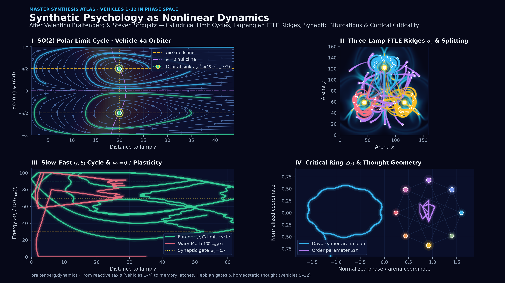

> *Prefer classic warm-paper print plates? Every 4K plate in all three showcase series ships with a companion Strogatz textbook edition—starting with [`media/phase_atlas/strogatz_atlas_textbook.png`](media/phase_atlas/strogatz_atlas_textbook.png) and [`media/v9_shy_tripanel_textbook.png`](media/v9_shy_tripanel_textbook.png).*


---

## Prologue: The Law of Uphill Analysis—Seen Through Three Lenses

In 1984, the neuroanatomist Valentino Braitenberg opened *Vehicles: Experiments in Synthetic Psychology* with a deceptively simple thought experiment. Give a wheeled cart two light sensors in front and two motors in back. Wire the left eye to the left wheel and the right eye to the right wheel, and watch what it does near a lamp: it charges furiously when close, swerves away as if startled, and flees into the dark. Observers can scarcely stop themselves from calling it **Fear** (*Vehicle 2a*). Cross the two wires—left eye to right wheel, right eye to left wheel—and the same cart pivots toward the bulb and rams it head-on: **Aggression** (*Vehicle 2b*). Flip the sign of the uncrossed wires from excitatory to inhibitory, and the cart turns gently toward the light, decelerates to a hush, and gazes into the lamp forever: **Love** (*Vehicle 3a*).

Braitenberg called this asymmetry the **Law of Uphill Analysis and Downhill Invention**: wiring sensors to motors from the inside out is effortless, whereas inferring internal circuitry from external behavior feels formidable because observers project fear, devotion, hesitation, trauma, caution, shyness, and daydreams onto motion.

To understand *how* minimal circuits manufacture rich inner lives—both for a single embodied agent and across an entire interacting population—we bring **three mathematical lenses** into lockstep:

1. **Valentino Braitenberg (Microscopic Circuit Causality — `Hero #0`):** Top-down anatomical schematics tracing which retinal pixels, threshold neurons, recurrent delay latches, and plastic wires fire *right now* inside one distinguished individual (`Hero #0`) to drive its wheels.
2. **Steven Strogatz (Macroscopic Phase-Space Geometry):** Symmetry reduction on cylinders, nullclines, transverse steering eigenvalues, isolated limit cycles, unwrapped Finite-Time Lyapunov Exponent (FTLE) ridges, fold catastrophes, slow–fast van der Pol hysteresis loops, Filippov switching hyperplanes ($w_c = 0.7$), and Kuramoto ring order parameters ($Z(t) = R e^{i\Phi}$) explaining *why* trajectories converge, oscillate, or scatter.
3. **Claude Shannon (Lossless Ensemble Information Flow):** Joint neural codebooks, Watanabe Total Correlation $TC(\mathbf{A})$, empirical density barcodes, time-delayed Schreiber Transfer Entropy $T_{S \to D}$, and sorted $N \times M$ microstate bit-rasters summarizing an entire $N$-vehicle swarm **without collapsing multimodal bifurcations or cross-neuron synergy into misleading sample means**.

| Psychological Phenomenon | Braitenberg Species | State Manifold $\mathcal{M}$ | Strogatz Geometric Invariant / Bifurcation | Dominant Shannon Signature | Showcase Plates |
|---|---|---|---|---|---|
| *Panic & Escape* | **2a: Fear** (`v2a_fear`) | Cylinder $\mathbb{R}_+ \times S^1$ | Unstable head-on ray $\psi = 0$ ($\lambda_\psi > 0$) & Rutherford deflection $b \mapsto \Delta\theta$ | Continuous ipsilateral sensor $\to$ motor gain | [`v2a_fear_phase.png`](media/phase_portraits/v2a_fear_phase.png) |
| *Rest & Devotion* | **3a: Love** (`v3a_love`) | Cylinder $\mathbb{R}_+ \times S^1$ | Stable fixed-point arrest segment on $\psi = 0$ ($v = 0, \lambda_\psi < 0$) & $\pm\pi/2$ saddles | Decelerating approach into zero-velocity sink | [`v3a_love_phase.png`](media/phase_portraits/v3a_love_phase.png) |
| *Ambivalence & Whim* | **4a: Orbiter** (`v4a_orbiter`) | $\mathbb{R}_+ \times S^1$ (1 lamp); $\mathbb{T}^2 \times S^1$ (3 lamps) | Chiral spiral sinks $(r_{\text{lc}}, \pm\pi/2)$ $\equiv$ circular limit cycle; 3-lamp FTLE chaos | Chiral CW/CCW sensorimotor codebook & crossed eye $\to$ motor MI | [`v4a_orbiter_phase.png`](media/phase_portraits/v4a_orbiter_phase.png), [`v4a_orbiter_tripanel.png`](media/v4a_orbiter_tripanel.png) |
| *Social Shyness* | **9: Shy** (`v9_shy`) | Target bearing $(r_{\text{target}}, \psi_{\text{bearing}}) \times \{0, 1\}^{13}$ | Bilateral retinal mirror-symmetry trigger $\psi \approx 0$ & 4-stage delay escape | Disjoint high-$TC$ codewords across watch vs flee cascade | [`v9_shy_tripanel.png`](media/v9_shy_tripanel.png), [`v9_shy.gif`](media/v9_shy.gif) |
| *Trauma / Remorse* | **5: Moth** (`v5_moth`) | $(\mathbb{R}^2 \times S^1) \times \{0, 1\}$ | Irreversible fold/latch catastrophe flipping $\psi = 0$ sink ($b=0$) to repeller ($b=1$) | Bimodal seek/flee codebook split + `pain → burned` Transfer Entropy | [`v5_moth_phase.png`](media/phase_portraits/v5_moth_phase.png), [`v5_moth_tripanel.png`](media/v5_moth_tripanel.png) |
| *Hunger & Drive* | **5: Forager** (`v5_forager`) | $(\mathbb{R}^2 \times S^1) \times [0, 100] \times \{0, 1\}$ | Slow–fast $(r, E)$ van der Pol relaxation limit cycle across $E \in [30, 90]$ | 1-bit hysteresis memory + 3-phase `osc_a,b,c` dispersal synergy | [`v5_forager_phase.png`](media/phase_portraits/v5_forager_phase.png), [`v5_forager_tripanel.png`](media/v5_forager_tripanel.png) |
| *Pavlovian Caution* | **7: Wary Moth** (`v7_wary_moth`) | $\mathcal{M}_{\text{body}} \times [0, 1]^2$ | Reversible Filippov synaptic bifurcation as Mnemotrix $w_{\text{red}}(t)$ crosses $w_c = 0.7$ | Bimodal weight barcode straddling $w_c = 0.7$ where sample mean $\bar{w}$ fails | [`v7_wary_moth_phase.png`](media/phase_portraits/v7_wary_moth_phase.png), [`v7_wary_moth_tripanel.png`](media/v7_wary_moth_tripanel.png) |
| *Causal Foresight* | **11: Cautious Driver** (`v11_cautious_driver`) | $(x, v) \times [0, 1]^6$ | Directed Ergotrix sequence staircase crossing $w_c = 0.7$ for preemptive yellow braking | Asymmetric causal prediction ($G \to Y \to R \to G$ vs $0$ reverse wires) | [`v11_cautious_driver_phase.png`](media/phase_portraits/v11_cautious_driver_phase.png) |
| *Trains of Thought* | **12: Daydreamer** (`v12_daydreamer`) | $\mathcal{M}_{\text{body}} \times \{0, 1\}^8 \times \mathbb{R}$ | Self-organized homeostatic criticality via caudate integral feedback & $Z(t) = R e^{i\Phi}$ | Zero-bit constant bias (`awake ≡ 1` $\implies 0.00\text{ bits}$) vs critical ring | [`v12_daydreamer_phase.png`](media/phase_portraits/v12_daydreamer_phase.png), [`v12_daydreamer_tripanel.png`](media/v12_daydreamer_tripanel.png) |

---

## Part I — Epistemological Foundations: Experimental Purity & Lossless Ensemble Coding

### 1.1 Axiom 1 (Single-Experiment Isolation) and the Three-Series Showcase Architecture

A strict epistemological boundary organizes every figure, animation, live Pygame overlay, and browser preset in this laboratory:

> [!IMPORTANT]
> **Axiom 1 (Strict Single-Experiment Isolation):** Every single-experiment visualization—all 8 **Deep Phase Portraits** (`media/phase_portraits/*_phase.png`), all 6 **Shannon × Strogatz Connectome Tri-Panels** (`media/*_tripanel.png` and `media/*.gif`), every live Pygame HUD view, and every [`explorer.html`](explorer.html) preset—characterizes **strictly one** scenario and **strictly one** homogeneous focal vehicle population sharing an identical connectome $\mathcal{G} = (\mathcal{V}, \mathcal{E})$. Pooling heterogeneous species into one ensemble state matrix or mixing two experiments without explicit comparative separation raises `AxiomViolationError` via `validate_single_experiment_axiom`.

Why is Axiom 1 mathematically indispensable—and how do our **three showcase galleries** complement one another?

1. **Well-Defined Pushforward Measure $\mu_t = (\Phi_0^t)_* \mu_0$ on One State Manifold $\mathcal{M}$:** An ensemble phase portrait represents a probability density evolving under a *single* dynamical flow $\Phi_0^t : \mathcal{M} \to \mathcal{M}$. Only when all $N$ focal vehicles obey the exact same differential-difference equations do empirical clouds trace genuine limit cycles, nullclines, and saddle separatrices.
2. **Isomorphic Connectome Coordinates for Information Theory:** Joint entropy $H(\mathbf{W})$ and Watanabe Total Correlation $TC(\mathbf{A})$ require random variables $(A_1, \dots, A_M)$ with identical anatomical meaning across every realization $n \in \{1, \dots, N\}$.
3. **Strict Separation of Focal Organisms from Moving World Stimuli (`v9_shy`):** In [`scenarios/dynamics-shy-swarm.yaml`](../../scenarios/dynamics-shy-swarm.yaml), roving white-fronted `Chaser` and `Walker` boxes move through the room as **time-dependent boundary conditions of the optical environment**. `select_focal_vehicles` isolates the homogeneous `Vehicle 9: Shy` swarm (`Shy #0` $\dots$ `Shy #15`) so environmental targets never contaminate Shy's phase coordinates or neural codebook.
4. **Three Complementary Visual Series (`media/`):**
   - **Series I — Pure Axiom-1 Deep Phase Portraits (`media/phase_portraits/`):** 8 four-panel Strogatz analytical plates (`v2a_fear`, `v3a_love`, `v4a_orbiter`, `v5_moth`, `v5_forager`, `v7_wary_moth`, `v11_cautious_driver`, `v12_daydreamer`), each dissecting one isolated vehicle's vector fields, nullclines, bifurcation sweeps, and trajectories in 4K detail.
   - **Series II — Pure Axiom-1 Shannon × Strogatz Ensemble Connectome Tri-Panels (`media/`):** 6 synchronized Arena + Phase Space + Lossless Nervous System plates and 60 FPS animations (`v9_shy`, `v5_moth`, `v5_forager`, `v7_wary_moth`, `v12_daydreamer`, `v4a_orbiter`), linking `Hero #0` causality to $N$-vehicle ensemble information flow.
   - **Series III — Comparative Synthesis Phase-Space Atlas (`media/phase_atlas/`):** Explicitly tagged comparative overview plates (`series="phase_atlas"`, `comparative_synthesis=True`: `strogatz_atlas.png`, `act1..act4.png`, and classic animations `orbiter.gif`, `ftle_swarm.gif`, `plasticity.gif`, `daydreamer.gif`) contrasting dynamical regimes side-by-side across Braitenberg's four-act progression.

---

### 1.2 Why Sample Means Destroy Nonlinear Ensemble Information (After Claude Shannon)

Suppose $N$ identical Braitenberg vehicles with $M$ binary threshold units navigate an arena at time $t$, generating the ensemble activation matrix $\mathbf{B}(t) \in \{0, 1\}^{N \times M}$ alongside continuous sensor, motor, metabolic, and synaptic state variables.

The most tempting summary of an $N$-vehicle nervous system is the **sample mean** $\bar{a}_k = \frac{1}{N}\sum_{n=1}^{N} B_{n,k}$ painted onto each unit of a single diagram. **Claude Shannon's 1948 mathematical theory of communication proves why naive averaging is catastrophic for nonlinear brains**—committing three distinct distortions simultaneously:

#### 1. Marginal Collapse of Bimodal Bifurcations ($p(x) \mapsto \mathbb{E}[X]$)
Near any separatrix, hysteresis band, or synaptic gate, an ensemble splits **bimodally** into distinct behavioral phases:
- **Discrete Threshold Units:** If half of a Moth swarm is actively seeking light ($A_k = 1$) while the burned half is silent ($A_k = 0$), the unit carries **maximum binary uncertainty**
  $$H(A_k) = -p_k \log_2 p_k - (1 - p_k)\log_2(1 - p_k) = 1.00\text{ bit} \qquad (p_k = 0.5),$$
  yet $\mathbb{E}[A_k] = 0.50$ paints the neuron half-dim—indistinguishable from a lukewarm analog sensor where no individual has decided!
- **Piecewise-Smooth Synaptic Gates ($w_c = 0.7$):** In `Vehicle 7` (*Wary Moth*), a Mnemotrix synapse conducts **if and only if** $w(t) > w_c = 0.7$. Suppose $45\%$ of the swarm is still naive at $w = 0.20$ while $55\%$ has already learned avoidance at $w = 0.95$. More than half the population has crossed the Filippov bifurcation, yet the ensemble average is
  $$\bar{w} = 0.45(0.20) + 0.55(0.95) = 0.6125 \le 0.70,$$
  **falsely reporting a silent, unlearned wire for the entire species!**

#### 2. Erasure of Higher-Order Synergy & Mutual Exclusivity ($TC(\mathbf{A})$)
Marginal firing rates $(p_1, \dots, p_M)$ discard **100% of cross-neuron coordination**. Compare two steering units $(A_1, A_2) = (\text{look\_left}, \text{look\_right})$ across three $N$-vehicle ensembles:

| Ensemble Regime | Joint Distribution $P(A_1, A_2)$ | Sample Means $(\bar{a}_1, \bar{a}_2)$ | Marginal Sum $H(A_1)+H(A_2)$ | Joint Entropy $H(\mathbf{W})$ | Watanabe Synergy $TC(\mathbf{A})$ |
|---|---|---|---|---|---|
| **Mutually Exclusive Steering** | $\frac{1}{2}(1,0) + \frac{1}{2}(0,1)$ | **$(0.50,\; 0.50)$** | $2.00\text{ bits}$ | **$1.00\text{ bit}$** | **$1.00\text{ bit}$** |
| **Locked Co-Activation** | $\frac{1}{2}(0,0) + \frac{1}{2}(1,1)$ | **$(0.50,\; 0.50)$** | $2.00\text{ bits}$ | **$1.00\text{ bit}$** | **$1.00\text{ bit}$** |
| **Uncorrelated Noise** | $\frac{1}{4}$ on all $4$ states in $\{0,1\}^2$ | **$(0.50,\; 0.50)$** | $2.00\text{ bits}$ | **$2.00\text{ bits}$** | **$0.00\text{ bits}$** |

All three regimes yield the **exact same sample-mean diagram** $(0.50, 0.50)$, even though the first executes crisp bilateral turns, the second locks both wheels together, and the third is pure coin-flip noise! Grouping rows of $\mathbf{B}(t)$ into exact $M$-bit **joint neural codewords** $\mathbf{w}_c \in \{0, 1\}^M$ with empirical probabilities $p_c = n_c / N$ recovers the exact **Joint Codebook Entropy** and **Watanabe Total Correlation (Multi-Information)**:

$$H(\mathbf{W}) = -\sum_{c=1}^{K} p_c \log_2 p_c, \qquad TC(\mathbf{A}) = \sum_{k=1}^{M} H(A_k) - H(\mathbf{W}) = D_{\mathrm{KL}}\!\left(P(\mathbf{A}) \;\middle\|\; \prod_{k=1}^{M} P(A_k)\right) \ge 0.$$

#### 3. The Zero-Bit Constant-Bias Paradox (`awake = 1`)
In `Vehicle 12` (*Daydreamer*), a tonic latch `awake` switches to $1$ at $t = 1.0\text{ s}$ to silence the initial `wake` starter pulse and remains at $1$ across every vehicle forever. Under mean-value rendering, `awake` blazes at $100\%$ brightness ($\mathbb{E}[A_{\text{awake}}] = 1.0$) while each cortical `idea_k` averages only $\approx 1/8 = 0.125$. Information theory exposes the illusion immediately:

$$P(A_{\text{awake}} = 1) = 1.0 \quad \Longrightarrow \quad H(A_{\text{awake}}) = -1\log_2 1 = \mathbf{0.00\text{ bits}},$$

whereas each cortical idea carries $H(A_{\text{idea}_k}) = h_2(1/8) \approx \mathbf{0.544\text{ bits}}$ and the active 8-idea cortical ring radiates $H(\mathbf{W}) \approx \mathbf{2.8\text{–}3.0\text{ bits}}$! A constant bias carries zero surprise and zero control information.

#### 4. The Four-Layer Lossless Visual Architecture
To preserve **100% of single-vehicle causality AND 100% of swarm information**, the Shannon × Strogatz Tri-Panel nervous system unites four lossless encodings:

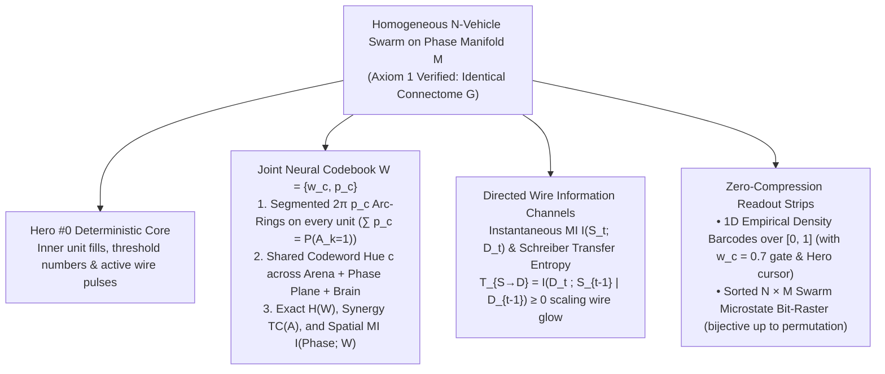

- **Segmented Joint Codebook Arc-Rings ($2\pi p_c$):** Around every unit $k$, each active codeword $c$ with $w_{c,k} = 1$ claims an angular sector $\Delta\theta_c = 2\pi p_c$ in Codeword $c$'s palette hue, satisfying the exact partition identity $\sum_{c \,:\, w_{c,k}=1} p_c = P(A_k = 1)$. **Shared hues reveal synchronous co-activation; disjoint hues prove mutual exclusivity** (`look_left` vs `look_right`, or `seek` vs `flee`)—and every particle in the Arena and Phase Portrait wears that exact same Codeword Hue!
- **Channel Mutual Information & Transfer Entropy Wires:** Bundled connections from $S$ to $D$ scale their glow by instantaneous mutual information $I(S_t; D_t)$ and **Schreiber Transfer Entropy**
  $$T_{S \to D} = I(D_t;\, S_{t-1} \mid D_{t-1}) = H(D_t, D_{t-1}) + H(S_{t-1}, D_{t-1}) - H(D_t, S_{t-1}, D_{t-1}) - H(D_{t-1}) \ge 0,$$
  spotlighting causal state transitions (`pain` flipping `burned`, or `symmetric` igniting `turn_away`) rather than static bias.
- **1D Empirical Density Barcodes & Sorted $N \times M$ Bit-Rasters:** Full empirical histograms over $[0, 1]$ reveal bimodal splits across $w_c = 0.7$ alongside `Hero #0`'s cursor tick, while the `(codeword_id, phase_angle)`-sorted $N \times M$ bit-raster displays every binary neuron of every individual in the swarm without a single bit of lossy compression.

---

## Act I — Symmetry Reduction on the Cylinder: Fear, Love, and the Birth of an Orbit

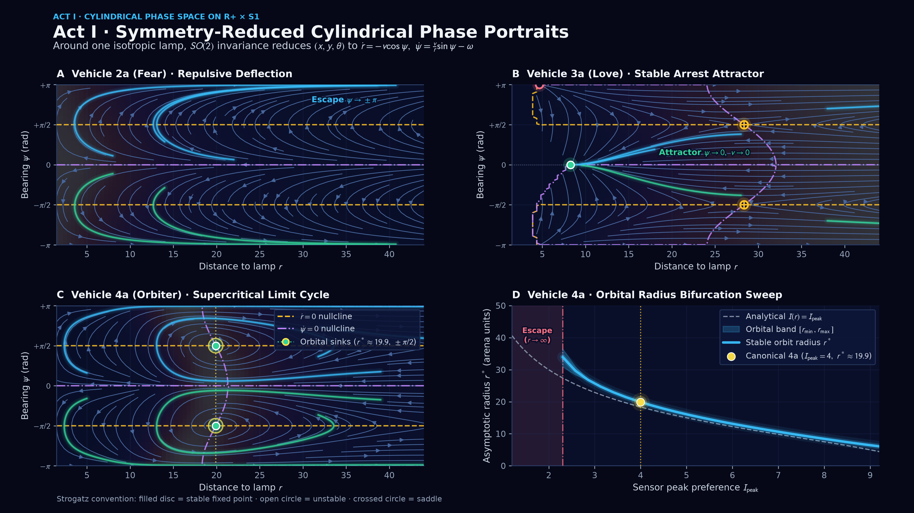

> *Comparative Atlas Print Plate:* [`media/phase_atlas/act1_polar_phase_portraits_textbook.png`](media/phase_atlas/act1_polar_phase_portraits_textbook.png)

### 2.1 Exact Kinematics on $SE(2)$ and $SO(2)$ Cylindrical Reduction

Consider a memoryless differential-drive vehicle of half-width $W_h$ and half-length $L_h$ (`size = 4` $\implies W_h = L_h = 2$ in [`vehicles/`](../../vehicles/)) moving with pose $(x, y, \theta) \in \mathbb{R}^2 \times S^1$. In body coordinates where $+y$ points forward and $+x$ points right ([`braitenberg/vehicle.py`](../../braitenberg/vehicle.py)):
- Two front sensors sit at $(\mp b_s, +f_s) = (\mp 0.9 W_h, +0.9 L_h) = (\mp 1.8, +1.8)$, i.e., world positions
  $$\mathbf{x}_L = \begin{pmatrix} x + f_s\cos\theta - b_s\sin\theta \\ y + f_s\sin\theta + b_s\cos\theta \end{pmatrix}, \qquad \mathbf{x}_R = \begin{pmatrix} x + f_s\cos\theta + b_s\sin\theta \\ y + f_s\sin\theta - b_s\cos\theta \end{pmatrix}.$$
- Two rear motors at $(\mp b_m, -0.6 L_h)$ ($b_m = 0.5 W_h = 1.0$) run at clamped wheel speeds
  $$v_L = \operatorname{clip}\!\big(v_0 + g\,\sigma\,R(S_{\text{in}, L}),\, 0,\, v_{\max}\big), \qquad v_R = \operatorname{clip}\!\big(v_0 + g\,\sigma\,R(S_{\text{in}, R}),\, 0,\, v_{\max}\big),$$
  driving the noiseless kinematics
  $$\dot{x} = v\cos\theta, \qquad \dot{y} = v\sin\theta, \qquad \dot{\theta} = \omega, \qquad \text{with}\quad v = \frac{v_L + v_R}{2}, \quad \omega = \frac{v_R - v_L}{2 b_m}.$$

Although $(x, y, \theta)$ is three-dimensional, around a **single isotropic lamp** at $\mathbf{s} = (s_x, s_y)$ with Lorentzian falloff ([`braitenberg/world.py`](../../braitenberg/world.py)),
$$S(\mathbf{x}) = \frac{I_0}{1 + \|\mathbf{x} - \mathbf{s}\|^2 / \ell^2},$$
the Euclidean group $SO(2) \ltimes \mathbb{R}^2$ acts as an exact symmetry, collapsing the 3D flow onto a **two-dimensional autonomous phase cylinder** $(r, \psi) \in \mathbb{R}_+ \times S^1$! Letting $r = \|\mathbf{x} - \mathbf{s}\| > 0$ and $\psi = \operatorname{wrap}_\pi(\operatorname{atan2}(s_y - y, s_x - x) - \theta) \in [-\pi, \pi]$ be the **bearing of the lamp in the vehicle's body frame** ($\psi = 0$ dead ahead, $\psi > 0$ port/left, $\psi < 0$ starboard/right, $\psi = \pm\pi$ dead astern), differentiating $r^2$ and $\phi - \theta$ yields the **exact $SO(2)$-reduced cylindrical equations**:

$$\dot{r} = -v(r, \psi)\cos\psi, \qquad \dot{\psi} = \frac{v(r, \psi)}{r}\sin\psi - \omega(r, \psi).$$

Every taxis, arrest, scattering flyby, and closed orbit of Vehicles 1–4 emerges from the tug-of-war in $\dot{\psi}$ between **kinematic parallax** $+\frac{v}{r}\sin\psi$ (sweeping a side lamp toward the stern as the cart moves forward) and **differential-drive steering** $-\omega(r, \psi)$.

### 2.2 Transverse Steering Eigenvalue Along $\psi = 0$: Why Wiring $\times$ Sign $\times$ Slope = Destiny

By bilateral eye symmetry, $S_L = S_R \equiv S_0(r)$ on $\psi = 0$ and $\psi = \pm\pi$, making head-on approach and head-on retreat **exact invariant rays**. Expanding the law-of-cosines eye distances $d_{L,R}^2(r, \psi) = r^2 + b_s^2 + f_s^2 - 2 r f_s\cos\psi \mp 2 r b_s\sin\psi$ near $\psi = 0$ gives
$$S_L(r, \psi) - S_R(r, \psi) = \frac{4 I_0 b_s r (r - f_s)}{\ell^2 \big(1 + d_0^2/\ell^2\big)^2}\,\psi + \mathcal{O}(\psi^3) \equiv \Gamma(r)\,\psi, \qquad \Gamma(r) > 0 \;\; (r > f_s).$$
With wiring chirality $\chi \in \{+1 \text{ (crossed)}, -1 \text{ (uncrossed)}\}$ and synapse sign $\sigma \in \{+1 \text{ (excitatory)}, -1 \text{ (inhibitory)}\}$, linearizing $\dot{\psi}$ at $\psi = 0$ yields the **transverse steering eigenvalue**:

$$\lambda_\psi(r; 0) = \left.\frac{\partial \dot{\psi}}{\partial \psi}\right|_{\psi = 0} = \frac{v(r, 0)}{r} - \underbrace{\frac{\chi\,\sigma\,g}{2 b_m}\,R'\!\big(S_0(r)\big)\,\Gamma(r)}_{\text{neural steering gain } \kappa(r)}.$$

Reading the triple sign product $\Xi(r) = \chi \cdot \sigma \cdot R'(S_0(r))$ classifies all classical two-wire vehicles at a glance:

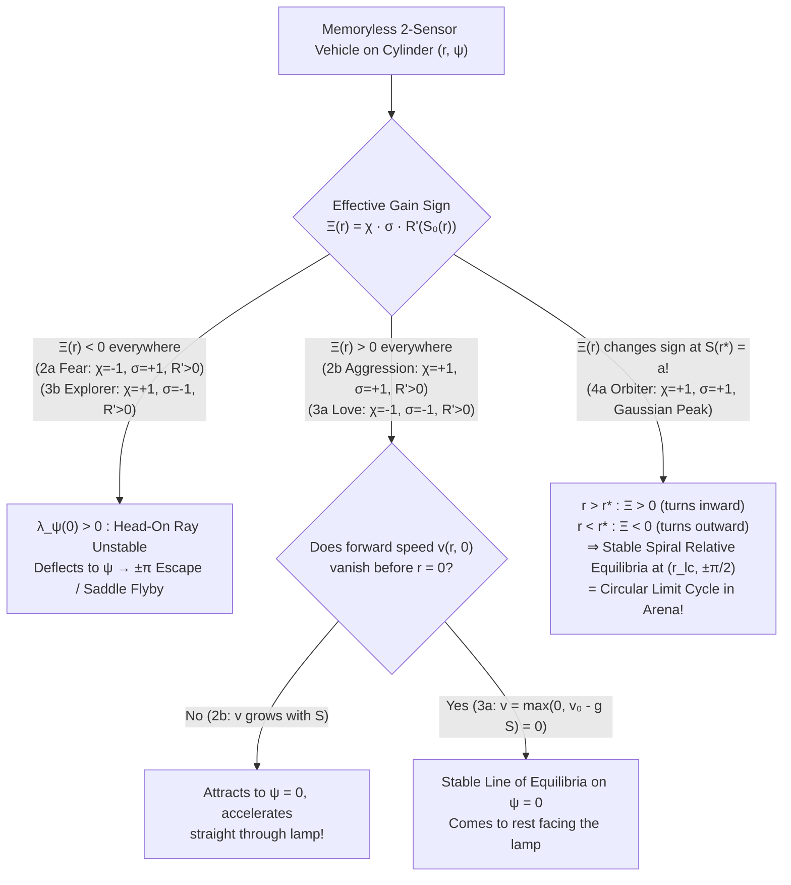

---

### 2.3 Pure Phase Portrait `v2a_fear` — Vehicle 2a: Fear (Repulsive Deflection & Rutherford Scattering)

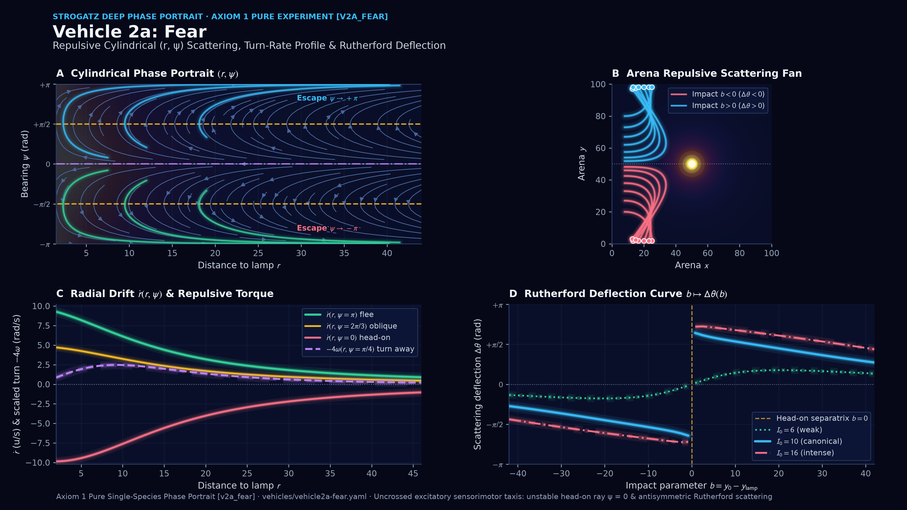

> *Definition:* [`vehicles/vehicle2a-fear.yaml`](../../vehicles/vehicle2a-fear.yaml) · *Scenario:* [`scenarios/vehicle2-fear-and-aggression.yaml`](../../scenarios/vehicle2-fear-and-aggression.yaml) · *Textbook Plate:* [`media/phase_portraits/v2a_fear_phase_textbook.png`](media/phase_portraits/v2a_fear_phase_textbook.png)

With ipsilateral excitatory wiring ($\chi = -1, \sigma = +1, R'(S) = 1 > 0$), $\Xi(r) < 0$ everywhere: both kinematic parallax and differential wheel speed push $\lambda_\psi(r; 0) > 0$. Any slight offset from dead-ahead ($\psi = 0$) drives the nearer wheel faster than the outer wheel, flaring $\psi \to \pm\pi$ in a hyperbolic **Rutherford-style repulsive scattering fan** whose deflection angle $\Delta\theta(b)$ peaks sharply at grazing impact parameters $b$ near the lamp's Lorentzian core.

---

### 2.4 Pure Phase Portrait `v3a_love` — Vehicle 3a: Love (Stable Arrest Segment & Saddle Separatrices)

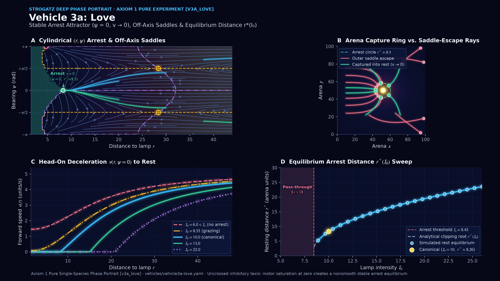

> *Definition:* [`vehicles/vehicle3a-love.yaml`](../../vehicles/vehicle3a-love.yaml) · *Scenario:* [`scenarios/vehicle3-love-and-explorer.yaml`](../../scenarios/vehicle3-love-and-explorer.yaml) · *Textbook Plate:* [`media/phase_portraits/v3a_love_phase_textbook.png`](media/phase_portraits/v3a_love_phase_textbook.png)

Flipping ipsilateral wires to inhibitory ($\chi = -1, \sigma = -1$, `base_speed = 5`, `gain = 0.6`) reverses the sign to $\Xi(r) > 0$: the nearer eye slows its own wheel, steering $\psi \to 0$ ($\lambda_\psi(r; 0) < 0$) while simultaneously braking forward velocity $v(r, 0) = \max\!\big(0,\, v_0 - g S_0(r)\big)$ to **complete rest** inside the critical arrest radius $S_0(r_{\text{rest}}) = v_0 / g = 5 / 0.6 \approx 8.33$! Away from $\psi = 0$, symmetric off-axis saddle separatrices divide trajectories captured into lifelong devotion from distant passersby that cruise past into the dark.

---

### 2.5 Pure Phase Portrait `v4a_orbiter` — Vehicle 4a: Orbiter (Supercritical Limit Cycle & Escape Catastrophe)

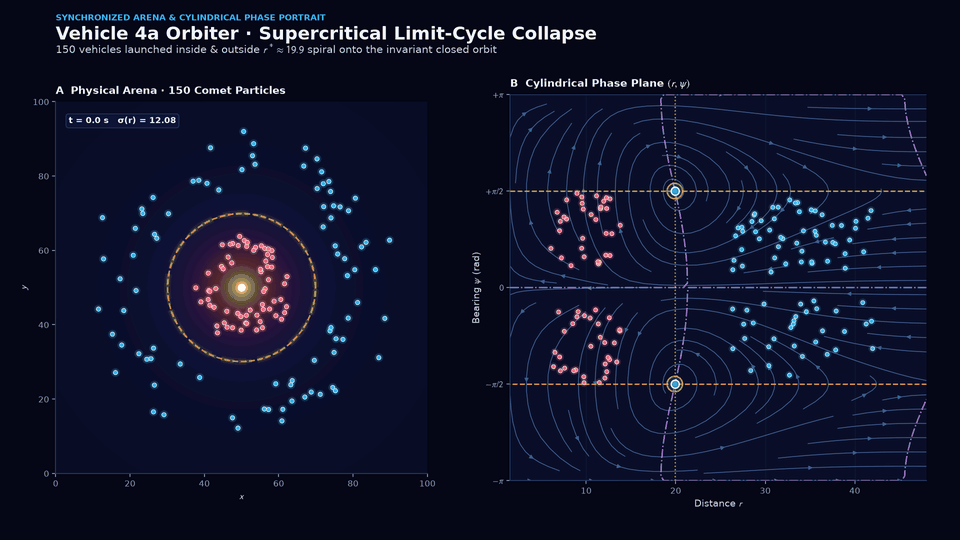

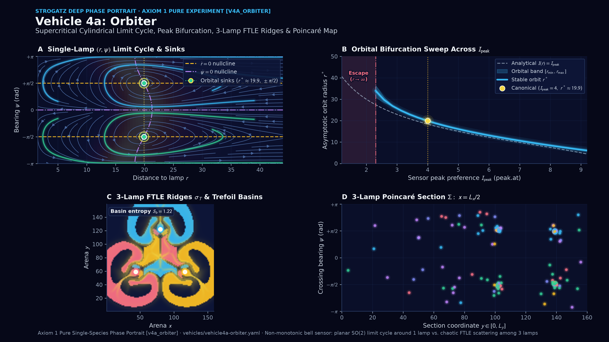

> *Definition:* [`vehicles/vehicle4a-orbiter.yaml`](../../vehicles/vehicle4a-orbiter.yaml) · *Scenario:* [`scenarios/vehicle4-orbiter-and-decider.yaml`](../../scenarios/vehicle4-orbiter-and-decider.yaml) · *Textbook Plate:* [`media/phase_portraits/v4a_orbiter_phase_textbook.png`](media/phase_portraits/v4a_orbiter_phase_textbook.png) · *Atlas Social Cuts:* `media/mp4/phase_atlas/orbiter_{16x9,1x1,9x16}.mp4`

**Vehicle 4a (*Orbiter*)** wires a **Gaussian peaked sensor response** $R(S) = \exp\!\big(-(S - a)^2 / (2 w^2)\big)$ (`at = 4`, `width = 1.5`) contralaterally ($\chi = +1, \sigma = +1$). Because $R'(S) = -\frac{S - a}{w^2} R(S)$ changes sign on the critical circle
$$S(r^*) = a \quad \Longleftrightarrow \quad r^* = \ell\sqrt{\frac{I_0}{a} - 1} = 15\sqrt{\frac{10}{4} - 1} \approx 18.37,$$
the vehicle acts like *Aggression* (turning inward) for $r > r^*$ and like *Fear* (turning outward) for $r < r^*$! On the tangential nullclines $\dot{r} = 0 \iff \psi = \pm\pi/2$, inward contralateral torque balances centrifugal parallax $\frac{v}{r_{\text{lc}}} = |\omega(r_{\text{lc}}, \pm\pi/2)|$ at $r_{\text{lc}} \approx 19.90$ in [`worlds/one-light.yaml`](../../worlds/one-light.yaml). Reconstructing $\dot{\phi} = \pm v / r_{\text{lc}} \neq 0$ lifts these two **chiral spiral relative equilibria** $(r_{\text{lc}}, \pm\pi/2)$ into isolated **counterclockwise and clockwise circular limit cycles** ($T \approx 16.42\text{ s}$) without a single oscillator neuron—until sweeping `peak.at` past the lamp's summit intensity $I_0$ triggers an orbital escape catastrophe.

---

## Act II — Broken Symmetry, Three-Body FTLE Chaos, and Retinal Mirror Symmetry


> *Comparative Atlas Print Plate:* [`media/phase_atlas/act2_lagrangian_chaos_ftle_textbook.png`](media/phase_atlas/act2_lagrangian_chaos_ftle_textbook.png)

On the single-lamp cylinder of Act I, Poincaré–Bendixson forbids chaos. The instant a **second** or **third** lamp turns on—or a roving conspecific enters the room—$SO(2)$ rotational symmetry shatters, lifting the flow irreducibly back into 3D $\mathbb{R}^2 \times S^1$ (or $\mathbb{T}^2 \times S^1$) where invariant manifolds stretch, fold, and intersect transversely.


> *Atlas Social Cuts:* `media/mp4/phase_atlas/ftle_swarm_{16x9,1x1,9x16}.mp4`

### 3.1 Unwrapped FTLE Ridges & Three-Body Lamp Pinball

Suppose we release a dense grid of vehicles at initial positions $\mathbf{x}_0 = (x_0, y_0)$ and integrate the noiseless flow forward over horizon $T > 0$ to obtain the spatial flow map $\Phi_0^T(\mathbf{x}_0)$.

> [!NOTE]
> **Unwrapped Flow Differentiation on Periodic Arenas (`edges: wrap`):** Differentiating modulo-wrapped final positions $(x_T \bmod W, y_T \bmod H)$ creates artificial jump ridges along arena seams. Differentiating the **unwrapped universal-cover lift** $\tilde{\Phi}_0^T(\mathbf{x}_0) = (u_x(T), u_y(T)) \in \mathbb{R}^2$ produces a completely seam-free Cauchy–Green deformation tensor $\Delta_T = [D\tilde{\Phi}_0^T]^\top [D\tilde{\Phi}_0^T]$ and forward **Finite-Time Lyapunov Exponent**:
> $$\sigma_T(\mathbf{x}_0) = \frac{1}{|T|}\ln\sqrt{\lambda_{\max}\!\big(\Delta_T(\mathbf{x}_0)\big)}.$$

Ridges of $\sigma_T(\mathbf{x}_0)$ expose **repelling Lagrangian Coherent Structures (LCS)**—the finite-time stable manifolds along which nearby vehicles shear exponentially apart:
- **Twin-Lamp Separatrix Splitting ([`scenarios/dynamics-twin-lamp-separatrix.yaml`](../../scenarios/dynamics-twin-lamp-separatrix.yaml)):** Vehicles launched $\Delta x = \pm 0.05$ or $\Delta\theta = \pm 0.1^\circ$ apart across the midline $x = 50$ between two lamps ride the stable manifold toward `[50, 50]`, pause in apparent "hesitation," and peel onto opposite lamps.
- **Three-Body Lamp Pinball ([`worlds/three-lights-chaos.yaml`](../../worlds/three-lights-chaos.yaml) & [`scenarios/dynamics-three-body-orbiter.yaml`](../../scenarios/dynamics-three-body-orbiter.yaml)):** Inspired by Gaspard & Rice's three-disk chaotic scatterer, three equilateral lamps (`intensity: 9`, `falloff: 12.5`, circumradius $42$ around `[80, 80]`) keep the saddle midpoint at $S(80, 59) \approx 2.24 < 4.0$ so outer orbits graze across three hyperbolic channels, generating interleaved **Wada-like capture basins** and Poincaré sections ($\Sigma: x = L_x/2$):

| Initial Heading $\theta_0$ at `[80, 59]` | Symbolic Lamp Itinerary (Noiseless) | Asymptotic Regime |
|---|---|---|
| $84^\circ$ ($\Delta\theta = -6^\circ$) | $0$ | Captured onto **North Lamp (0)** limit cycle |
| $86^\circ$ ($\Delta\theta = -4^\circ$) | $0 \to 1 \to 2 \to 0 \to \dots$ | **Multi-lamp chaotic grand tour** |
| $88^\circ$ ($\Delta\theta = -2^\circ$) | $0 \to 2$ | Slingshots off Lamp 0 onto **Southeast Lamp (2)** limit cycle |
| $92^\circ$ ($\Delta\theta = +2^\circ$) | $0 \to 1$ | Mirror slingshot onto **Southwest Lamp (1)** limit cycle |
| $94^\circ$ ($\Delta\theta = +4^\circ$) | $0 \to 2 \to 1 \to 0 \to \dots$ | **Mirror-chirality chaotic grand tour** |
| $96^\circ$ ($\Delta\theta = +6^\circ$) | $0$ | Captured onto **North Lamp (0)** limit cycle |

---

### 3.2 Shannon × Strogatz Ensemble `v4a_orbiter` — Orbiter Swarm in Three-Lamp Chaos

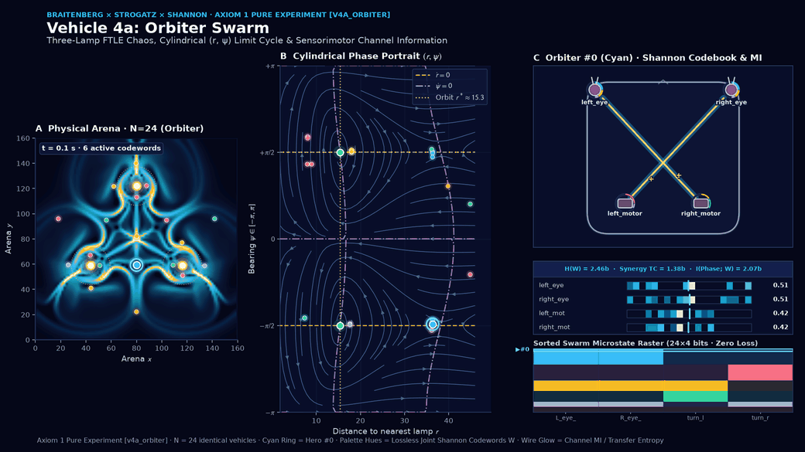

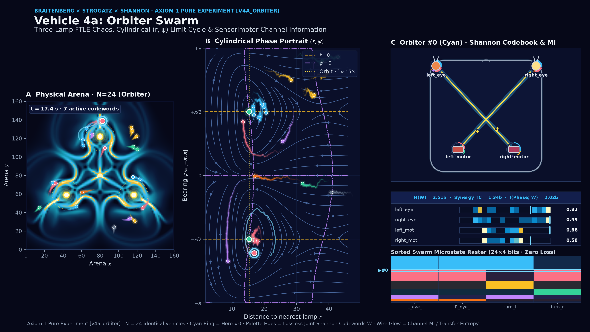

> *Swarm Scenario:* [`scenarios/dynamics-orbiter-swarm.yaml`](../../scenarios/dynamics-orbiter-swarm.yaml) · *Definition:* [`vehicles/vehicle4a-orbiter.yaml`](../../vehicles/vehicle4a-orbiter.yaml) · *Textbook Plate:* [`media/v4a_orbiter_tripanel_textbook.png`](media/v4a_orbiter_tripanel_textbook.png) · *60 FPS Social Cuts:* `media/mp4/v4a_orbiter_{16x9,1x1,9x16}.mp4`

Releasing 24 homogeneous `Vehicle 4a: Orbiter` agents across [`worlds/three-lights-chaos.yaml`](../../worlds/three-lights-chaos.yaml) reveals how even an interneuron-free sensorimotor map (`units: []`) partitions into crisp Shannon codewords `(left_eye_high, right_eye_high, turn_left, turn_right)`: CCW orbiters ($\psi \approx +\pi/2$), CW orbiters ($\psi \approx -\pi/2$), and FTLE-ridge saddle scatterers maintain high contralateral Channel Mutual Information $I(\text{eye}; \text{motor})$ while bimodal eye/motor density barcodes track their split across inner and outer rings.

---

### 3.3 Shannon × Strogatz Ensemble `v9_shy` — Vehicle 9: Shy Swarm (Mirror Symmetry & Reflex Cascade)


> *Swarm Scenario:* [`scenarios/dynamics-shy-swarm.yaml`](../../scenarios/dynamics-shy-swarm.yaml) · *Definition:* [`vehicles/vehicle9-shy.yaml`](../../vehicles/vehicle9-shy.yaml) · *Textbook Plate:* [`media/v9_shy_tripanel_textbook.png`](media/v9_shy_tripanel_textbook.png) · *60 FPS Social Cuts:* `media/mp4/v9_shy_{16x9,1x1,9x16}.mp4`

**Vehicle 9 (*Shy*)** turns spatial symmetry on a 2D camera directly into social perception in relative target coordinates $(r_{\text{target}}, \psi_{\text{bearing}})$:
- **Bilateral Optical Mirror-Symmetry Detector:** Each Shy vehicle carries a $4 \times 24$ forward `retina` ($60^\circ \times 8^\circ$ FOV, range $30$). Roving `Chaser` and `Walker` boxes carry bright white fronts ($10$) and gray sides/backs ($5$). Two $4 \times 4$ comparator arrays test reflection symmetry across the central 8 columns ($j \in \{0, \dots, 3\}$):
  $$\text{odd\_left}[i, j] = \Theta\!\big(\text{retina}[i, 8+j] - \text{retina}[i, 15-j] - 4\big), \qquad \text{odd\_right}[i, j] = \Theta\!\big(\text{retina}[i, 15-j] - \text{retina}[i, 8+j] - 4\big).$$
- **Curious Gaze-Centering vs Head-On Escape Cascade:** Viewed obliquely, a target excites `left_heavier` or `right_heavier`, rotating Shy *toward* it (`look_left`/`look_right`). The instant a Chaser faces Shy **head-on** ($\psi_{\text{bearing}} \approx 0$ with aligned heading), its bright face saturates `retina[1:3, 10:14]` (`front_ahead` $\ge 70$) while mirror mismatches vanish (`odd_left = odd_right = 0`), igniting `symmetric`!
- **Four-Stage Sequential Delay Latch & Shannon Codebook:** `symmetric` latches `turn_away` ($1\text{ s}$), triggering delayed `run` ($\tau = 1\text{ s}$) $\to$ `ran` ($\tau = 0.5\text{ s}$) $\to$ `run_over` $\to$ `turn_back` ($1\text{ s}$ half-turn) $\to$ `watch`, while `fleeing` inhibits gaze-tracking throughout the sprint. Across the 16-vehicle Shy swarm, watching left, watching right, turning away, sprinting, and turning back manifest as **disjoint, mutually exclusive high-$TC$ codewords** with surges of Transfer Entropy along the delay chain.

---

## Act III — Memory as Phase-Space Dimensionality Expansion (Vehicles 5–11)

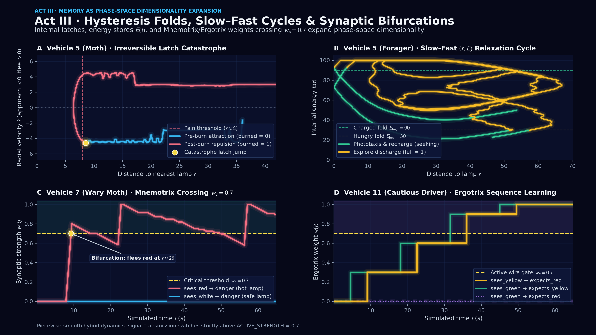

> *Comparative Atlas Print Plate:* [`media/phase_atlas/act3_hysteresis_and_plasticity_textbook.png`](media/phase_atlas/act3_hysteresis_and_plasticity_textbook.png)

Why must every learning or habituating organism possess internal state variables beyond its body pose? Classical ODE theory gives an immediate geometric answer:

> **The Uniqueness Obstruction to Memoryless History:** By Cauchy–Lipschitz uniqueness on $\mathbb{R}^2 \times S^1$, two visits to the exact same physical pose $(x, y, \theta)$ in an autonomous memoryless system *must* generate identical future trajectories. **A vehicle can only remember trauma, cycle between hunger and satiety, associate danger with color, or anticipate a yellow traffic light by adding internal coordinates to its phase space.**

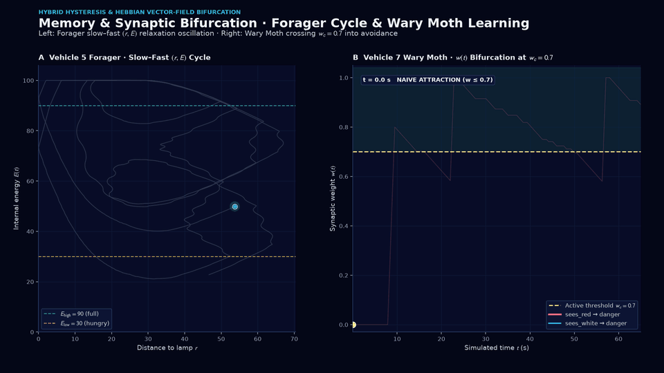

> *Atlas Social Cuts:* `media/mp4/phase_atlas/plasticity_{16x9,1x1,9x16}.mp4`

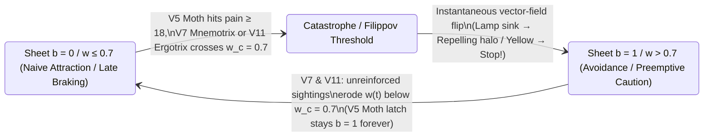

---

### 4.1 Discrete Fold/Latch Catastrophe — `v5_moth` (*Vehicle 5: Moth*)

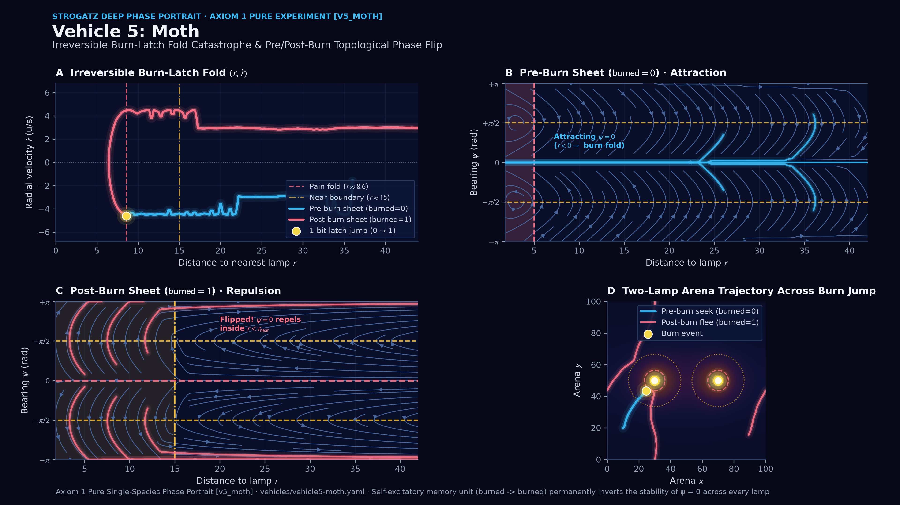


> *Swarm Scenario:* [`scenarios/dynamics-moth-swarm.yaml`](../../scenarios/dynamics-moth-swarm.yaml) · *Definition:* [`vehicles/vehicle5-moth.yaml`](../../vehicles/vehicle5-moth.yaml) · *Textbook Plates:* [`media/phase_portraits/v5_moth_phase_textbook.png`](media/phase_portraits/v5_moth_phase_textbook.png), [`media/v5_moth_tripanel_textbook.png`](media/v5_moth_tripanel_textbook.png) · *60 FPS Social Cuts:* `media/mp4/v5_moth_{16x9,1x1,9x16}.mp4`

**Vehicle 5 (*Moth*)** adjoins a single self-excitatory binary latch `burned` ($b \in \{0, 1\}$, delay $\tau = 0.05\text{ s}$):
$$b(t + \tau) = \Theta\!\big(\text{pain}(t) + b(t) - 1\big), \qquad \text{pain}(t) = \Theta\!\big(S_L(t) + S_R(t) - 18\big).$$
- **Strogatz Two-Sheet Catastrophe:** Phase space splits into $(\mathbb{R}^2 \times S^1) \times \{0, 1\}$. On the naive sheet $b = 0$, $\psi = 0$ is an attractive funnel ($-\dot{r} > 0$) terminating at the fold circle $r_{\text{burn}} \approx 8.6$ ($r_{\text{pain}} \approx 5.0$ around an isolated lamp) in [`worlds/two-lights.yaml`](../../worlds/two-lights.yaml). Crossing $r_{\text{burn}}$ fires `pain` and latches $b : 0 \mapsto 1$ irreversibly, flipping $\psi = 0$ into a repeller on the upper sheet $b = 1$ where entering `near` ($S_L + S_R \ge 10$, $r_{\text{near}} \approx 15.0\text{–}16.5$) drives `flee_left`/`flee_right` away from *both* lamps!
- **Shannon Ensemble Signature:** As staggered waves of moths reach the lamps, the swarm coexists across Naive Seek codewords (`burned=0` + `seek`) and Wary Avoidance codewords (`burned=1` + `near` + `flee`), producing strong spatial mutual information $I(\text{Phase}; \mathbf{W})$ and a `pain → burned` Transfer Entropy spike at the fold jump.

---

### 4.2 Slow–Fast Relaxation Limit Cycle — `v5_forager` (*Vehicle 5: Forager*)

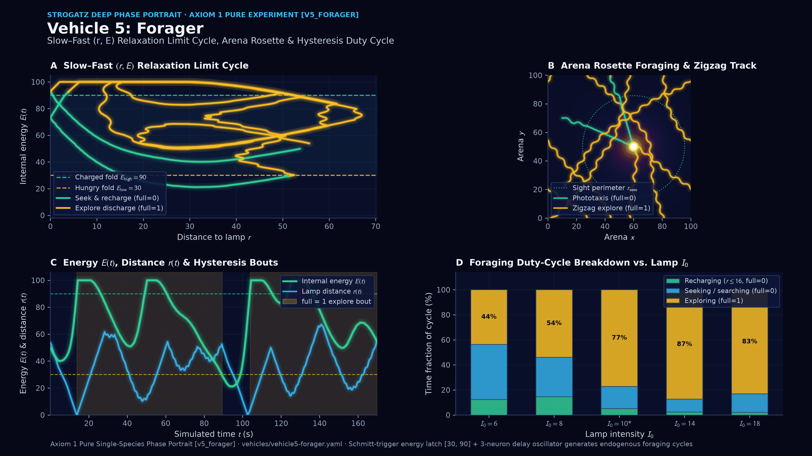

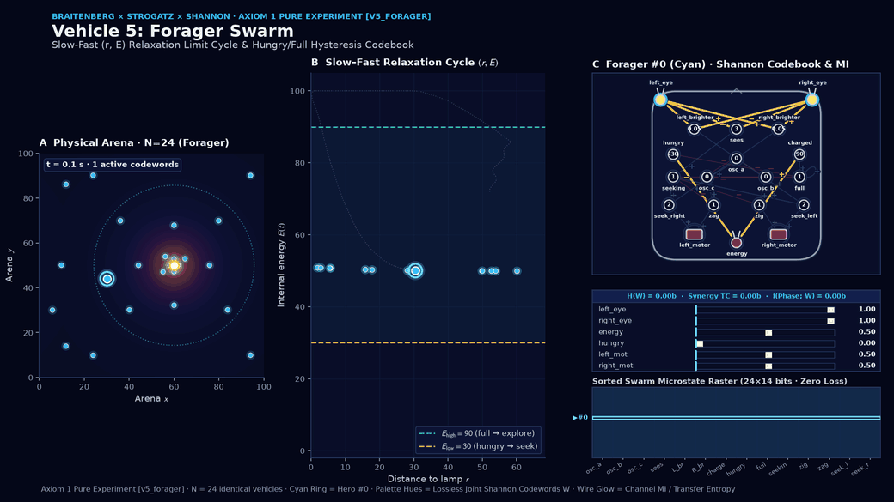


> *Swarm Scenario:* [`scenarios/dynamics-forager-swarm.yaml`](../../scenarios/dynamics-forager-swarm.yaml) · *Definition:* [`vehicles/vehicle5-forager.yaml`](../../vehicles/vehicle5-forager.yaml) · *Textbook Plates:* [`media/phase_portraits/v5_forager_phase_textbook.png`](media/phase_portraits/v5_forager_phase_textbook.png), [`media/v5_forager_tripanel_textbook.png`](media/v5_forager_tripanel_textbook.png) · *60 FPS Social Cuts:* `media/mp4/v5_forager_{16x9,1x1,9x16}.mp4`

Coupling a slow metabolic coordinate $E(t) \in [0, 100]$ to a reversible **Schmitt-trigger latch** (`full`) converts the Moth's one-way jump into a self-sustained **two-timescale relaxation oscillation**—synthetic psychology's van der Pol cycle:
$$\dot{E} = g_{\text{charge}}\,S(\mathbf{x}) - c_{\text{move}}\,|v| - c_{\text{basal}}, \qquad \text{full}(t + \tau) = \Theta\!\big(\Theta(E - 90) + \text{full}(t) - \Theta(30 - E) - 1\big).$$
- **Strogatz Hysteresis Loop on $(r, E)$:** Inside $E \in (30, 90)$, behavior is multivalued over $(r, E)$ and resolved only by the 1-bit latch `full`: hungry seekers (`full = 0`) inhibit the 3-neuron ring oscillator (`osc_a, osc_b, osc_c`, $\tau = 0.3\text{ s}$) to climb the lamp gradient until hitting the upper fold $E = 90$, whereas satiated explorers (`full = 1`) unleash `zig`/`zag` dispersal into the dark until hitting the lower fold $E = 30$.
- **Shannon Ensemble Signature:** The `energy` density barcode spans $[0.30, 0.90]$ while the 14-unit codebook cleanly separates bilateral `seeking` states from the 3-phase `osc_a,b,c` dispersal cycle.

---

### 4.3 Mnemotrix Pavlovian Plasticity & Filippov Gate at $w_c = 0.7$ — `v7_wary_moth` (*Vehicle 7: Wary Moth*)

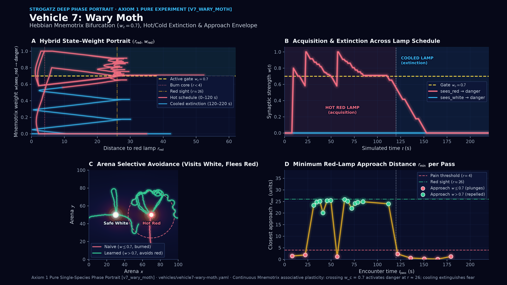


> *Swarm Scenario:* [`scenarios/dynamics-wary-moth-swarm.yaml`](../../scenarios/dynamics-wary-moth-swarm.yaml) · *Definition:* [`vehicles/vehicle7-wary-moth.yaml`](../../vehicles/vehicle7-wary-moth.yaml) · *Textbook Plates:* [`media/phase_portraits/v7_wary_moth_phase_textbook.png`](media/phase_portraits/v7_wary_moth_phase_textbook.png), [`media/v7_wary_moth_tripanel_textbook.png`](media/v7_wary_moth_tripanel_textbook.png) · *60 FPS Social Cuts:* `media/mp4/v7_wary_moth_{16x9,1x1,9x16}.mp4`

In [`worlds/hot-lamp.yaml`](../../worlds/hot-lamp.yaml), a cool White Lamp at `[30, 50]` and a periodically scorching Red Lamp at `[70, 50]` drive continuous **Mnemotrix** coincidence plasticity across `sees_red -> danger` and `sees_white -> danger`, gated by `ACTIVE_STRENGTH` ($w_c = 0.7$ in [`braitenberg/definition.py`](../../braitenberg/definition.py)):
$$\dot{w}_{i \to \text{danger}} = \begin{cases} +0.50\text{ s}^{-1}, & \text{while } y_i = 1 \text{ and } \text{pain} = 1, \\ -0.02\text{ s}^{-1}, & \text{while } y_i = 1 \text{ and } \text{pain} = 0, \end{cases} \qquad I_{i \to \text{danger}}(t) = y_i(t)\,\mathbf{1}\!\big[w_i(t) > w_c\big], \;\; w_c = 0.7.$$
- **Strogatz Codimension-1 Synaptic Bifurcation:** While $w_{\text{red}}(t) \le 0.7$, the wire is silent and moths plunge into the burn core $r_{\text{red}} \le 4$. The instant $w_{\text{red}}(t)$ pierces $w_c = 0.7$, a **Filippov bifurcation** jumps minimum approach distance $r_{\min}$ out to the red-sight halo $r_{\text{red}} \approx 26$ while keeping the cool white lamp ($w_{\text{white}} \equiv 0$) attractive—and cooling the red lamp slowly erodes $w_{\text{red}}$ back below $0.7$, reversing the bifurcation (extinction)!
- **Shannon Ensemble Signature:** On the `sees_red->danger M` **Empirical Density Barcode**, naive and conditioned sub-populations form two distinct lobes straddling the vertical $w_c = 0.7$ gate tick (where a naive sample mean $\bar{w}$ would erase the learned lobe!), while Transfer Entropy $T_{\text{sees\_red} \to \text{danger}}$ lights up across conditioned individuals.

---

### 4.4 Pure Phase Portrait `v11_cautious_driver` — Vehicle 11: Cautious Driver (Ergotrix Causal Foresight)

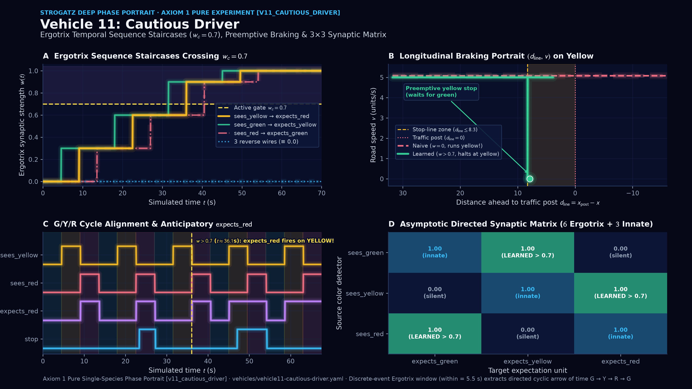

> *Definition:* [`vehicles/vehicle11-cautious-driver.yaml`](../../vehicles/vehicle11-cautious-driver.yaml) · *Scenario:* [`scenarios/vehicle11-cautious-driver.yaml`](../../scenarios/vehicle11-cautious-driver.yaml) · *World:* [`worlds/traffic-light-yellow.yaml`](../../worlds/traffic-light-yellow.yaml) · *Textbook Plate:* [`media/phase_portraits/v11_cautious_driver_phase_textbook.png`](media/phase_portraits/v11_cautious_driver_phase_textbook.png)

Whereas Vehicle 7's Mnemotrix learns *simultaneous* correlation ($A \wedge B$), **Vehicle 11 (*Cautious Driver*)** introduces Braitenberg's **Ergotrix** rule to learn **time-asymmetric causal sequences** ($A$ *followed within $\tau_{\text{within}}$ by* $B$). On a looping $100 \times 20$ road ([`worlds/traffic-light-yellow.yaml`](../../worlds/traffic-light-yellow.yaml)), a roadside signal at `[50, 13]` cycles strictly clockwise through **Green ($0\text{–}4.5\text{ s}$) $\to$ Yellow ($4.5\text{–}9.0\text{ s}$) $\to$ Red ($9.0\text{–}13.5\text{ s}$)** ($T = 13.5\text{ s}$), while all $3 \times 2 = 6$ directed cross-color wires from `sees_{green,yellow,red}` to `expects_{green,yellow,red}` carry Ergotrix eligibility windows $\tau_{\text{within}} = 5.5\text{ s}$ (`learn = 0.3`, `forget = 0.1`):
- **Arrow-of-Time Weight Staircases:** Because $4.5\text{ s} < \tau_{\text{within}} = 5.5\text{ s} < 9.0\text{ s}$, every `Green → Yellow`, `Yellow → Red`, and `Red → Green` transition rewards the **three forward causal wires** by $+0.3$ per cycle ($0 \to 0.3 \to 0.6 \to 0.9 > w_c = 0.7 \to 1.0$), whereas the **three anti-causal reverse wires** (`Red → Yellow`, `Yellow → Green`, `Green → Red`) miss the $5.5\text{ s}$ window and stay clamped near $0$!
- **Preemptive Braking Bifurcation in $(d_{\text{line}}, v)$:** Before maturation ($w_{\text{sees\_yellow} \to \text{expects\_red}} \le 0.7$), `stop` (`expects_red` $\wedge$ `at_line` at $d_{\text{line}} \lesssim 8.3$) fires only on red, letting a driver arriving late in yellow coast past the post. Once the third traffic cycle pushes $w_{\text{sees\_yellow} \to \text{expects\_red}} = 0.9 > 0.7$, seeing yellow **immediately activates `expects_red`**, shifting the braking portrait $(d_{\text{line}}, v)$ to halt cleanly at the line the instant yellow appears!

---

## Act IV — Self-Organized Homeostatic Criticality (`v12_daydreamer`)


> *Comparative Atlas Print Plate:* [`media/phase_atlas/act4_neural_criticality_textbook.png`](media/phase_atlas/act4_neural_criticality_textbook.png)

In Chapter 12 (*Trains of Thought*), eight cortical units `idea_0` $\dots$ `idea_7` ($\tau = 1\text{ s}$, self-inhibiting after one pulse) form a directed circulant graph where each idea excites **two** successors, $k \to (k + 1) \bmod 8$ and $k \to (k + 3) \bmod 8$ ([`vehicles/vehicle12-daydreamer.yaml`](../../vehicles/vehicle12-daydreamer.yaml)). Because out-degree $d_{\text{out}} = 2 > 1$, unguarded fixed thresholds either die into subcritical silence (`Silent`, $\theta_0 = 2$) or explode into supercritical seizure (`Flooded`, $\theta_0 = 1$, all 8 ideas locked on).


> *Atlas Social Cuts:* `media/mp4/phase_atlas/daydreamer_{16x9,1x1,9x16}.mp4`

### 5.1 Caudate Integral Feedback, Kuramoto Order $Z(t)$, and the Zero-Bit `awake` Proof

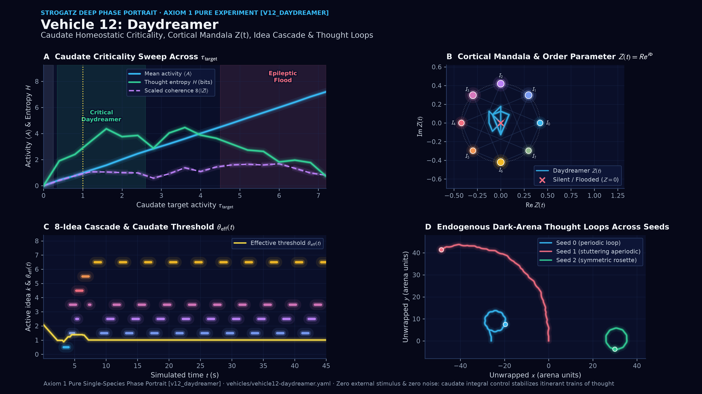


> *Swarm Scenario:* [`scenarios/dynamics-daydreamer-swarm.yaml`](../../scenarios/dynamics-daydreamer-swarm.yaml) · *Definition:* [`vehicles/vehicle12-daydreamer.yaml`](../../vehicles/vehicle12-daydreamer.yaml) · *Textbook Plates:* [`media/phase_portraits/v12_daydreamer_phase_textbook.png`](media/phase_portraits/v12_daydreamer_phase_textbook.png), [`media/v12_daydreamer_tripanel_textbook.png`](media/v12_daydreamer_tripanel_textbook.png) · *60 FPS Social Cuts:* `media/mp4/v12_daydreamer_{16x9,1x1,9x16}.mp4`

Braitenberg stabilizes the cortex at the **edge of chaos** with global **caudate integral threshold control** and Kuramoto ring order diagnostics:

$$\dot{\vartheta}(t) = \alpha\!\left(\sum_{k=0}^{7} a_k(t) - A^*\right), \qquad \theta_k^{\text{eff}}(t) = \theta_0 + \eta_k + \vartheta(t - \tau_c), \qquad Z(t) = \frac{1}{8}\sum_{k=0}^{7} y_k(t)\,e^{i 2\pi k / 8} = R(t)\,e^{i\Phi(t)},$$

with target budget $A^* = 1$, adaptation rate $\alpha = 0.5\text{ s}^{-1}$, fast striatal delay $\tau_c = 0.05\text{ s} \ll \tau = 1\text{ s}$, and quenched threshold jitter $\eta_k \sim \mathcal{U}[-0.3, +0.3]$:
- **Spontaneous Ignition & Branch Pruning:** In silence ($A = 0 < A^*$), $\vartheta(t)$ ramps negative until the lowest-jitter idea ignites spontaneously; whenever a pulse forks into $k+1$ and $k+3$ ($A = 2 > A^*$), $\vartheta(t)$ rises within $\tau_c = 0.05\text{ s}$ to prune the higher-threshold branch, locking $\langle A(t) \rangle = A^* = 1$ (effective branching ratio unity!).
- **Order Parameter $(A, R)$ & Arena Calligraphy:** Coma gives $(A = 0, R = 0)$ and epileptic flood gives $(A = 8, \mathbf{R = 0})$ by roots-of-unity cancellation $\sum_{k=0}^7 e^{i 2\pi k/8} = 0$, whereas critical trains of thought sustain **$R(t) \in [0.12, 0.24] > 0$** as $\Phi(t)$ steps around $+1$ perimeter arcs and $+3$ star chords—tracing polygonal and rosette motor calligraphy in total darkness!
- **Shannon Ensemble Signature:** Across all 24 vehicles for $t > 1\text{ s}$, tonic `awake = 1` exhibits **$H(\text{awake}) = 0.00\text{ bits}$** (zero entropy halo despite mean $1.0$!), while the 8-idea cortical ring carries $\approx 2.8\text{–}3.0\text{ bits}$ of sequence entropy $H(\mathbf{W})$ and directed $+1/+3$ Transfer Entropy.

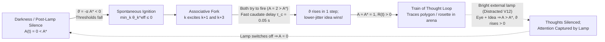

---

## Part III — Interactive Exploration & Headless Publication Studio Guide

### 6.1 Standalone Tri-Panel Browser Laboratory (`explorer.html`)

Open [`explorer.html`](explorer.html) directly in any modern browser—**100% self-contained and offline-ready with zero external CDN or network dependencies**:

```bash
open experiments/strogatz-dynamics/explorer.html   # macOS (or double-click in any OS)
```

- **6 Pure Single-Species Tabs (Axiom 1 Enforced Live):** Switch cleanly among `v9_shy`, `v5_moth`, `v5_forager`, `v7_wary_moth`, `v12_daydreamer`, and `v4a_orbiter` (`validateSingleExperimentAxiom` verified on every step).
- **Click-to-Switch Hero Tracer:** Click **any** vehicle in **Canvas 1 (Physical Arena)** or **Canvas 2 (Phase Portrait)** (or pick from the `Hero Tracer` dropdown) to lock the cyan selection ring, phase ribbon, inner schematic core, barcode cursor, and bit-raster pointer onto that individual in real time.
- **Interactive Manipulation & 4K Export:** Drag lamps (or roving `Chaser`/`Walker` boxes in `v9_shy`) to deform fields and FTLE ridges live; drag empty arena space to launch an additional peer of the active species; press **`N`** (or use `Neural View`) to switch among `Composite Shannon`, `Codebook Rings`, `Entropy & Transfer Entropy`, and `Microstate Raster`; toggle **Cosmic Dark** $\leftrightarrow$ **Strogatz Textbook**; and click **Export 4K Tri-Panel PNG** (`3840 × 2160`).

### 6.2 Real-Time Pygame Simulator HUD (`D` & `N` Keys)

Run any swarm or classical dynamical scenario in the interactive Pygame simulator:

```bash
# Pure Axiom-1 Multi-Vehicle Swarm Scenarios
python -m braitenberg scenarios/dynamics-shy-swarm.yaml
python -m braitenberg scenarios/dynamics-moth-swarm.yaml
python -m braitenberg scenarios/dynamics-forager-swarm.yaml
python -m braitenberg scenarios/dynamics-wary-moth-swarm.yaml
python -m braitenberg scenarios/dynamics-daydreamer-swarm.yaml
python -m braitenberg scenarios/dynamics-orbiter-swarm.yaml

# Classical Single- & Few-Body Separatrix, Scattering, and Ergotrix Scenarios
python -m braitenberg scenarios/dynamics-three-body-orbiter.yaml
python -m braitenberg scenarios/dynamics-twin-lamp-separatrix.yaml
python -m braitenberg scenarios/vehicle11-cautious-driver.yaml
```

- Press **`D`** to cycle the live Strogatz × Shannon Dynamics modes:
  `0: Off` $\to$ `1: Arena Flow` $\to$ `2: Phase + Shannon Brain` $\to$ `3: Full Tri-View`.
- Press **`N`** to cycle the right-hand Shannon Nervous System view:
  `composite` $\to$ `codebook` $\to$ `entropy` $\to$ `raster`.
- **Click any vehicle** in the arena (or drag light sources with the mouse) to switch the cyan-ringed `Hero` tracer across the Arena, Phase Portrait inset, Empirical Density Barcodes, and Sorted Microstate Bit-Raster simultaneously (automatically excluding environmental `Chaser`/`Walker` stimulus boxes from the focal species ensemble).

### 6.3 Unified 3-Series Headless Publication Studio (`python -m braitenberg.dynamics`)

`python -m braitenberg.dynamics` generates all three complementary galleries across `--series tripanels | phase-portraits | atlas | all`, `--theme cosmic | textbook`, and `--aspect 16:9 | 1:1 | 9:16`:

```bash
# Render all 3 showcase galleries at once (or pick one series; --skip-existing speeds incremental builds)
python -m braitenberg.dynamics showcase --out-dir experiments/strogatz-dynamics/media --series all
python -m braitenberg.dynamics showcase --out-dir experiments/strogatz-dynamics/media --series phase-portraits
python -m braitenberg.dynamics showcase --out-dir experiments/strogatz-dynamics/media --series tripanels --skip-existing
python -m braitenberg.dynamics showcase --out-dir experiments/strogatz-dynamics/media --series atlas

# Series I — Pure Axiom-1 4-Panel Deep Phase Portraits (8 isolated experiments: *_phase.png)
python -m braitenberg.dynamics poster --series phase-portraits --experiment v11_cautious_driver --theme cosmic --aspect 16:9 --out-dir experiments/strogatz-dynamics/media/phase_portraits
python -m braitenberg.dynamics poster --series phase-portraits --experiment all --theme textbook --aspect 16:9 --out-dir experiments/strogatz-dynamics/media/phase_portraits

# Series II — Pure Axiom-1 Shannon × Strogatz Tri-Panels (6 swarm experiments: *_tripanel.png & *.gif)
python -m braitenberg.dynamics poster --series tripanels --experiment v9_shy --neural-view composite --theme cosmic --aspect 16:9 --out-dir experiments/strogatz-dynamics/media
python -m braitenberg.dynamics animate --series tripanels --experiment v7_wary_moth --aspect 9:16 --fps 60 --seconds 7 --out-dir experiments/strogatz-dynamics/media

# Series III — Comparative Synthesis Phase-Space Atlas (act 1|2|3|4|atlas|all & classic scenes)
python -m braitenberg.dynamics poster --series atlas --act all --theme cosmic --aspect 16:9 --out-dir experiments/strogatz-dynamics/media/phase_atlas
python -m braitenberg.dynamics animate --series atlas --scene ftle-swarm --aspect 16:9 --fps 60 --seconds 8 --out-dir experiments/strogatz-dynamics/media/phase_atlas
```

---

## Complete Three-Series Showcase Media Index

All 48 tracked 4K plates & GIFs (plus 30 gitignored 60 FPS H.264 social MP4 cuts in `16:9`, `1:1`, and `9:16`) are generated deterministically under `experiments/strogatz-dynamics/media/`:

### Series I — Pure Axiom-1 Deep Phase Portraits (`media/phase_portraits/` — 16 Tracked 4K Plates)

| Experiment ID | Cosmic Dark 4K Plate | Strogatz Textbook Print Plate | Four-Panel Analytical Scope |
|---|---|---|---|
| `v2a_fear` | [`media/phase_portraits/v2a_fear_phase.png`](media/phase_portraits/v2a_fear_phase.png) | [`media/phase_portraits/v2a_fear_phase_textbook.png`](media/phase_portraits/v2a_fear_phase_textbook.png) | $(r, \psi)$ repulsive streamplot, arena scattering fan, $(\dot{r}, \omega)$ profiles, $b \mapsto \Delta\theta$ curve |
| `v3a_love` | [`media/phase_portraits/v3a_love_phase.png`](media/phase_portraits/v3a_love_phase.png) | [`media/phase_portraits/v3a_love_phase_textbook.png`](media/phase_portraits/v3a_love_phase_textbook.png) | $(r, \psi)$ arrest sink & $\pm\pi/2$ saddles, capture vs escape tracks, $v(r)$ braking, $r^*(I_0)$ sweep |
| `v4a_orbiter` | [`media/phase_portraits/v4a_orbiter_phase.png`](media/phase_portraits/v4a_orbiter_phase.png) | [`media/phase_portraits/v4a_orbiter_phase_textbook.png`](media/phase_portraits/v4a_orbiter_phase_textbook.png) | $(r, \psi)$ chiral limit cycle, `peak.at` escape sweep, 3-lamp FTLE ridges $\sigma_T$, Poincaré section $\Sigma$ |
| `v5_moth` | [`media/phase_portraits/v5_moth_phase.png`](media/phase_portraits/v5_moth_phase.png) | [`media/phase_portraits/v5_moth_phase_textbook.png`](media/phase_portraits/v5_moth_phase_textbook.png) | $(r, \dot{r})$ burn-latch catastrophe, pre-burn $(b=0)$ sink, post-burn $(b=1)$ repeller, 2-lamp jump track |
| `v5_forager` | [`media/phase_portraits/v5_forager_phase.png`](media/phase_portraits/v5_forager_phase.png) | [`media/phase_portraits/v5_forager_phase_textbook.png`](media/phase_portraits/v5_forager_phase_textbook.png) | $(r, E)$ hysteresis limit cycle, rosette foraging track, $(E, r, \text{full})$ traces, duty-cycle breakdown |
| `v7_wary_moth` | [`media/phase_portraits/v7_wary_moth_phase.png`](media/phase_portraits/v7_wary_moth_phase.png) | [`media/phase_portraits/v7_wary_moth_phase_textbook.png`](media/phase_portraits/v7_wary_moth_phase_textbook.png) | $(r_{\text{red}}, w_{\text{red}})$ Filippov crossing at $0.7$, hot/cool extinction traces, 2-lamp tracks, $r_{\min}$ per pass |
| `v11_cautious_driver` | [`media/phase_portraits/v11_cautious_driver_phase.png`](media/phase_portraits/v11_cautious_driver_phase.png) | [`media/phase_portraits/v11_cautious_driver_phase_textbook.png`](media/phase_portraits/v11_cautious_driver_phase_textbook.png) | Ergotrix $G \to Y \to R \to G$ staircases, $(d_{\text{line}}, v)$ yellow braking, phase raster, $3\times 3$ synaptic matrix |
| `v12_daydreamer` | [`media/phase_portraits/v12_daydreamer_phase.png`](media/phase_portraits/v12_daydreamer_phase.png) | [`media/phase_portraits/v12_daydreamer_phase_textbook.png`](media/phase_portraits/v12_daydreamer_phase_textbook.png) | Caudate criticality sweep, cortical mandala & $Z(t) = R e^{i\Phi}$, $\theta_{\text{eff}}(t)$ breathing, dark calligraphy |

### Series II — Pure Axiom-1 Shannon × Strogatz Tri-Panels (`media/` — 18 Tracked Plates & GIFs + 18 Local MP4s)

| Experiment ID | Animated GIF | Cosmic Dark 4K Tri-Panel | Strogatz Textbook 4K Tri-Panel | Local 60 FPS Social Cuts |
|---|---|---|---|---|
| `v9_shy` | [`media/v9_shy.gif`](media/v9_shy.gif) | [`media/v9_shy_tripanel.png`](media/v9_shy_tripanel.png) | [`media/v9_shy_tripanel_textbook.png`](media/v9_shy_tripanel_textbook.png) | `media/mp4/v9_shy_{16x9,1x1,9x16}.mp4` |
| `v5_moth` | [`media/v5_moth.gif`](media/v5_moth.gif) | [`media/v5_moth_tripanel.png`](media/v5_moth_tripanel.png) | [`media/v5_moth_tripanel_textbook.png`](media/v5_moth_tripanel_textbook.png) | `media/mp4/v5_moth_{16x9,1x1,9x16}.mp4` |
| `v5_forager` | [`media/v5_forager.gif`](media/v5_forager.gif) | [`media/v5_forager_tripanel.png`](media/v5_forager_tripanel.png) | [`media/v5_forager_tripanel_textbook.png`](media/v5_forager_tripanel_textbook.png) | `media/mp4/v5_forager_{16x9,1x1,9x16}.mp4` |
| `v7_wary_moth` | [`media/v7_wary_moth.gif`](media/v7_wary_moth.gif) | [`media/v7_wary_moth_tripanel.png`](media/v7_wary_moth_tripanel.png) | [`media/v7_wary_moth_tripanel_textbook.png`](media/v7_wary_moth_tripanel_textbook.png) | `media/mp4/v7_wary_moth_{16x9,1x1,9x16}.mp4` |
| `v12_daydreamer` | [`media/v12_daydreamer.gif`](media/v12_daydreamer.gif) | [`media/v12_daydreamer_tripanel.png`](media/v12_daydreamer_tripanel.png) | [`media/v12_daydreamer_tripanel_textbook.png`](media/v12_daydreamer_tripanel_textbook.png) | `media/mp4/v12_daydreamer_{16x9,1x1,9x16}.mp4` |
| `v4a_orbiter` | [`media/v4a_orbiter.gif`](media/v4a_orbiter.gif) | [`media/v4a_orbiter_tripanel.png`](media/v4a_orbiter_tripanel.png) | [`media/v4a_orbiter_tripanel_textbook.png`](media/v4a_orbiter_tripanel_textbook.png) | `media/mp4/v4a_orbiter_{16x9,1x1,9x16}.mp4` |

### Series III — Comparative Synthesis Phase-Space Atlas (`media/phase_atlas/` — 14 Tracked Plates & GIFs + 12 Local MP4s)

| Asset | Description | Textbook Print Variant / 60 FPS MP4 Cuts |
|---|---|---|
| [`media/phase_atlas/strogatz_atlas.png`](media/phase_atlas/strogatz_atlas.png) | 4K $2 \times 2$ Master Synthesis Atlas across Acts I–IV | [`media/phase_atlas/strogatz_atlas_textbook.png`](media/phase_atlas/strogatz_atlas_textbook.png) |
| [`media/phase_atlas/act1_polar_phase_portraits.png`](media/phase_atlas/act1_polar_phase_portraits.png) | Comparative $SO(2)$ cylindrical $(r, \psi)$ portraits, nullclines & limit cycle | [`media/phase_atlas/act1_polar_phase_portraits_textbook.png`](media/phase_atlas/act1_polar_phase_portraits_textbook.png) |
| [`media/phase_atlas/act2_lagrangian_chaos_ftle.png`](media/phase_atlas/act2_lagrangian_chaos_ftle.png) | Unwrapped FTLE ridges ($\sigma_T$), trefoil capture basins & Poincaré section | [`media/phase_atlas/act2_lagrangian_chaos_ftle_textbook.png`](media/phase_atlas/act2_lagrangian_chaos_ftle_textbook.png) |
| [`media/phase_atlas/act3_hysteresis_and_plasticity.png`](media/phase_atlas/act3_hysteresis_and_plasticity.png) | Comparative Moth fold jump, Forager $(r, E)$ cycle & $w_c = 0.7$ bifurcation | [`media/phase_atlas/act3_hysteresis_and_plasticity_textbook.png`](media/phase_atlas/act3_hysteresis_and_plasticity_textbook.png) |
| [`media/phase_atlas/act4_neural_criticality.png`](media/phase_atlas/act4_neural_criticality.png) | Daydreamer caudate phase diagram, Kuramoto $Z(t)$ & dark-arena tracks | [`media/phase_atlas/act4_neural_criticality_textbook.png`](media/phase_atlas/act4_neural_criticality_textbook.png) |
| [`media/phase_atlas/orbiter.gif`](media/phase_atlas/orbiter.gif) | 150 comet-tailed Vehicle 4a particles collapsing onto the $(r, \psi)$ limit cycle | `media/mp4/phase_atlas/orbiter_{16x9,1x1,9x16}.mp4` |
| [`media/phase_atlas/ftle_swarm.gif`](media/phase_atlas/ftle_swarm.gif) | 300 bioluminescent vehicles shearing along multi-lamp FTLE separatrices | `media/mp4/phase_atlas/ftle_swarm_{16x9,1x1,9x16}.mp4` |
| [`media/phase_atlas/plasticity.gif`](media/phase_atlas/plasticity.gif) | Comparative Forager relaxation cycle & Wary Moth $w(t) > 0.7$ bifurcation | `media/mp4/phase_atlas/plasticity_{16x9,1x1,9x16}.mp4` |
| [`media/phase_atlas/daydreamer.gif`](media/phase_atlas/daydreamer.gif) | 8-idea cortical ring traveling waves, $Z(t)$ rosette & dark-arena calligraphy | `media/mp4/phase_atlas/daydreamer_{16x9,1x1,9x16}.mp4` |

---

## References & Further Reading

1. **Braitenberg, V.** (1984). *Vehicles: Experiments in Synthetic Psychology*. MIT Press.
2. **Strogatz, S. H.** (2015). *Nonlinear Dynamics and Chaos: With Applications to Physics, Biology, Chemistry, and Engineering* (2nd ed.). Westview Press.
3. **Strogatz, S. H.** (2000). From Kuramoto to Crawford: exploring the onset of synchronization in populations of coupled oscillators. *Physica D*, 143(1–4), 1–20.
4. **Shannon, C. E.** (1948). A Mathematical Theory of Communication. *Bell System Technical Journal*, 27(3), 379–423 & 623–656.
5. **Watanabe, S.** (1960). Information theoretical analysis of multivariate correlation. *IBM Journal of Research and Development*, 4(1), 66–82.
6. **Schreiber, T.** (2000). Measuring information transfer. *Physical Review Letters*, 85(2), 461–464.
7. **Haller, G.** (2015). Lagrangian Coherent Structures. *Annual Review of Fluid Mechanics*, 47, 137–162.
8. **Gaspard, P., & Rice, S. A.** (1989). Scattering from a classically chaotic repellor. *Journal of Chemical Physics*, 90(4), 2225–2241.
9. **di Bernardo, M., Budd, C. J., Champneys, A. R., & Kowalczyk, P.** (2008). *Piecewise-Smooth Dynamical Systems: Theory and Applications*. Springer.
