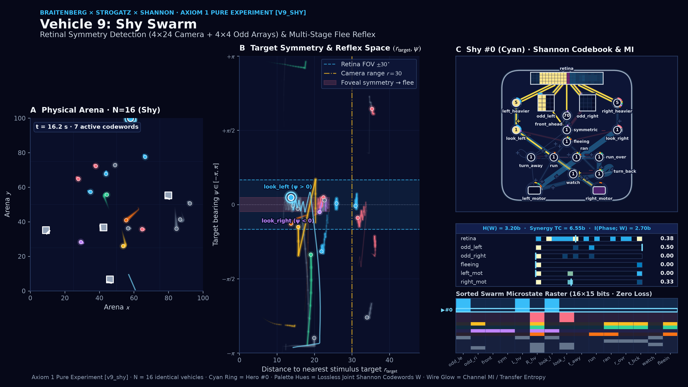
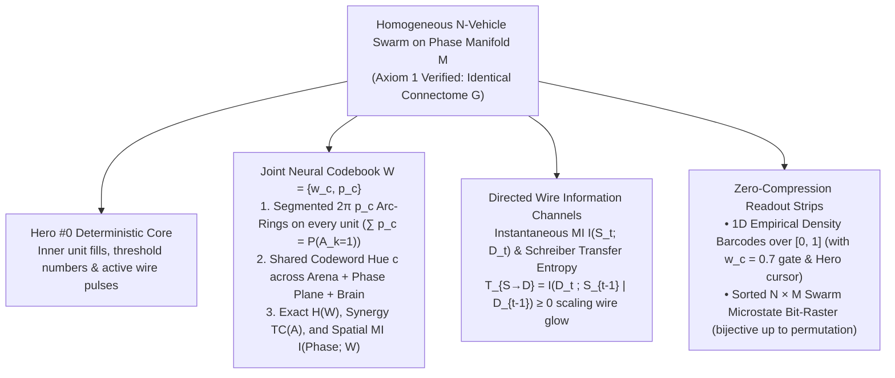
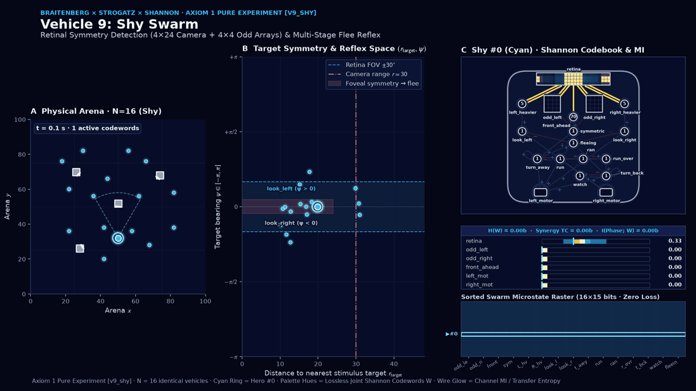
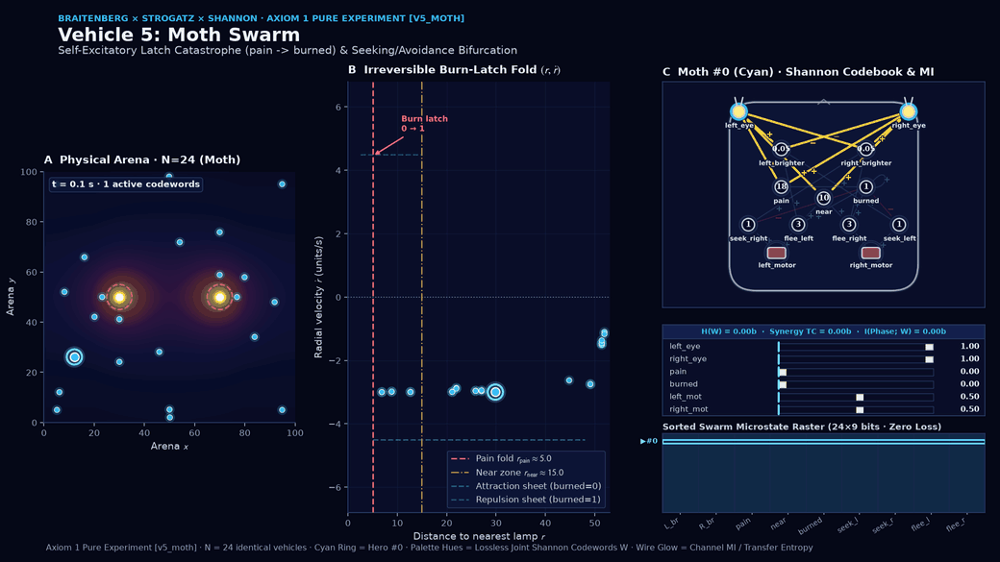
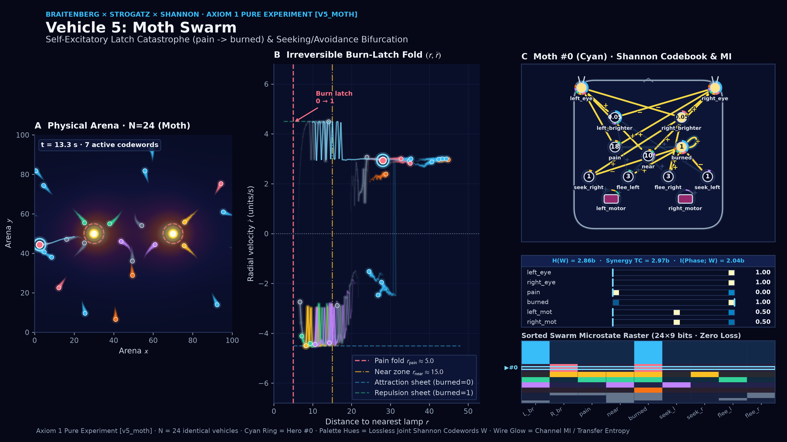
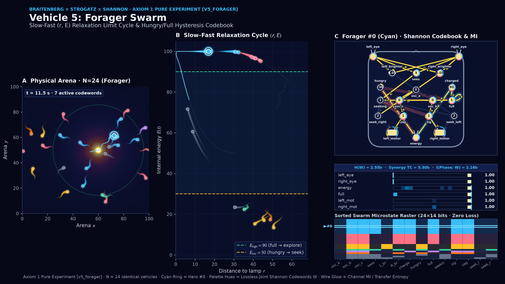
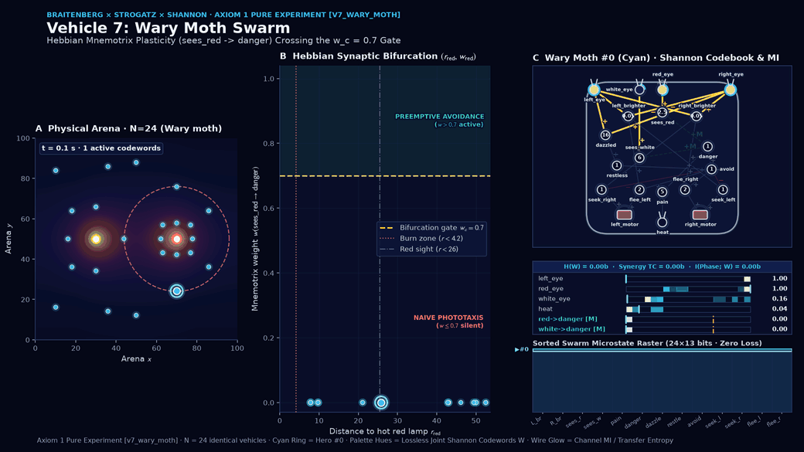
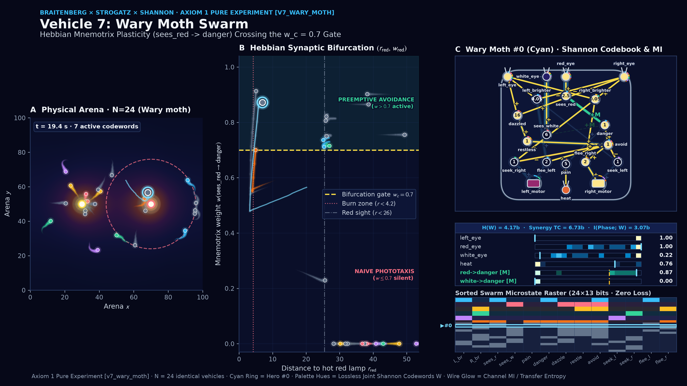
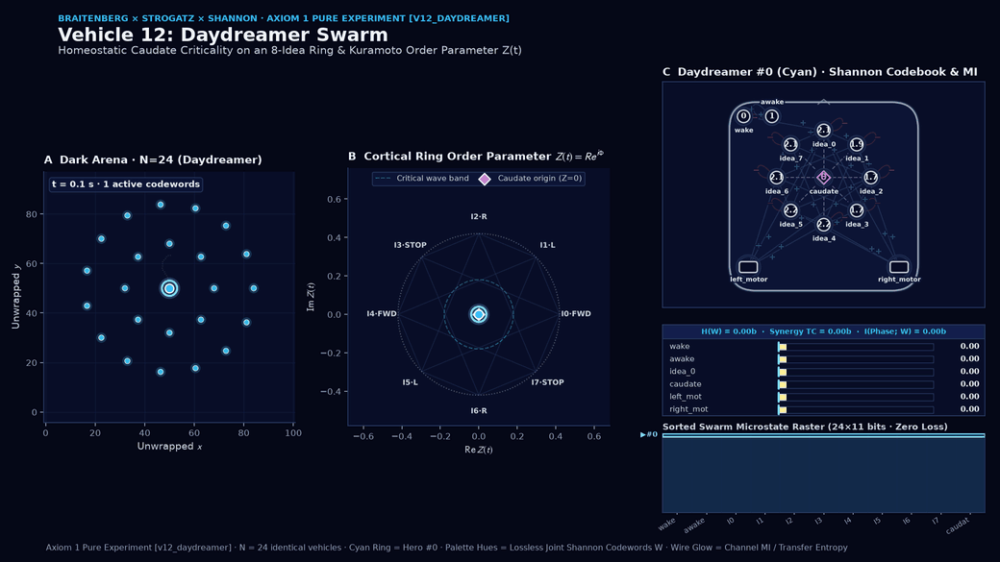
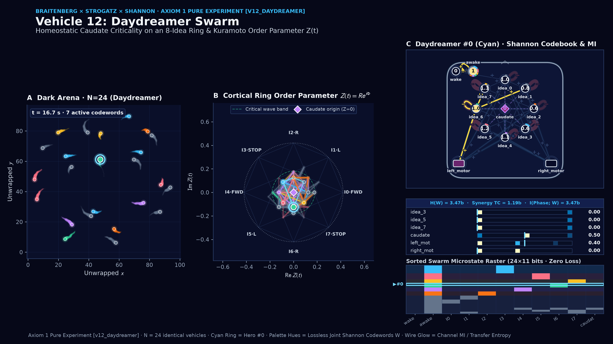

# Synthetic Psychology Through Phase Space and Information Theory

*Uniting Valentino Braitenberg's nervous systems, Steven Strogatz's geometric bifurcations, and Claude Shannon's lossless ensemble coding.*



> *Prefer warm-paper textbook plates? Every 4K Tri-Panel plate also ships in a classic Strogatz print edition: [`media/v9_shy_tripanel_textbook.png`](media/v9_shy_tripanel_textbook.png).*

---

## Prologue: Three Lenses on One Nervous System

In 1984, Valentino Braitenberg opened *Vehicles: Experiments in Synthetic Psychology* with his **Law of Uphill Analysis and Downhill Invention**: wiring sensors to motors through threshold neurons is delightfully simple from the inside out, yet reconstructing that wiring from outside behavior feels nearly impossible because observers project fear, affection, remorse, caution, shyness, and daydreams onto motion.

To understand *how* simple circuits manufacture rich inner lives—not merely for a single trajectory, but across an entire population of embodied agents—we need three complementary mathematical lenses working in lockstep:

1. **Valentino Braitenberg (Microscopic Circuit Causality):** A top-down anatomical schematic (`Hero #0`) showing which pixels, threshold units, recurrent latches, and plastic synapses fire *right now* to drive the left and right wheels.
2. **Steven Strogatz (Macroscopic Phase-Space Geometry):** Symmetry-reduced coordinates, nullclines, Finite-Time Lyapunov Exponent (FTLE) ridges, fold catastrophes, slow–fast hysteresis loops, Filippov switching hyperplanes ($w_c = 0.7$), and Kuramoto order parameters ($Z(t) = R e^{i\Phi}$) that explain *why* trajectories converge, oscillate, or scatter.
3. **Claude Shannon (Lossless Ensemble Information Flow):** Joint neural codebooks, Watanabe Total Correlation ($TC$), empirical density barcodes, time-delayed Transfer Entropy ($T_{S \to D}$), and sorted $N \times M$ bit-rasters that summarize an entire $N$-vehicle swarm **without collapsing multimodal or correlated states into misleading sample means**.

| Experiment ID | Braitenberg Species | Strogatz Phase Portrait | Dominant Shannon Phenomenon |
|---|---|---|---|
| **`v9_shy`** | **Vehicle 9: Shy** (`retina` $4\times 24$, `odd_L/R` $4\times 4$, 13 reflex units) | Target relative bearing $(r_{\text{target}}, \psi_{\text{bearing}})$ & FOV cone | Disjoint codebook arcs on mirror-symmetry watch vs 4-stage flee cascade |
| **`v5_moth`** | **Vehicle 5: Moth** (9 threshold units, `burned` latch) | Two-sheet fold catastrophe $(r, -\dot{r}) \times \{0, 1\}$ | Bimodal seek/flee codebook split + `pain → burned` Transfer Entropy surge |
| **`v5_forager`** | **Vehicle 5: Forager** (14 units + slow energy $E$) | Slow–fast $(r, E)$ van der Pol relaxation cycle | 1-bit hysteresis memory across $E \in [30, 90]$ + gated `osc_a,b,c` synergy |
| **`v7_wary_moth`** | **Vehicle 7: Wary Moth** (13 units + 2 Mnemotrix wires) | Filippov synaptic bifurcation $(r_{\text{red}}, w_{\text{red}})$ at $w_c = 0.7$ | Bimodal weight barcode straddling $w_c = 0.7$ where sample mean $\bar{w}$ fails |
| **`v12_daydreamer`** | **Vehicle 12: Daydreamer** (8-idea ring + `caudate` control) | Kuramoto disc $Z(t) = R e^{i\Phi}$ & homeostatic trace | Zero-bit constant-bias proof (`awake ≡ 1` $\implies 0\text{ bits}$) vs critical ring |
| **`v4a_orbiter`** | **Vehicle 4a: Orbiter** (Gaussian peak + crossed wires) | Cylindrical $(r, \psi)$ spiral sinks & 3-lamp FTLE web | Chiral CW/CCW sensorimotor codebook & eye $\to$ motor Channel MI $I(S; D)$ |

---

## 1. Axiom of Experimental Purity

A foundational discipline governs every scenario, poster, animation, Pygame HUD overlay, and interactive browser preset in this suite:

> [!IMPORTANT]
> **Axiom 1 (Strict Single-Experiment Isolation):** Every dynamical visualization characterizes **strictly one** scenario and **strictly one** homogeneous focal vehicle population sharing an identical connectome $\mathcal{G} = (\mathcal{V}, \mathcal{E})$. Cross-species mashups (such as combining a Vehicle 5 Forager and a Vehicle 7 Wary Moth in a single composite figure, or pooling heterogeneous brains into one state matrix) are programmatically forbidden (`validate_single_experiment_axiom` / `AxiomViolationError`).

Why is experimental purity mathematically non-negotiable?

1. **Well-Defined Ensemble Measure $\mu_t$ on One State Manifold $\mathcal{M}$:** A phase portrait is the pushforward of an initial probability density $\mu_0$ under a single autonomous or time-periodic flow $\Phi_0^t : \mathcal{M} \to \mathcal{M}$. Only when all $N$ focal vehicles obey the *exact same* differential-difference equations on $\mathcal{M}$ do empirical point clouds trace genuine invariant manifolds, limit cycles, and saddle separatrices of one dynamical system.
2. **Isomorphic Connectome Coordinates for Information Theory:** Joint neural entropy $H(\mathbf{W})$ and Total Correlation $TC(\mathbf{A})$ require random variables $(A_1, \dots, A_M)$ with identical semantic definitions across every sample $n \in \{1, \dots, N\}$.
3. **Clean Boundary Between Focal Organisms and Moving World Stimuli (`v9_shy`):** When an environment contains moving stimulus agents—such as the white-fronted `Chaser` and `Walker` boxes that a `Vehicle 9: Shy` swarm watches through its $4 \times 24$ retina—those stimulus boxes act purely as **time-dependent boundary conditions of the world**. `select_focal_vehicles` isolates the homogeneous `Vehicle 9: Shy` swarm (`Shy #0` $\dots$ `Shy #15`) so environmental targets never contaminate Shy's phase ensemble or neural codebook.
4. **Bridging Microscopic Causality and Macroscopic Statistics (`Hero #0`):** Highlighting one distinguished member of the homogeneous swarm—**`Hero #0`** (or any peer clicked live in the arena or phase portrait)—lets the viewer trace exact deterministic single-vehicle cause and effect inside the full statistical context of its $N - 1$ identical peers.

---

## 2. Why Sample Means Destroy Ensemble Information (After Claude Shannon)

Suppose $N$ identical Braitenberg vehicles with $M$ binary threshold units navigate an arena at time $t$, producing the ensemble activation matrix $\mathbf{B}(t) \in \{0, 1\}^{N \times M}$ alongside continuous sensor, motor, metabolic, and synaptic variables.

The most tempting summary of an $N$-agent nervous system is the **sample mean** $\bar{a}_k = \frac{1}{N}\sum_{n=1}^{N} B_{n,k}$ painted onto each neuron of a single diagram. **Claude Shannon's 1948 information theory proves why naive averaging is catastrophic for nonlinear brains**—committing three distinct mathematical sins simultaneously:

### 2.1 Marginal Collapse of Bimodal Bifurcations ($p(x) \mapsto \mathbb{E}[X]$)

Near any separatrix, hysteresis loop, or learning threshold, an ensemble splits **bimodally** into two distinct behavioral macroscopic phases:
- **Discrete Units:** If half of a Moth swarm is actively seeking light ($A_k = 1$) while the burned half is silent ($A_k = 0$), the empirical distribution carries **maximum binary uncertainty**
  $$H(A_k) = -p_k \log_2 p_k - (1 - p_k)\log_2(1 - p_k) = 1.00\text{ bit} \qquad (p_k = 0.5),$$
  yet $\mathbb{E}[A_k] = 0.50$ renders the unit half-dim—indistinguishable from a sluggish analog sensor where nobody is committed!
- **Piecewise-Smooth Synaptic Gates ($w_c = 0.7$):** In `Vehicle 7` (*Wary Moth*), a Mnemotrix wire conducts **if and only if** $w(t) > w_c = 0.7$. Suppose $45\%$ of the swarm is naive at $w = 0.20$ and $55\%$ has already learned avoidance at $w = 0.95$. Over half the population has crossed the Filippov bifurcation, yet the ensemble mean is
  $$\bar{w} = 0.45(0.20) + 0.55(0.95) = 0.6125 \le 0.70,$$
  **falsely reporting an inactive synapse for the entire species!**

### 2.2 Erasure of Higher-Order Synergy & Mutual Exclusivity ($TC(\mathbf{A})$)

Even worse, marginal firing rates $(p_1, \dots, p_M)$ discard **100% of cross-neuron coordination**. Consider two motor-command units $(A_1, A_2) = (\text{look\_left}, \text{look\_right})$ across three $N$-vehicle ensembles:

| Ensemble Regime | Joint Distribution $P(A_1, A_2)$ | Sample Means $(\bar{a}_1, \bar{a}_2)$ | Marginal Sum $H(A_1)+H(A_2)$ | Joint Entropy $H(\mathbf{W})$ | Watanabe Synergy $TC(\mathbf{A})$ |
|---|---|---|---|---|---|
| **Mutually Exclusive Steering** | $\frac{1}{2}(1,0) + \frac{1}{2}(0,1)$ | **$(0.50,\; 0.50)$** | $2.00\text{ bits}$ | **$1.00\text{ bit}$** | **$1.00\text{ bit}$** |
| **Locked Co-Activation** | $\frac{1}{2}(0,0) + \frac{1}{2}(1,1)$ | **$(0.50,\; 0.50)$** | $2.00\text{ bits}$ | **$1.00\text{ bit}$** | **$1.00\text{ bit}$** |
| **Uncorrelated Noise** | $\frac{1}{4}$ on all $4$ states in $\{0,1\}^2$ | **$(0.50,\; 0.50)$** | $2.00\text{ bits}$ | **$2.00\text{ bits}$** | **$0.00\text{ bits}$** |

All three ensembles produce the **exact same mean-activity diagram** $(0.50, 0.50)$, even though the first turns cleanly left or right, the second locks both wheels together, and the third is pure noise!

Grouping the rows of $\mathbf{B}(t)$ into exact $M$-bit **joint neural codewords** $\mathbf{w}_c \in \{0, 1\}^M$ with empirical probabilities $p_c = n_c / N$ recovers the exact **Joint Codebook Entropy** and **Watanabe Total Correlation (Multi-Information)**:

$$H(\mathbf{W}) = -\sum_{c=1}^{K} p_c \log_2 p_c, \qquad TC(\mathbf{A}) = \sum_{k=1}^{M} H(A_k) - H(\mathbf{W}) = D_{\mathrm{KL}}\!\left(P(\mathbf{A}) \;\middle\|\; \prod_{k=1}^{M} P(A_k)\right) \ge 0.$$

### 2.3 The Zero-Bit Constant-Bias Paradox (`awake = 1`)

In `Vehicle 12` (*Daydreamer*), a tonic unit `awake` latches to $1$ at $t = 1.0\text{ s}$ to silence the initial `wake` pulse and stays at $1$ across every vehicle forever. Under mean-value rendering, `awake` blazes at $100\%$ intensity ($\mathbb{E}[A_{\text{awake}}] = 1.0$) while each cortical `idea_k` averages only $\mathbb{E}[A_{\text{idea}_k}] \approx 1/8 = 0.125$. Information theory immediately diagnoses the illusion:

$$P(A_{\text{awake}} = 1) = 1.0 \quad \Longrightarrow \quad H(A_{\text{awake}}) = -1\log_2 1 = \mathbf{0.00\text{ bits}},$$

whereas each cortical idea carries $H(A_{\text{idea}_k}) = h_2(1/8) \approx \mathbf{0.544\text{ bits}}$ and the active 8-idea sequence carries $H(\mathbf{W}) \approx \mathbf{2.8\text{–}3.0\text{ bits}}$! A constant bias carries zero surprise and zero control information.

### 2.4 The Four-Layer Lossless Visual Architecture

To preserve **100% of single-circuit causality AND 100% of ensemble information**, Panel 3 (*Hero + Shannon Nervous System*) combines four mathematically lossless encodings:



1. **Joint Codebook Segmented Arc-Rings ($2\pi p_c$):** Around every unit $k$, each active codeword $c$ in which $w_{c,k} = 1$ claims an arc of angular span $\Delta\theta_c = 2\pi p_c$ painted in Codeword $c$'s palette hue. Notice the exact partition identity:
   $$\sum_{c \,:\, w_{c,k} = 1} p_c = P(A_k = 1).$$
   Total arc coverage shows the exact marginal firing probability, while **shared hues across units reveal joint co-activation and disjoint hues reveal mutual exclusivity** (`look_left` vs `look_right`, or `seek` vs `flee`)—and every particle in the Arena and Phase Portrait wears that exact same Codeword Hue!
2. **Channel Mutual Information & Transfer Entropy Wires:** Each bundled connection from source $S$ to destination $D$ glows in proportion to instantaneous channel mutual information $I(S_t; D_t)$ and **Schreiber Transfer Entropy**
   $$T_{S \to D} = I(D_t;\, S_{t-1} \mid D_{t-1}) = H(D_t, D_{t-1}) + H(S_{t-1}, D_{t-1}) - H(D_t, S_{t-1}, D_{t-1}) - H(D_{t-1}) \ge 0,$$
   highlighting causal state transitions (such as `pain` flipping `burned`, or `symmetric` igniting `turn_away`) rather than static bias!
3. **1D Empirical Density Barcodes over $[0, 1]$:** Every continuous sensor, motor, metabolic energy store, and plastic synapse renders its full $B$-bin empirical histogram across $[0, 1]$—exposing bimodal splits across $w_c = 0.7$ alongside a crisp cursor tick for `Hero #0`.
4. **Sorted $N \times M$ Swarm Microstate Bit-Raster:** Ordering the $N$ rows by `(codeword_id, phase_angle)` displays the complete binary microstate of every single vehicle in the swarm without a single bit of lossy compression.

---

## 3. Six Pure Experiments in Synthetic Psychology

### 3.1 `v9_shy` — Vehicle 9: Shy Swarm (Mirror Symmetry & Reflex Cascade)




> *Scenario:* [`scenarios/dynamics-shy-swarm.yaml`](../../scenarios/dynamics-shy-swarm.yaml) · *Definition:* [`vehicles/vehicle9-shy.yaml`](../../vehicles/vehicle9-shy.yaml) · *Textbook Plate:* [`media/v9_shy_tripanel_textbook.png`](media/v9_shy_tripanel_textbook.png) · *60 FPS Social Cuts:* `media/mp4/v9_shy_{16x9,1x1,9x16}.mp4`

Braitenberg's **Vehicle 9 (*Shy*)** demonstrates how spatial geometry on a 2D retina turns directly into social perception:
- **Optical Mirror-Symmetry Detector:** Each Shy vehicle carries a $4 \times 24$ forward `retina` ($60^\circ \times 8^\circ$ FOV, range $30$). Environmental `Chaser` and `Walker` boxes have bright white fronts ($10$) and gray sides/backs ($5$). Two $4 \times 4$ comparator arrays test bilateral reflection symmetry across the central 8 columns ($j \in \{0, \dots, 3\}$):
  $$\text{odd\_left}[i, j] = \Theta\!\big(\text{retina}[i, 8+j] - \text{retina}[i, 15-j] - 4\big), \qquad \text{odd\_right}[i, j] = \Theta\!\big(\text{retina}[i, 15-j] - \text{retina}[i, 8+j] - 4\big).$$
- **Gaze Centering vs Head-On Escape:** Seen at an oblique angle, a Chaser triggers `left_heavier` or `right_heavier`, causing Shy to pivot *toward* it (`look_left`/`look_right`) and watch curiously. The instant the Chaser turns **straight toward Shy** ($\psi \approx 0$ with aligned heading), its white front fills `retina[1:3, 10:14]` (`front_ahead` $\ge 70$) while mirror mismatches vanish (`odd_left = odd_right = 0`), firing `symmetric`!
- **Four-Stage Sequential Delay Latch:** `symmetric` triggers `turn_away` (self-latched for $1\text{ s}$), which excites delayed `run` ($\tau = 1\text{ s}$), whose echo `ran` ($\tau = 0.5\text{ s}$) fires `run_over` $\to$ `turn_back` ($1\text{ s}$ half-turn) $\to$ `watch`, while `fleeing` suppresses gaze-tracking throughout the escape! On the $(r_{\text{target}}, \psi_{\text{bearing}})$ phase plane and Shannon Codebook, watching left, watching right, turning away, sprinting, and turning back appear as **mutually exclusive high-$TC$ codewords**.

---

### 3.2 `v5_moth` — Vehicle 5: Moth Swarm (Irreversible Fold/Latch Catastrophe)





> *Scenario:* [`scenarios/dynamics-moth-swarm.yaml`](../../scenarios/dynamics-moth-swarm.yaml) · *Definition:* [`vehicles/vehicle5-moth.yaml`](../../vehicles/vehicle5-moth.yaml) · *Textbook Plate:* [`media/v5_moth_tripanel_textbook.png`](media/v5_moth_tripanel_textbook.png) · *60 FPS Social Cuts:* `media/mp4/v5_moth_{16x9,1x1,9x16}.mp4`

By Cauchy–Lipschitz uniqueness on $\mathbb{R}^2 \times S^1$, a memoryless vehicle revisiting the same pose $(x, y, \theta)$ can never alter its mind. **Vehicle 5 (*Moth*)** expands phase space via a single self-excitatory binary latch `burned` ($b \in \{0, 1\}$, delay $\tau = 0.05\text{ s}$):
$$b(t + \tau) = \Theta\!\big(\text{pain}(t) + b(t) - 1\big), \qquad \text{pain}(t) = \Theta\!\big(S_L(t) + S_R(t) - 18\big).$$
- **Two-Sheet Phase Geometry:** In [`worlds/two-lights.yaml`](../../worlds/two-lights.yaml), unburned moths ride the upper inward branch ($b = 0$, $-\dot{r} > 0$) straight toward the nearest lamp until crossing the fold boundary $r_{\text{burn}} \approx 11.2$. Firing `pain` flips $b : 0 \mapsto 1$ irreversibly, dropping the trajectory onto the lower avoidance sheet ($b = 1$) where entering `near` ($S_L + S_R \ge 10$, $r_{\text{near}} \approx 18.4$) drives active repulsion (`flee_left`/`flee_right`).
- **Shannon Signature:** As staggered waves of moths reach the lamps, the ensemble coexists across Naive Seek codewords (`seek_left`/`seek_right` + `burned=0`) and Wary Avoidance codewords (`burned=1` + `near` + `flee`), driving high spatial mutual information $I(\text{Phase}; \mathbf{W})$ between $(r, -\dot{r})$ and the 9-unit codebook.

---

### 3.3 `v5_forager` — Vehicle 5: Forager Swarm (Slow–Fast Relaxation Limit Cycle)




> *Scenario:* [`scenarios/dynamics-forager-swarm.yaml`](../../scenarios/dynamics-forager-swarm.yaml) · *Definition:* [`vehicles/vehicle5-forager.yaml`](../../vehicles/vehicle5-forager.yaml) · *Textbook Plate:* [`media/v5_forager_tripanel_textbook.png`](media/v5_forager_tripanel_textbook.png) · *60 FPS Social Cuts:* `media/mp4/v5_forager_{16x9,1x1,9x16}.mp4`

Coupling a slow internal metabolic coordinate $E(t) \in [0, 100]$ to a reversible **Schmitt-trigger latch** (`full`) converts the Moth's one-way catastrophe into a self-sustained **slow–fast relaxation oscillation**—synthetic psychology's van der Pol cycle:
$$\dot{E} = g_{\text{charge}}\,S(\mathbf{x}) - c_{\text{move}}\,|v| - c_{\text{basal}}, \qquad \text{full}(t + \tau) = \Theta\!\big(\Theta(E - 90) + \text{full}(t) - \Theta(30 - E) - 1\big).$$
- **Hysteresis Loop on $(r, E)$:** Inside the hysteresis band $E \in (30, 90)$, two vehicles at the *exact same* position and energy behave oppositely depending on which fold they visited last: hungry seekers (`full = 0`) silence the 3-neuron inhibitory ring oscillator (`osc_a, osc_b, osc_c`, $\tau = 0.3\text{ s}$) to climb up the solar gradient until $E = 90$, whereas satiated explorers (`full = 1`) unleash `zig`/`zag` dispersal into the dark until $E = 30$.
- **Shannon Signature:** The `energy` barcode spans $[0.3, 0.9]$ while the codebook cleanly partitions the 3-phase `osc_a,b,c` dispersal states from the bilateral `seeking` states.

---

### 3.4 `v7_wary_moth` — Vehicle 7: Wary Moth Swarm (Filippov Gate at $w_c = 0.7$)





> *Scenario:* [`scenarios/dynamics-wary-moth-swarm.yaml`](../../scenarios/dynamics-wary-moth-swarm.yaml) · *Definition:* [`vehicles/vehicle7-wary-moth.yaml`](../../vehicles/vehicle7-wary-moth.yaml) · *Textbook Plate:* [`media/v7_wary_moth_tripanel_textbook.png`](media/v7_wary_moth_tripanel_textbook.png) · *60 FPS Social Cuts:* `media/mp4/v7_wary_moth_{16x9,1x1,9x16}.mp4`

In [`worlds/hot-lamp.yaml`](../../worlds/hot-lamp.yaml), a cool White Lamp at `[30, 50]` and a periodically scorching Red Lamp at `[70, 50]` test Pavlovian associative learning across two **Mnemotrix** wires (`sees_red -> danger` and `sees_white -> danger`):
$$\dot{w}_{i \to \text{danger}} = \begin{cases} +0.50\text{ s}^{-1}, & \text{while } y_i = 1 \text{ and } \text{pain} = 1, \\ -0.02\text{ s}^{-1}, & \text{while } y_i = 1 \text{ and } \text{pain} = 0, \end{cases} \qquad I_{i \to \text{danger}}(t) = y_i(t)\,\mathbf{1}\!\big[w_i(t) > w_c\big], \;\; w_c = 0.7.$$
- **Codimension-1 Synaptic Bifurcation:** While $w_{\text{red}} \le 0.7$, the green `M` wire is dashed and silent; moths plunge into $r_{\text{red}} \le 4$ and suffer burns that pump $w_{\text{red}}$ upward. The instant a moth's weight pierces $w_c = 0.7$, its vector field bifurcates—repelling it at the outer red-sight halo $r_{\text{red}} \approx 26$ while still visiting the cool white lamp ($w_{\text{white}} \equiv 0$)!
- **Shannon Signature:** On the `sees_red->danger M` **Empirical Density Barcode**, the swarm visibly splits into two lobes straddling the vertical $w_c = 0.7$ gate tick, while Transfer Entropy $T_{\text{sees\_red} \to \text{danger}}$ ignites exclusively across conditioned individuals.

---

### 3.5 `v12_daydreamer` — Vehicle 12: Daydreamer Swarm (Self-Organized Criticality)





> *Scenario:* [`scenarios/dynamics-daydreamer-swarm.yaml`](../../scenarios/dynamics-daydreamer-swarm.yaml) · *Definition:* [`vehicles/vehicle12-daydreamer.yaml`](../../vehicles/vehicle12-daydreamer.yaml) · *Textbook Plate:* [`media/v12_daydreamer_tripanel_textbook.png`](media/v12_daydreamer_tripanel_textbook.png) · *60 FPS Social Cuts:* `media/mp4/v12_daydreamer_{16x9,1x1,9x16}.mp4`

In total darkness (`sensors: []`), eight cortical units `idea_0 .. idea_7` ($\tau = 1\text{ s}$) excite $k + 1 \bmod 8$ and $k + 3 \bmod 8$—an explosive out-degree-2 graph stabilized at the edge of chaos by integral **caudate threshold control**:
$$\dot{\vartheta}(t) = \alpha\!\left(\sum_{k=0}^{7} a_k(t) - A^*\right), \qquad \theta_k^{\text{eff}}(t) = 2 + \eta_k + \vartheta(t - \tau_c), \qquad Z(t) = \frac{1}{8}\sum_{k=0}^{7} y_k(t)\,e^{i 2\pi k / 8} = R(t)\,e^{i\Phi(t)}.$$
- **Endogenous Calligraphy & Criticality:** Fast striatal feedback ($\tau_c = 0.05\text{ s} \ll 1\text{ s}$) prunes branching forks using quenched threshold heterogeneity $\eta_k \sim \mathcal{U}[-0.3, +0.3]$, stabilizing $\langle A(t) \rangle = A^* = 1$ and $R(t) > 0$ so each vehicle's dark-arena path draws a geometric signature of its internal attractor loop.
- **Shannon Signature:** Once $t > 1\text{ s}$, `awake = 1` across all 24 vehicles—displaying **$H(\text{awake}) = 0.00\text{ bits}$** (zero entropy halo despite unit mean!) while the 8-idea cortical ring radiates rich multi-bit sequence entropy $H(\mathbf{W})$ and $+1/+3$ chord Transfer Entropy!

---

### 3.6 `v4a_orbiter` — Vehicle 4a: Orbiter Swarm (Cylindrical Limit Cycles & 3-Lamp FTLE Chaos)


> *Scenario:* [`scenarios/dynamics-orbiter-swarm.yaml`](../../scenarios/dynamics-orbiter-swarm.yaml) · *Definition:* [`vehicles/vehicle4a-orbiter.yaml`](../../vehicles/vehicle4a-orbiter.yaml) · *Textbook Plate:* [`media/v4a_orbiter_tripanel_textbook.png`](media/v4a_orbiter_tripanel_textbook.png) · *60 FPS Social Cuts:* `media/mp4/v4a_orbiter_{16x9,1x1,9x16}.mp4`

Around a single lamp, Euclidean symmetry $SO(2) \ltimes \mathbb{R}^2$ reduces $(x, y, \theta)$ to the autonomous phase cylinder $(r, \psi)$:
$$\dot{r} = -v(r, \psi)\cos\psi, \qquad \dot{\psi} = \frac{v(r, \psi)}{r}\sin\psi - \omega(r, \psi), \qquad \sigma_T(\mathbf{x}_0) = \frac{1}{|T|}\ln\sqrt{\lambda_{\max}\!\big([D\tilde{\Phi}_0^T]^\top [D\tilde{\Phi}_0^T]\big)}.$$
- **Limit Cycles & Three-Body Scattering:** Vehicle 4a's Gaussian sensor curve $R(S) = \exp\!\big(-(S - 4)^2 / (2 \cdot 1.5^2)\big)$ flips steering sign across $S(r^*) = 4$, birthing chirally symmetric spiral sinks at $(r_{\text{lc}}, \pm\pi/2)$ (counterclockwise and clockwise arena orbits). Lighting three equilateral lamps in [`worlds/three-lights-chaos.yaml`](../../worlds/three-lights-chaos.yaml) breaks $SO(2)$ symmetry and weaves unwrapped **FTLE ridges** (repelling Lagrangian Coherent Structures) along which neighboring vehicles scatter onto competing lamps and chaotic figure-eight tours.
- **Shannon Signature:** Even without hidden interneurons (`units: []`), the 4-bit sensorimotor state `(left_eye, right_eye, right_motor, left_motor)` and crossed contralateral Channel Mutual Information $I(\text{eye}; \text{motor})$ distinguish CW orbiters, CCW orbiters, and saddle-transiting scatterers!

---

## 4. CLI, Live Pygame (`D` & `N` Keys), and `explorer.html` Guide

### 4.1 Standalone Tri-Panel Browser Lab (`explorer.html`)

Open [`explorer.html`](explorer.html) directly in any modern browser—**100% offline-ready with zero external CDN or network links**:

```bash
open experiments/strogatz-dynamics/explorer.html   # macOS (or double-click in any OS)
```

- **6 Pure Single-Species Tabs:** Switch cleanly between `v9_shy`, `v5_moth`, `v5_forager`, `v7_wary_moth`, `v12_daydreamer`, and `v4a_orbiter` (`validateSingleExperimentAxiom` enforced live).
- **Click-to-Switch Hero Tracer:** Click **any** vehicle in **Canvas 1 (Arena)** or **Canvas 2 (Phase Portrait)** (or choose from the `Hero Tracer` dropdown) to lock the cyan selection ring, phase ribbon, inner schematic core, barcode cursor, and bit-raster pointer onto that individual!
- **Interactive Manipulation:** Drag lamps (or roving `Chaser`/`Walker` boxes in `v9_shy`) to deform fields and FTLE ridges in real time; drag empty arena space to launch an additional peer of the active species; press **`N`** (or use `Neural View`) to switch between `Composite Shannon`, `Codebook Rings`, `Entropy & Transfer Entropy`, and `Microstate Raster`; click **Export 4K Tri-Panel PNG** to save a `3840 × 2160` publication plate.

### 4.2 Real-Time Pygame Simulator HUD (`D` & `N` Keys)

Run any swarm or single-vehicle scenario in the interactive Pygame simulator:

```bash
python -m braitenberg scenarios/dynamics-shy-swarm.yaml
python -m braitenberg scenarios/dynamics-moth-swarm.yaml
python -m braitenberg scenarios/dynamics-forager-swarm.yaml
python -m braitenberg scenarios/dynamics-wary-moth-swarm.yaml
python -m braitenberg scenarios/dynamics-daydreamer-swarm.yaml
python -m braitenberg scenarios/dynamics-orbiter-swarm.yaml
```

- Press **`D`** to cycle the Strogatz × Shannon Dynamics modes:
  `0: Off` $\to$ `1: Arena Flow` $\to$ `2: Phase + Shannon Brain` $\to$ `3: Full Tri-View`.
- Press **`N`** to cycle the right-hand Nervous System view:
  `composite` $\to$ `codebook` $\to$ `entropy` $\to$ `raster`.
- **Click any vehicle** in the arena to switch the cyan-ringed `Hero` tracer across the Arena, Phase Portrait inset, Empirical Density Barcodes, and Microstate Bit-Raster simultaneously (automatically filtering out environmental `Chaser`/`Walker` agents).

### 4.3 Headless Publication Studio (`python -m braitenberg.dynamics`)

```bash
# Render the complete 1-Experiment-Per-File Showcase Gallery (12 4K PNGs, 6 GIFs, 18 60fps MP4s)
python -m braitenberg.dynamics showcase --out-dir experiments/strogatz-dynamics/media

# Render a 4K Tri-Panel poster for one experiment (or all) in Cosmic Dark or Strogatz Textbook style
python -m braitenberg.dynamics poster --experiment v9_shy --neural-view composite --theme cosmic --aspect 16:9 --out-dir experiments/strogatz-dynamics/media
python -m braitenberg.dynamics poster --experiment all --theme textbook --aspect 16:9 --out-dir experiments/strogatz-dynamics/media

# Render 60 FPS animations across widescreen (16:9), square (1:1), or vertical social (9:16)
python -m braitenberg.dynamics animate --experiment v7_wary_moth --aspect 9:16 --fps 60 --seconds 7 --out-dir experiments/strogatz-dynamics/media
```

---

## References

1. **Braitenberg, V.** (1984). *Vehicles: Experiments in Synthetic Psychology*. MIT Press.
2. **Strogatz, S. H.** (2015). *Nonlinear Dynamics and Chaos: With Applications to Physics, Biology, Chemistry, and Engineering* (2nd ed.). Westview Press.
3. **Shannon, C. E.** (1948). A Mathematical Theory of Communication. *Bell System Technical Journal*, 27(3), 379–423 & 623–656.
4. **Watanabe, S.** (1960). Information theoretical analysis of multivariate correlation. *IBM Journal of Research and Development*, 4(1), 66–82.
5. **Schreiber, T.** (2000). Measuring information transfer. *Physical Review Letters*, 85(2), 461–464.
6. **Haller, G.** (2015). Lagrangian Coherent Structures. *Annual Review of Fluid Mechanics*, 47, 137–162.
7. **di Bernardo, M., Budd, C. J., Champneys, A. R., & Kowalczyk, P.** (2008). *Piecewise-Smooth Dynamical Systems: Theory and Applications*. Springer.
