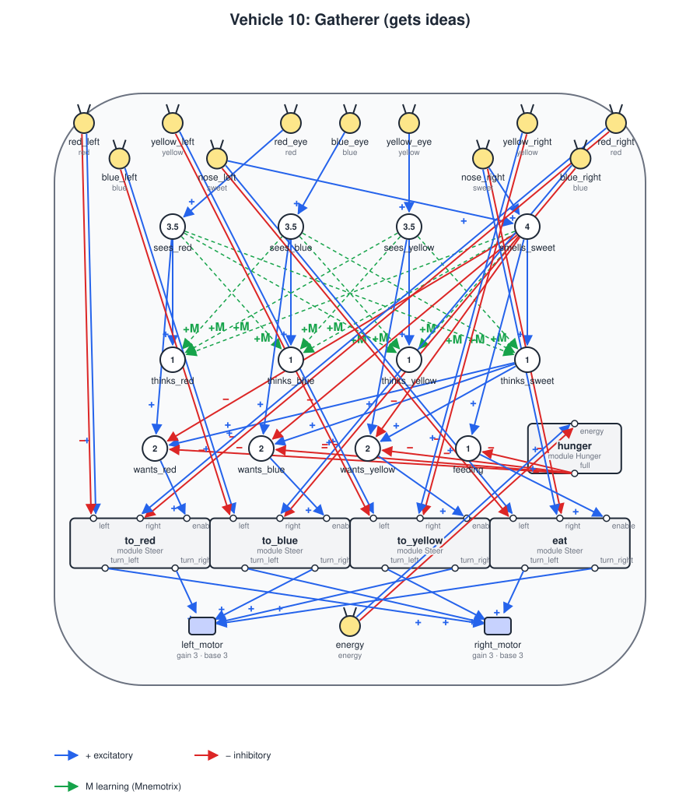
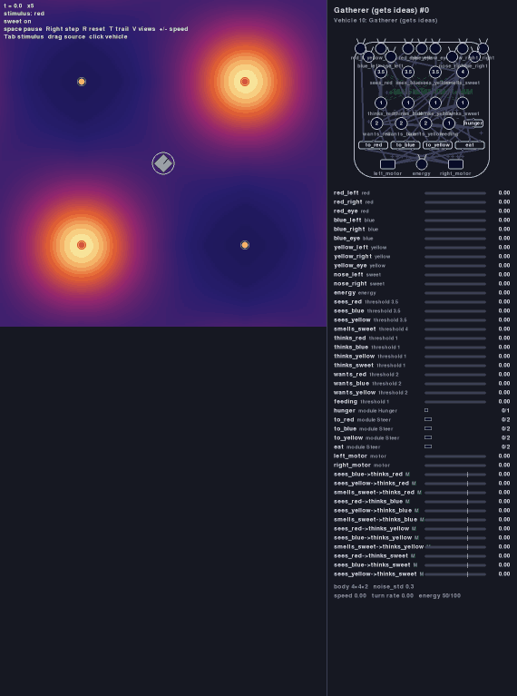

# Vehicle 10 — Getting Ideas: the gatherer

**Status:** implemented. The values below were tuned on seeds 0 to 4; *Implementation notes* says what implementing it changed from the first version of this spec, including one change to the Mnemotrix rule.

## Summary

Braitenberg's chapter on Vehicle 10 ("Getting Ideas") goes on from the concepts of Vehicle 7. A Mnemotrix wire links two things that keep happening together ([vehicle-07.md](vehicle-07.md)). A vehicle with many elements and Mnemotrix wires among all of them links whole groups: elements that the world keeps presenting together end up wired to each other, and from then on any part of the group calls up the rest. Such a group is an **idea**. Its biological counterpart, in the book's notes, is the cell assembly, which the notes call the embodiment of ideas. Nobody designs an idea: which groups form is decided by the statistics of the world the vehicle lives in, not by the designer. And an idea can be on, as a whole, when only part of it is in the senses.

The wary moth of Vehicle 7 already has a concept, but the smallest one, and a designed one: the designer chose the one wire that could learn, `sees_red → danger`, and decided what `danger` means. This spec takes the next step with no new kind of part, and one change to the Mnemotrix rule (see *Learned from events only*):

- **Wires from everything to everything.** Every sense is wired by Mnemotrix to an element for every other sense. The designer does not say which senses belong together.
- **Ideas emerge.** In the gatherer's world, red and sweet come together at the berry bushes, and blue and yellow at the stones. Of the twelve wires, the four inside these two groups mature and the other eight stay at 0. The vehicle has got two ideas that nobody gave it.
- **Part calls up the whole.** Once it has the idea of the berry bush, seeing red from afar makes it think *sweet*, long before it can smell anything, and a hungry gatherer heads for it.
- **Ideas regroup.** After 600 s the berries are gone and the stones turn sweet. The old idea falls apart, and a new one forms with three members: blue, yellow and sweet. Now any one of them calls up the other two.





*The default scenario, seed 0, all 1200 seconds, played at twenty times the speed. At the bottom of the panel, watch `sees_red->thinks_sweet` and `smells_sweet->thinks_red` grow with the first meals, and the four wires between blue and yellow as the gatherer passes a stone. After 600 s, the red wires fade while the four between sweet and the stones' colors grow. Tab switches the heat map between the stimuli.*

## Senses and thoughts

The gatherer's brain has two rows of units:

- **Senses:** `sees_red`, `sees_blue`, `sees_yellow` and `smells_sweet`, threshold units that fire when the stimulus is near enough. They are fed by sensors only.
- **Thoughts:** `thinks_red`, `thinks_blue`, `thinks_yellow` and `thinks_sweet`. Each takes its own sense through a fixed wire, so it is on whenever its sense is, and takes each of the **other three** senses through a Mnemotrix wire that starts at 0. Twelve learning wires in all.

An idea is a group of thoughts linked by active wires both ways. When the gatherer sees red and has the idea of the berry bush, `thinks_red` is on through its sense and `thinks_sweet` through the learned wire `sees_red → thinks_sweet`: it thinks of sweet without smelling it.

### How the wires learn

Each wire follows the Mnemotrix rule of [vehicle-07.md](vehicle-07.md): while its source sense fires, the wire grows if its destination thought is driven by its fixed inputs, which here is its own sense, and shrinks if it is not. So `sees_red → thinks_sweet` grows while red is seen and sweet is smelled, and shrinks while red is seen and sweet is not. It does not change while red is out of sight. And `smells_sweet → thinks_red`, the wire the other way, grows and shrinks with the same events seen from the other side: it shrinks only when sweet is smelled with no red in sight.

A wire matures when its source is mostly accompanied by its destination: with `learn` 0.5 and `forget` 0.01, a second together outweighs 50 seconds apart. Wires between senses that never come together never grow at all.

### Learned from events only

Until this spec, a Mnemotrix wire learned whenever its destination was driven by its **other** inputs, learning ones included ([vehicle-07.md](vehicle-07.md), *Why "other inputs"*). With many learning wires into one unit, that lets one association teach another. When the honey appears on the stones, `smells_sweet → thinks_red`, left over from the berries, still fires `thinks_red`; blue is in sight at the same time, so `sees_blue → thinks_red` would learn from it, and the stones' idea would take in red, which the gatherer never sees there. The two wires would then keep each other active, and the false idea would never go away.

So since this spec a Mnemotrix wire, like an Ergotrix wire since Vehicle 11 ([vehicle-11.md](vehicle-11.md), *Why fixed inputs only*), learns only from its destination's **fixed** inputs: it grows while its source fires and the destination's fixed inputs alone reach its threshold, and shrinks while its source fires and they do not. A thought called up by an association is not an event. The wary moth, the only vehicle with Mnemotrix wires before this one, is unchanged: its `danger` learns from `pain`, a fixed input, and its two learning wires are never on together.

### Why two rows

The wires go from senses to thoughts, never from thought to thought. With Mnemotrix wires among the thoughts themselves, a learned pair would hold itself on: `thinks_red` would fire `thinks_sweet`, which would fire `thinks_red`, and the idea, once on, would never let go, whatever the senses said. That is the chain reaction of Vehicle 12, which needs its threshold control ([vehicle-12.md](vehicle-12.md)). With two rows, an idea is on exactly while some part of it is in the senses, and goes off when the senses leave it.

The price is that ideas do not chain: if red goes with sweet and sweet with blue, seeing red calls up sweet but not blue, because `thinks_sweet` drives no wire. Ideas that call up other ideas, and ideas that stay on by themselves, are left for later (see *Out of scope*).

## The world

`worlds/orchard.yaml`: a 100 × 100 arena with `edges: wrap`, two berry bushes and two stones, at the corners of a square, so that each bush is 50 units from each stone and 71 from the other bush:

| Stimulus | Sources | Meaning |
|---|---|---|
| `red` | `[25, 25]` and `[75, 75]`, intensity 10, falloff 15 | The berry bushes are red. |
| `blue` | `[75, 25]` and `[25, 75]`, intensity 10, falloff 15 | The stones are blue ... |
| `yellow` | `[75, 25]` and `[25, 75]`, intensity 10, falloff 15 | ... and yellow. |
| `sweet` | at the bushes, intensity 10, falloff 4, `schedule: {period: 1200, on_at: 0, off_at: 600}` | Berries, for the first 600 s of every 1200. |
| `sweet` | at the stones, intensity 10, falloff 4, `schedule: {period: 1200, on_at: 600, off_at: 1200}` | Honey on the stones, for the other 600 s. |

The colors are seen from about 20 units away and the sweet smelled from about 6, so no place is in sight of both a bush and a stone, and sweet is smelled only where its color is in sight.

## The gatherer

`vehicles/vehicle10-gatherer.yaml`, `general.type` `"10"`.

### Parts

- **Body:** `size` 4, `noise_std` 0.3, so that it wanders from one corner to another, as the wary moth does.
- **Sensors:** for each color, `red_left` and `red_right` at the front corners with `field_of_view` 90, to steer, and `red_eye` near the middle of the front, all around, to see it; the same for `blue` and `yellow`. `nose_left` and `nose_right` at `[∓0.45, 0.78]`, reading `sweet`, all around. `energy`, drawn at `[0, -0.8]`. The sensors of each kind are spread along the front so that the diagram can label them.
- **Energy:** as the landmark forager's ([vehicle-11.md](vehicle-11.md)): `initial` 50, `max` 100, `consumption` 0.5, `basal` 2, `charge_from: sweet`, `charge_gain` 4.
- **Motors:** `left_motor` and `right_motor`, as the landmark forager's.

### Units

| Unit | Inputs | Threshold | Fires when | Role |
|---|---|---|---|---|
| `sees_red` | `red_eye` | 3.5 | a red bush within about 20 units | Sense |
| `sees_blue` | `blue_eye` | 3.5 | a stone within about 20 units | Sense |
| `sees_yellow` | `yellow_eye` | 3.5 | a stone within about 20 units | Sense |
| `smells_sweet` | `nose_left`, `nose_right` | 4 | sweet within about 6 units | Sense |
| `thinks_red` | `sees_red`; Mnemotrix from `sees_blue`, `sees_yellow`, `smells_sweet` | 1 | red is seen, or called up | Thought |
| `thinks_blue` | `sees_blue`; Mnemotrix from the other three senses | 1 | blue is seen, or called up | Thought |
| `thinks_yellow` | `sees_yellow`; Mnemotrix from the other three senses | 1 | yellow is seen, or called up | Thought |
| `thinks_sweet` | `smells_sweet`; Mnemotrix from `sees_red`, `sees_blue`, `sees_yellow` | 1 | sweet is smelled, or called up | Thought |
| `wants_red` | `sees_red`, `thinks_sweet`, inhibitory `smells_sweet`, inhibitory `hunger.full` | 2 | hungry, red in sight, and it thinks of sweet, while not yet smelling it | Go to red |
| `wants_blue` | the same with `sees_blue` | 2 | | Go to blue |
| `wants_yellow` | the same with `sees_yellow` | 2 | | Go to yellow |
| `feeding` | `smells_sweet`, inhibitory `hunger.full` | 1 | sweet smelled while hungry | Eat |

Every Mnemotrix wire has `strength` 0, `learn` 0.5 and `forget` 0.01.

| Module | File | Inputs | Does |
|---|---|---|---|
| `hunger` | `hunger.yaml` | `energy`: `energy` | `full` from energy 90 until energy 30 |
| `to_red` | `steer.yaml` | `red_left`, `red_right`, `enable`: `wants_red` | Turn toward the red bush |
| `to_blue` | `steer.yaml` | `blue_left`, `blue_right`, `enable`: `wants_blue` | Turn toward the stone |
| `to_yellow` | `steer.yaml` | `yellow_left`, `yellow_right`, `enable`: `wants_yellow` | Turn toward the stone |
| `eat` | `steer.yaml` | `nose_left`, `nose_right`, `enable`: `feeding` | Circle the sweet while eating |

Each steer module's `turn_left` goes to `right_motor` and `turn_right` to `left_motor`.

### What is built in and what is learned

Two things are built in, as values are in Vehicle 4: sweet is good (the `wants_` units go for what makes it think of sweet), and a full gatherer is not interested. What is learned is **which** colors mean sweet. The `wants_` units are wired alike for every color, so the designer does not say which one leads to food; each is no more than "go to this color while it makes you think of sweet".

The senses are not gated by hunger. A full gatherer still sees and smells, and goes on learning what goes with what: ideas form whether or not they are of use at the moment.

### How it behaves

- **At first** every wire is at 0. Seeing red calls up nothing, so the gatherer wanders and finds the berries only by chance. When it does, it eats until full and wanders off, while `sees_red → thinks_sweet` and `smells_sweet → thinks_red` grow.
- **Passing a stone**, it sees blue and yellow together, and the four wires between them grow. They never shrink: blue is never seen without yellow.
- **The idea of the berry bush.** After a meal or two the red wires are active. Now a hungry gatherer that sees red thinks of sweet, and `wants_red` turns it toward the bush from 20 units away. The other eight wires stay at 0: no color is ever seen with a color of the other kind, and blue and yellow never with sweet.
- **The berries are gone (600 s).** The gatherer still goes to the red bushes, thinking of sweet, and finds nothing. Each such visit wears down `sees_red → thinks_sweet`, until it goes inactive and red no longer attracts it: the disappointment of the wary moth when its lamp went cold.
- **The new idea.** Wandering, it comes upon the honey on a stone, and blue, yellow and sweet are sensed together. The wires from blue and yellow to sweet, and from sweet to blue and yellow, grow, and join the wires between blue and yellow that were there already: one idea with three members. Now seeing blue, or yellow, calls up the whole of it, and the gatherer heads for the stones.
- **The old idea fades slowly.** `smells_sweet → thinks_red` shrinks only while sweet is smelled with no red, which now happens at every meal, so it goes inactive too. Until it does, eating honey makes the gatherer think of red: the old idea lingers in the new.

### Diagram and panel

The diagram puts the senses in a row above the thoughts, each thought below its own sense, so that the fixed wires are short and vertical and the twelve Mnemotrix wires cross between the rows. They are drawn as any Mnemotrix wire ([vehicle-diagram.md](vehicle-diagram.md)): green, labeled `M`, dashed while inactive, wider as they grow. The readouts show the twelve strengths. In the run, watch the two ideas form as two bundles of crossing wires turn solid, and later one bundle fade and the other grow by one member.

## Definition, world and scenario

- `vehicles/vehicle10-gatherer.yaml`: the definition above.
- `vehicles/vehicle10-gatherer-control.yaml`: the same with every `learn` set to 0, for the criteria.
- `worlds/orchard.yaml`: the world above.
- `scenarios/vehicle10-gatherer.yaml`: one gatherer in `orchard` at `[50, 50]`, heading 45°, `dt` 0.01.
- `specs/images/vehicle10-gatherer.svg` and `specs/images/vehicle10-gatherer.gif`: the diagram and the recording above.

```
python -m braitenberg scenarios/vehicle10-gatherer.yaml
python -m braitenberg.diagram vehicles/vehicle10-gatherer.yaml --out specs/images/vehicle10-gatherer.svg
python -m braitenberg.record scenarios/vehicle10-gatherer.yaml --seconds 1200 --every 1 --speed 20 --scale 0.5 --out specs/images/vehicle10-gatherer.gif
```

The gatherer is made of threshold units, Mnemotrix wires, energy and the `hunger` and `steer` modules, all of which existed. The only code change is the Mnemotrix rule (*Learned from events only*). The definition gives every part a `position`, so that the diagram shows the two rows of four with the twelve wires crossing between them.

## Related specs

- [vehicle-07.md](vehicle-07.md): the Mnemotrix wire and its rule, which this spec changes to learn from fixed inputs only. Its *Out of scope* points here for larger concepts.
- [vehicle-definition.md](vehicle-definition.md): *Learning connections*, updated to the fixed-inputs rule.
- [vehicle-11.md](vehicle-11.md): the landmark forager, whose energy, hunger and steering the gatherer reuses, and which learns a landmark with an Ergotrix wire because its cue is gone before the food comes. Here the color is still in sight while the sweet is smelled, so a Mnemotrix wire is the right one.
- [vehicle-12.md](vehicle-12.md): the threshold control, which ideas that hold themselves on would need.
- [modules.md](modules.md): the `hunger` and `steer` modules.
- [worlds.md](worlds.md): schedules, which switch the sweet from the bushes to the stones.

## Acceptance criteria

Criteria 1 to 6 use the default scenario, run headless for 1200 s, and must hold for each of seeds 0 to 4. A wire is **active** when its strength is above 0.7. "Phase 1" is 0 to 600 s and "phase 2" is 600 to 1200 s.

1. **Ideas emerge:** by the end of phase 1, the four wires between red and sweet and between blue and yellow (both ways) are active.
2. **Nothing else is learned:** throughout phase 1, the other eight wires stay at or below 0.7; the four between red and blue or yellow, and between blue or yellow and red, stay at 0 throughout the run.
3. **Part calls up the whole:** in phase 1, there is a moment when `thinks_sweet` is on while `smells_sweet` is off and `sees_red` is on.
4. **The idea pays:** over seeds 0 to 4 together, in phase 1 the gatherer has at least one and a half times as many meals (`hunger.full` turning on) as the control vehicle in the same scenario and seeds. (Tuning measured 33 against 18.)
5. **The old idea falls apart:** in phase 2, `sees_red → thinks_sweet` goes inactive, and from 0.2 s after that (the time the change takes to reach `wants_red`), while it stays inactive, `wants_red` never fires.
6. **A new idea with three members:** in phase 2, there is a moment when the six wires among blue, yellow and sweet (both ways) are all active, and a moment when `thinks_sweet` is on while `sees_blue` is on and `smells_sweet` is off.

The gatherer's brain fed by hand, `dt` 0.01:

7. **Symmetry of the rule:** red and sweet on together for 2 s make both `sees_red → thinks_sweet` and `smells_sweet → thinks_red` active; red on alone for 15 s afterwards brings the first down by 0.15 and leaves the second unchanged.
8. **Learned from events only:** with `smells_sweet → thinks_red` at 1, blue and sweet on together for 5 s keep `thinks_red` on, leave `sees_blue → thinks_red` at 0, and bring `smells_sweet → thinks_red` down by 0.05.
9. **Any member calls up the others:** with the six wires among blue, yellow and sweet at 1, blue alone fires `thinks_yellow` and `thinks_sweet`, and not `thinks_red`.
10. **No reverberation:** with every wire set to 1, every thought goes off within 0.2 s once all four senses are off.
11. **Nothing else changes:** every existing test passes unchanged, the wary moth's included.
12. **Display and headless:** the diagram reports the twelve Mnemotrix wires with their strengths, the SVG is generated without importing pygame, and running the scenario headless never imports pygame.

## Open questions

- **Fidelity to the chapter.** This spec was written without the text of chapter 10 at hand. Its reading of "Getting Ideas" (ideas as groups bound by Mnemotrix wires, formed by the statistics of the world, called up whole by a part) comes from Vehicle 7, from the notes' cell assemblies, and from Vehicles 11 to 13, which build on it. Before implementing, check it against the chapter, and in particular any example the chapter gives, which the scenario should follow if it can.

## Implementation notes

- **Learned from events only.** With the Vehicle 7 rule, the stones' idea took in red on every seed, as described in *Learned from events only*, and `smells_sweet → thinks_red` stayed at 1 to the end. The rule change fixed it.
- **`forget` 0.01 instead of 0.02.** The gatherer sees a color from 20 units and smells sweet from 6, and passes the bushes and stones while full, so with 0.02 the ideas faded between meals: at 300 s, `sees_red → thinks_sweet` was below 0.7 on three seeds of five.
- **Phases of 600 s instead of 300 s.** In 300 s the gatherer had only one to five meals, and the learner ate barely more than the control (14 against 10). With 600 s, 33 against 18.
- **Meals instead of time near sweet** for criterion 4: the time spent eating is set by hunger, a meal lasting until the gatherer is full, so it hardly differs between the gatherer and the control; how often it finds food does.
- **Criterion 6** asks for a moment when the six wires are all active, not for them to be active at the end: `sees_blue → thinks_sweet` sometimes dips below 0.7 near the end while the gatherer, full, passes stones. Its second half asked for blue alone, without yellow; the two are seen from the same place, so that hardly happens in the run, and criterion 9 checks it on the brain fed by hand.
- **Timing in the criteria.** A change in a wire reaches `wants_red` two unit delays later, so criterion 5 starts 0.2 s after the drop. Criterion 7 starts its 15 s of red alone 1 s after the sweet, once the sweet has passed out of the units' windows, and the drop is 0.15, at `forget` 0.01.

## Out of scope

- **Ideas that call up ideas.** Wires between thoughts, so that red, linked to sweet, and sweet, linked to blue, would make red call up blue: an association never experienced. It needs the thoughts to drive wires, and with that, the control of Vehicle 12.
- **Ideas that hold themselves on.** An idea that stays on after the senses have left it, as a cell assembly that reverberates. The same loops, and the same control.
- **Ideas that recruit** new members while they are on, which Vehicle 13 lists as meditation ([vehicle-13.md](vehicle-13.md), *Out of scope*).
- **A shorthand for all-to-all wiring.** The twelve wires are written out. A key that wires every element of a group to every other, leaving out itself, would be useful for larger groups, and is a code change left for when a vehicle needs one.
