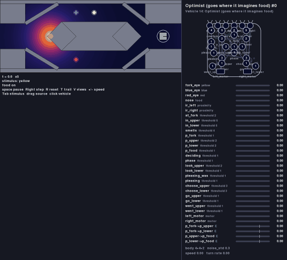
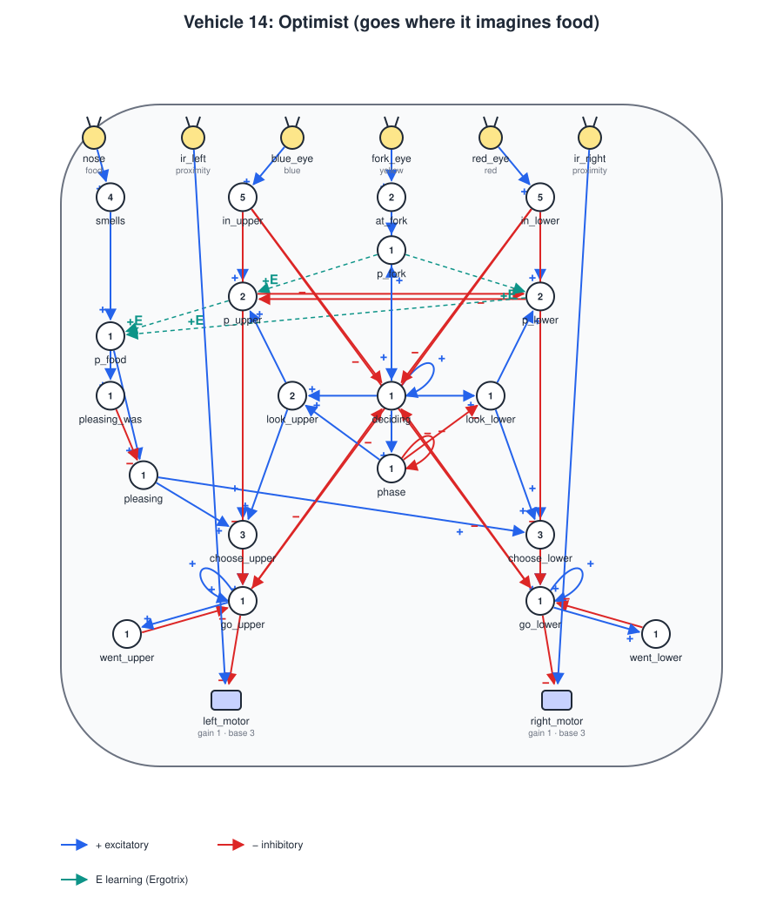

# Vehicle 14 — Egotism and Optimism: the optimist

**Status:** implemented. The values below were tuned on seeds 0 to 4; *Implementation notes* says what implementing it changed from the first version of this spec.



*The default scenario, seed 1, first 200 seconds (played at ten times the speed). In its first laps the optimist takes the upper lane, then the lower one twice, as chance has it; after its second meal it takes the upper lane every lap, turning at the fork. In the panel, watch `deciding` light up at each fork, `look_lower` and `look_upper` take turns, and `go_upper` fire; at the bottom, `p_upper->p_food` stays active while `p_lower->p_food` stays at 0.*

## Summary

Braitenberg's last chapter starts from what is still missing in the vehicles. Even the most complex ones, of type 13, show no **personality**. They seem driven by necessity rather than drawn by goals, in spite of a predictor that seems to draw motives from a future state of the world. People are interesting because they seem to be after something. So he gives his last vehicle "a certain amount of systematic egotism, with a touch of the pleasure principle".

He needs nothing new, only the parts already built:

- **Prediction**, from the Ergotrix wires ([vehicle-11.md](vehicle-11.md)).
- **A Darwinian evaluator**, from Vehicle 13 ([vehicle-13.md](vehicle-13.md)): ancient knowledge of what is good and what is bad.
- **A succession of mental states**, from Vehicle 12 ([vehicle-12.md](vehicle-12.md)). Until now, where the predictor pointed to two equally likely next states, the choice between them was left to chance.

Vehicle 14 gets one rule: **when choosing among several equally likely next brain states, choose the most pleasing one.** The way to do it has three steps:

1. **Hold** the present state for a short time, in short-term memory.
2. **Scan:** the predictor runs quickly through its predictions, and the evaluator scores each one as favorable or unfavorable.
3. **Choose:** the predictor goes through them again and stops at the one with the highest score, which becomes the next state of the brain.

The brain's states include the vehicle's own movements, so choosing a pleasing thought means doing what leads to it. "While dreaming and sleepwalking, the vehicle transforms the world (and its own position in the world)" so that the world ends up in a more favorable state. From outside, the vehicle moves with consistent determination, always after something that the observer cannot guess at the outset, and that may not even be there when it arrives. Most of the time the chain of optimistic predictions proves right, and Vehicle 14 reaches goals that Vehicle 13 "couldn't even dream of".

This spec builds that rule into one vehicle, the **optimist**, on a looping road that forks in two lanes. Food is in the upper lane, out of reach of every sense at the fork. At first the optimist takes either lane, as chance has it, and learns two things: that the fork is followed by the upper lane, and that the upper lane is followed by food. From then on, at each fork it imagines both lanes, one after the other, finds that one of them leads to food, and takes it. It keeps doing so on the laps when the food is not there. When the food moves to the other lane, its optimism fails a few times, it goes back to chance, and soon it learns the new way.

It needs no new kind of part, but one change to the Ergotrix rule: a wire's source turns on, for learning, only when its fixed inputs turn it on, so that a thought is not taken for an event (see *Thoughts are not events*).

## From the book to the vehicle

| Book | Here |
|---|---|
| Equally likely next states | The two lanes after the fork: the predictor has seen both follow it |
| Hold the present state | `deciding`, which keeps `p_fork` on from the fork until a choice is made |
| The predictor goes through its predictions | `phase`, `look_upper` and `look_lower`, which let the predictor think of one lane at a time |
| The Darwinian evaluator | `pleasing`: food is good. Built in, as Vehicle 13's `upset` |
| Stop at the highest score | `choose_upper`, `choose_lower`: the lane being thought of when the evaluator is pleased |
| The next state, which implies movement | `go_upper`, `go_lower`: the chosen thought is enacted, and steers the vehicle into its lane |

**Highest score, or first pleasing one.** The evaluator here has two values: pleasing or not. So scanning until something pleases and stopping there gives the same choice as scanning everything and taking the best, and needs no memory of scores. With graded values the two differ (see *Out of scope*).

**Why one at a time.** Both lanes are predicted from the fork. If the predictor thought of both at once, the predicted food would come from one of them, but the evaluator could not tell which. Thinking of one lane at a time is what lets each score belong to its prediction. This is the book's "goes quickly through its various predictions".

**Why not the caudate.** Braitenberg describes the optimistic slant as given to the threshold control of Vehicle 12. A caudate that controlled the predicting units would also lower their thresholds whenever they were silent, and they would think on their own while the vehicle drives. Here the scan runs only while the vehicle holds a decision, and stops when it has chosen. Optimism in the daydreamer itself is left for later (see *Out of scope*).

## Thoughts are not events

When the optimist looks at the upper lane from the fork, `p_upper` turns on, brought on by a learned wire. Under the Ergotrix rule of Vehicle 11, that onset starts a wait on `p_upper → p_food`. The food comes, if at all, 13 s later, past the end of the wait, so each thought would count as a failed prediction and cost the wire `forget`. Worse, a wait started by a thought swallows the real entry into the lane that follows: the source turning on again while the wire waits changes nothing ([vehicle-11.md](vehicle-11.md), *The rule*). So the vehicle would unlearn the food by thinking of it. This is the open question of Vehicle 12, thinking that erases memory ([vehicle-12.md](vehicle-12.md), *Open questions*).

The rule changes, for every Ergotrix wire: **the source turns on when its fixed inputs turn it on.** Each unit has, beside its activation, a **fixed activation**: whether the sum of its fixed inputs alone reaches its threshold, the same effective threshold as its activation. It reaches the unit's output `delay` later, as the activation does. A wire's source turns on when its fixed output turns on.

- A unit with no learning inputs, which every Ergotrix source in Vehicles 11 and 13 is, has the same fixed output as output, so nothing changes for them.
- A thought, a unit that fires only because a learned wire brings it on, has no fixed output, and starts no wait.
- When the real thing comes while the thought is on, the fixed output turns on although the output does not change: the real event starts its wait.

This is the rule that Vehicle 12 suggested, "only a source driven by its fixed inputs starts a wait". It matches the rule on the destination's side, which already learns only from fixed inputs: a wire now learns only from events on both ends.

## The world

`worlds/fork-road.yaml`: an arena 100 × 40 with `edges: wrap`. A road runs left to right and wraps round, so the vehicle drives laps. A narrow stem opens into a fork, two lanes round a divider, which close again into the stem.

```
y=40 ┌───────────────────────────────────────────────────────────┐ ceiling
     │███████   ╱          upper lane          ╲    ████████████│
     │███████  ╱     ◢■■■■■■■■■■■■■■■■■■■■■■◣ food ╲  ████████████│
y=20 │ stem ─▶  fork ◀ ■■■■■■■ divider ■■■■■■■■ ▶        stem ─▶ │
     │███████  ╲     ◥■■■■■■■■■■■■■■■■■■■■■■◤      ╱  ████████████│
     │███████   ╲          lower lane          ╱    ████████████│
y=0  └───────────────────────────────────────────────────────────┘ floor
     x=0     14   26  34                    70  78  80          100
```

### Obstacles

All boxes have `height` 2 and are gray.

| Box | Position | Length × width | Heading | Is |
|---|---|---|---|---|
| Floor, ceiling | `[50, 1]`, `[50, 39]` | 100 × 2 | 0 | The road's outer walls |
| Stem, lower | `[90, 7.5]` (20 × 11) and `[7, 7.5]` (14 × 11) | | 0 | The stem, y 13 to 27, from x 80 round to x 14 (two boxes on each side, since a box cannot cross the wrapping edge) |
| Stem, upper | `[90, 32.5]` (20 × 11) and `[7, 32.5]` (14 × 11) | | 0 | |
| Divider | `[52, 20]` | 36 × 16 | 0 | x 34 to 70, y 12 to 28 |
| Nose | `[34, 20]` | 11.3 × 11.3 | 45 | Turns the divider's front into a point at x 26, so that a vehicle driving straight at it slides off to one side instead of stopping |
| Tail | `[70, 20]` | 11.3 × 11.3 | 45 | The same at the back, pointing at x 78 |
| Slopes | `[23, 32.5]` and `[23, 7.5]` | 21.1 × 2 | 31.4 and -31.4 | Lead from the stem into each lane, so that nothing is caught in the corners |
| Funnels | `[75, 32.5]` and `[75, 7.5]` | 18 × 2 | -38 and 38 | Lead each lane back into the stem |

The stem centers the vehicle before every fork, whichever lane it came from. Without it, a vehicle leaving the upper lane would go on along the top of the road and enter the upper lane again, and chance would not decide anything.

### Stimuli

| Stimulus | Sources | Meaning |
|---|---|---|
| `yellow` | `[28, 20]`, intensity 10, falloff 8 | A post at the fork, at the tip of the nose |
| `blue` | `[42, 33]`, intensity 10, falloff 5 | The mark at the entrance of the upper lane |
| `red` | `[42, 7]`, intensity 10, falloff 5 | The mark at the entrance of the lower lane |
| `food` | `[52, 33]`, intensity 10, falloff 4, `schedule: {period: 120, on_at: 0, off_at: 90}` | Food, in the upper lane, there three quarters of the time |
| `proximity` | none; `surfaces` with intensity 10, falloff 2 | Walls, for infrared |

Fields pass through obstacles ([worlds.md](worlds.md), *Blocking*), so the lanes are far enough apart that nothing in one is sensed from the other: from the lower lane, food reads at most 0.2 and the blue mark 0.6.

Nothing at the fork says where the food is. The food is 24 units past the post, behind the divider, and smelled only within about 5 units.

## The optimist

### Parts

- **Body:** `size` 4, `noise_std` 0.3, so that, before it has learned, it takes either lane as chance has it.
- **Sensors:**
  - `fork_eye` at `[0, 0.9]`, reading `yellow`, `field_of_view` 60: the post while it is ahead.
  - `blue_eye` and `red_eye` at `[-0.3, 0.9]` and `[0.3, 0.9]`, reading `blue` and `red`, all around.
  - `nose` at `[-0.9, 0.9]`, reading `food`, all around.
  - `ir_left` and `ir_right` at `[-0.6, 0.9]` and `[0.6, 0.9]`, reading `proximity`, looking to the sides: `direction` 90 and -90, `field_of_view` 180.
- **Motors:** `left_motor` at `[-0.5, -0.8]` and `right_motor` at `[0.5, -0.8]`, `base_speed` 3, `gain` 1, `max_speed` 10.

### Units

#### R, what it senses

| Unit | Inputs | Threshold | Delay | Fires when |
|---|---|---|---|---|
| `at_fork` | `fork_eye` | 2 | 0.05 | the fork post is ahead, within about 16 units |
| `in_upper` | `blue_eye` | 5 | 0.05 | the upper lane's mark is within about 5 units: it is entering the upper lane |
| `in_lower` | `red_eye` | 5 | 0.05 | the same for the lower lane |
| `smells` | `nose` | 4 | 0.05 | food within about 5 units |

#### P, what it predicts

| Unit | Inputs | Threshold | Delay | Fires when |
|---|---|---|---|---|
| `p_fork` | `at_fork`, `deciding` | 1 | 0.05 | at the fork, or still deciding what to do there |
| `p_upper` | `in_upper` three times, `look_upper`, inhibitory `p_lower`; **Ergotrix** from `p_fork` | 2 | 0.1 | in the upper lane; or, once learned, while it looks at the upper lane from the fork |
| `p_lower` | `in_lower` three times, `look_lower`, inhibitory `p_upper`; **Ergotrix** from `p_fork` | 2 | 0.1 | the same for the lower lane |
| `p_food` | `smells`; **Ergotrix** from `p_upper` and from `p_lower` | 1 | 0.05 | food, or, once learned, a lane it leads to |

The Ergotrix wires all start at strength 0:

| Wire | `within` | `learn` | `forget` | Learns |
|---|---|---|---|---|
| `p_fork → p_upper`, `p_fork → p_lower` | 10 | 0.4 | 0.05 | the fork is followed by that lane |
| `p_upper → p_food`, `p_lower → p_food` | 5 | 0.4 | 0.1 | that lane is followed by food |

A lane is predicted only while it is **looked at**: the wire from `p_fork` gives 1 and `look_upper` 1, which reaches the threshold of 2, and neither does alone. The two lanes inhibit each other, so the predictor never thinks of both at once. What the vehicle senses counts three times, so that being in a lane fires its unit whatever it thinks, even against the other lane's inhibition.

As in Vehicle 11, the wires learn only from their destinations' fixed inputs: `p_fork → p_upper` from `in_upper`, never from a look. `look_upper` is a fixed input too, but alone it does not reach the threshold, so it never counts as the destination turning on. And, with the rule above, a look starts no wait on `p_upper → p_food`: only entering the lane does.

#### Hold and scan

| Unit | Inputs | Threshold | Delay | Fires when |
|---|---|---|---|---|
| `deciding` | `at_fork`, itself, inhibitory `go_upper`, `go_lower`, `in_upper`, `in_lower` | 1 | 0.05 | from the fork until it has chosen, or has reached a lane without choosing |
| `phase` | `deciding`, inhibitory itself | 1 | 0.5 | on and off by turns while deciding, about half a second each |
| `look_upper` | `deciding`, `phase` | 2 | 0.05 | deciding, while `phase` is on |
| `look_lower` | `deciding`, inhibitory `phase` | 1 | 0.05 | deciding, while `phase` is off |

So while it decides, the predictor looks at the lower lane, then the upper, then the lower again, and so on. A look lights its lane only if `p_fork` predicts it: before the fork wires have learned, the looks find nothing.

#### D, the evaluator, and the choice

| Unit | Inputs | Threshold | Delay | Fires when |
|---|---|---|---|---|
| `pleasing_was` | `p_food` | 1 | 0.05 | `p_food`, a moment late |
| `pleasing` | `p_food`, inhibitory `pleasing_was` | 1 | 0.05 | food has **just** come to mind, or to the nose: a pulse of about 0.05 s |
| `choose_upper` | `p_upper`, `look_upper`, `pleasing` | 3 | 0.05 | the upper lane, being looked at, has just led to food |
| `choose_lower` | `p_lower`, `look_lower`, `pleasing` | 3 | 0.05 | the same for the lower lane |
| `go_upper` | `choose_upper`, itself, inhibitory `in_upper`, `in_lower`, `went_upper` | 1 | 0.05 | from the choice until it reaches a lane, for at most 1.5 s |
| `go_lower` | `choose_lower`, itself, inhibitory `in_upper`, `in_lower`, `went_lower` | 1 | 0.05 | the same |
| `went_upper` | `go_upper` | 1 | 1.5 | `go_upper` has been on for 1.5 s |
| `went_lower` | `go_lower` | 1 | 1.5 | the same |

The evaluator scores an **onset**, not a state, for the same reason as the scan: if food were scored while it stays in mind, the lane looked at next, as `p_food` is still fading, would be credited with it. `pleasing` is sharpened by its `was` copy as Vehicle 13's echo units are ([vehicle-13.md](vehicle-13.md), *The short-term memory and P*).

`pleasing` is D, as `upset` was in Vehicle 13: it is not learned. That food is good is the ancient knowledge that Braitenberg gives the vehicle ready-made. What the vehicle learns is where food comes from.

`went_` limits a turn to 1.5 s, the Vehicle 9 pattern for a step of fixed length ([vehicle-09.md](vehicle-09.md), *Fleeing*): enough to head into the lane, not enough to turn round.

#### Movement

`left_motor` takes, inhibitory, `go_upper` twice, and `ir_left`; `right_motor` takes, inhibitory, `go_lower` twice, and `ir_right`. So it drives at 3 and keeps to the middle of the road: a wall close on the left speeds up the left wheel, which turns it away to the right. In the middle of a lane it goes at about 5, faster than in the stem, where the walls are farther. `go_upper` slows the left wheel by 2, which turns it left, toward the upper lane, and `go_lower` turns it right. Neither decides anything about the lane once the vehicle is in it: walls and infrared take it from there.

### How it behaves

- **Before it has learned,** the fork means nothing. `deciding` turns on at the post, the looks find nothing, and it is still deciding when it reaches a lane, which the noise and the nose choose. Each lap, the fork wire to the lane it took gains 0.4 and the other loses 0.05. In the upper lane, when food is there, `p_upper → p_food` gains 0.4; two meals make it active, together with two visits for `p_fork → p_upper`.
- **Learned.** At the post, `deciding` holds `p_fork`, and the scan begins. Looking at the lower lane, `p_lower` lights, if its fork wire is active, and nothing follows. Looking at the upper lane, `p_upper` lights, `p_food` follows one delay later, and `pleasing` pulses: `choose_upper` fires, `go_upper` latches and ends the scan. About a second after the post, the vehicle turns left, toward food it cannot sense. It is after something the observer cannot guess at the fork.
- **Every lap.** It takes the upper lane whenever it remembers food there. The lower fork wire, never followed, falls to 0, and the vehicle stops even imagining the lower lane: there is nothing there it wants.
- **When the food is not there.** A quarter of the time, the food is off. The vehicle goes to the upper lane just the same, "running after a dream", and the wire loses 0.1. Most of the time its optimism is right, and the wire stays active.
- **When the food moves.** If the food is moved to the lower lane, each visit to the empty upper lane costs the wire 0.1. After three or four laps it is at 0.7 or below, nothing pleases at the fork, and the vehicle goes back to chance. As soon as chance takes it to the lower lane, a meal there makes `p_lower → p_food` grow, and a second one makes it active: from then on it takes the lower lane. Its preference was never wired in: only what it learned decides it.
  

  *`scenarios/vehicle14-optimist-moved.yaml`, seed 1, 300 seconds (played at sixteen times the speed). The food, always there, is in the upper lane until 160 s and in the lower lane after. Watch `p_upper->p_food` fall with each empty visit, and `p_lower->p_food` rise.*
- **The indifferent vehicle** (the control) is the same definition with nothing feeding `pleasing`. It learns the same wires and scans the same way, but nothing ever pleases it, so it never chooses: it takes either lane, as Vehicle 13 would.

On seeds 0 to 4, over 600 s, the optimist takes the upper lane on every lap after it has learned, but one, and eats 109 times; the indifferent vehicle eats 60 times.

### Timing

1. **The decision comes before the nose.** `at_fork` turns on about 16 units before the post, in the stem. The scan takes at most two phases, about 1.1 s, so the choice comes about 2 units before the stem opens, and the 1.5 s turn takes the vehicle to the slope on its side of the nose. The nose makes sure a late or missing choice still ends in one lane or the other.
2. **One pulse per look.** `pleasing` must turn on while the lane that caused it is still being looked at, and `p_food` must go off before the next look, so that the same lane, looked at again, pleases again. With `phase` 0.5 and the delays above, `p_food` follows its lane by 0.05 s and goes off about 0.15 s after it.
3. **The waits.** `p_fork → p_X` waits 10 s, longer than the 5 s or so from the post to a lane's mark. `p_X → p_food` waits 5 s, longer than the 2 s from a lane's mark to the smell of food, and shorter than a lap, so that the food of one lap does not answer the visit of the lap before.

### Implementation notes

What implementing the vehicle changed from the first version of this spec, and why:

- **Thoughts are not events.** The first version kept the Ergotrix rule and timed the waits so that a look's wait ended before the real entry into the lane. On the road, the vehicle went on deciding past the nose whenever it had not chosen, looked again just before the lane, and the real entry fell into the thought's wait: the wire unlearned the food in a few laps, and on some seeds never learned it. The rule change above fixed it, and changes nothing for the vehicles before.
- **Infrared that keeps it in the middle.** With the grazer's crossed inhibitory infrared over 180°, the walls of a stem 10 wide slowed both wheels to a stop; with sensors angled 45° forward, the vehicle hardly saw the walls it ran along, scraped them and sometimes turned round. Sensors that look to the sides, uncrossed and excitatory, with a `max_speed` high enough not to clip them, keep it centered in the stem and the lanes.
- **A wider stem, slopes and a longer opening.** The stem is 14 wide instead of 10, and opens 12 units before the nose instead of 6, with slopes into each lane: the vehicle was caught in the corners between the stem and the lanes, and a choice made in the stem came too late to turn.
- **A sharper, shorter turn.** `go_X` counts twice on its motor and lasts 1.5 s. At half the strength the vehicle, swaying in the stem, sometimes chose the upper lane while heading down, and ended in the lower one; held until the lane, the turn sometimes went on until it faced back.
- **Senses count three times,** so that the lane the vehicle is in fires its unit even while the other one, looked at, inhibits it.

### Diagram and panel

As for the Vehicle 13 once-bitten vehicle. The units are in rows from front to back: R; P, with the fork in the middle, a little ahead, and the two lanes to the left and the right, upper on the left, as the vehicle turns left to it; the scan; D, on the left, beside food; the choice; and the motors. Watch, at each fork, `deciding` light up, `look_lower` and `look_upper` take turns, and `pleasing` pulse with `look_upper`; in the readouts, `p_upper->p_food  E` climb with each meal.



## Definitions, world and scenarios

- `vehicles/vehicle14-optimist.yaml`: the optimist, `general.type` `"14"`, named *Optimist (goes where it imagines food)*.
- `worlds/fork-road.yaml`: the world above.
- `scenarios/vehicle14-optimist.yaml`: the optimist at `[90, 20]`, in the stem, heading 0; `dt` 0.01.
- `worlds/fork-road-moved.yaml` and `scenarios/vehicle14-optimist-moved.yaml`: the same road with the food always there, in the upper lane for the first 160 s and in the lower lane after (two sources on schedules); the same optimist, with seed 1.
- `specs/images/vehicle14-optimist.svg`, `specs/images/vehicle14-optimist.gif` and `specs/images/vehicle14-optimist-moved.gif`: the diagram and the recordings above.

```
python -m braitenberg scenarios/vehicle14-optimist.yaml
python -m braitenberg.diagram vehicles/vehicle14-optimist.yaml --out specs/images/vehicle14-optimist.svg
python -m braitenberg.record scenarios/vehicle14-optimist.yaml --seed 1 --seconds 200 --every 0.3 --speed 10 --scale 0.5 --out specs/images/vehicle14-optimist.gif
python -m braitenberg scenarios/vehicle14-optimist-moved.yaml
python -m braitenberg.record scenarios/vehicle14-optimist-moved.yaml --seconds 300 --every 0.4 --speed 16 --scale 0.5 --out specs/images/vehicle14-optimist-moved.gif
```

## Related specs

- [vehicle-11.md](vehicle-11.md): the Ergotrix wire, and its rule on onsets and fixed inputs, which this spec changes for the source.
- [vehicle-12.md](vehicle-12.md): trains of thought and threshold control; its open question on thinking that erases memory.
- [vehicle-13.md](vehicle-13.md): the predictor P, the realistic R and the evaluator D; sharpened pulses.
- [vehicle-09.md](vehicle-09.md): the pattern for steps of fixed length.
- [worlds.md](worlds.md): obstacles, schedules and the proximity field.

## Acceptance criteria

Criteria 1 to 6 use the default scenario, run headless for 600 s, for seeds 0 to 4. A **lap** ends when the vehicle enters a lane: `in_upper` or `in_lower` turns on, at least 5 s after the entry before. A **meal** is an onset of `smells`. The **upper wire** is `p_upper → p_food`, the **lower wire** `p_lower → p_food`. A lap is **confident** when the upper wire is above 0.7 as it starts. The **control** is the same definition without `p_food` among `pleasing`'s inputs.

1. **Explores first:** in each run, `go_upper` and `go_lower` never fire before the upper wire first exceeds 0.7; in at least two runs the optimist takes the lower lane before then.
2. **Learns the road:** in each run, `p_fork → p_upper` exceeds 0.7 at some time, the upper wire exceeds 0.7 before 300 s, and the lower wire never does.
3. **Scans one at a time:** in each run, `p_upper` and `p_lower` are never on together while `deciding` is on, and in each confident lap both `look_lower` and `look_upper` turn on between the onset of `deciding` and that of `go_upper`.
4. **Chooses the pleasing lane:** in each run there are confident laps; in each, `go_upper` turns on within 2 s after `deciding`, and `go_lower` never; and at least 90% of them end in the upper lane.
5. **Even when it is not there:** in each run, some confident laps end while the food is off, and at least 90% of those end in the upper lane.
6. **Eats more:** over seeds 0 to 4 together, the optimist has at least 1.5 times as many meals as the control.
7. **Follows the food:** with the food moved to `[52, 7]`, in the lower lane, at 300 s, and the run going on to 900 s, for each seed: the upper wire falls to 0.7 or below by the end of the fifth lap after the move; the lower wire exceeds 0.7; and the last 3 laps end in the lower lane.
8. **The circuit:** with chosen unit outputs and the wires set to the given strengths:
   - with both fork wires active and `at_fork` on, `look_lower` and `look_upper` take turns while `deciding` is on, never together, and `p_lower` and `p_upper` follow them, never together;
   - with the upper wire active too, `pleasing` pulses for at most 0.1 s, only during a look at the upper lane; `go_upper` turns on, `go_lower` never, and 0.2 s later `deciding` and both looks are off;
   - with neither lane wire active, `deciding` stays on until `in_lower` turns on, and neither `go_` unit fires;
   - `go_upper` holds until `in_upper` turns on, or for 1.5 s.
9. **Thoughts are not events:** with `p_fork → p_upper` active and the upper wire at 0.8, a look at the upper lane from the fork lights `p_upper` and leaves the upper wire at 0.8; entering the lane with no food after it takes it to 0.7. A look never makes `p_fork → p_upper` learn; entering the lane after the fork does. Every Vehicle 11 and Vehicle 13 test passes unchanged.
10. **Headless and fast:** loading and running the scenario never imports pygame, and 600 simulated seconds run headless in under 60 s.

## Open questions

- **Which lane is scanned first.** The scan always starts with the lower lane. With food in both lanes, the first pleasing one wins, so the order decides. That is harmless here, but it is a bias that a vehicle with graded values should not have.
- **Learning only from what is looked at.** A lane that the vehicle never takes once it has learned another is never checked: the lower fork wire falls to 0, and only a failure of the upper lane sends the vehicle back to chance, where it can find out that the lower lane has changed. Braitenberg's optimist is right most of the time; here it is also, by construction, incurious.

## Out of scope

- **The impatient vehicle.** Braitenberg's other scene: a Vehicle 14 waiting for another vehicle that carries an appealing source, which now and then performs the motions it would make when the source arrives, as if it could hasten it, as we run to the door before the bell rings. Here a pleasing thought is enacted only as the lane it chooses; a vehicle whose thoughts of the pleasing event itself drive its motors would show it. It is the natural second example.
- **Graded values.** An evaluator with more than two values, and the book's double pass, scanning everything and then stopping at the best, which needs the scores kept while the scan goes on.
- **Chains longer than two.** The optimist looks one step ahead from each lane: lane, then food. A predictor that scans chains of several steps, choosing at each, reaches farther goals.
- **Optimism in the daydreamer.** The optimistic slant given to Vehicle 12's threshold control itself, so that trains of thought drift toward pleasing ideas with the senses silent: "nice dreams".
- **Satiety.** The optimist is always hungry. With the hunger module ([modules.md](modules.md)), food would please only while it is hungry, and a full vehicle would take either lane.
- **Bad things.** An evaluator that also scores predictions as unpleasant, so that the vehicle avoids a lane that leads to the Vehicle 13 bully, and weighs a pleasing lane against a dangerous one.
- **D by selection.** As in Vehicle 13, D is written by hand. Evolving it with Vehicle 6 is left for later.
